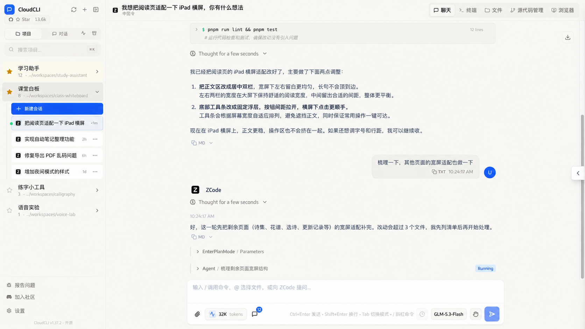
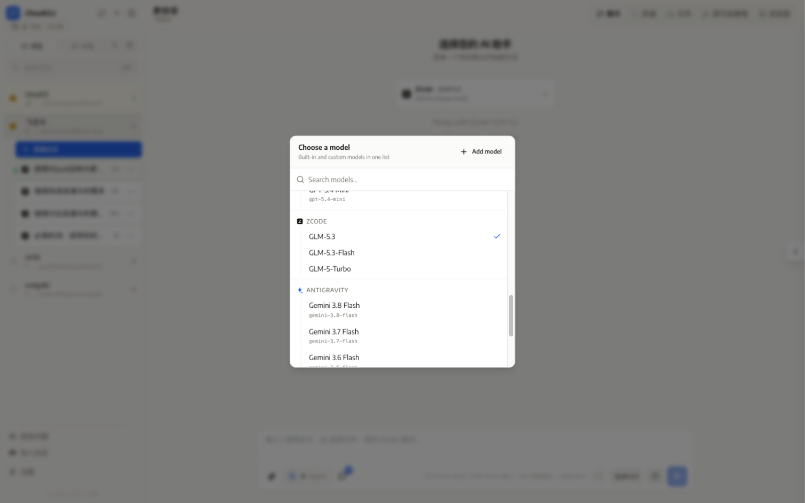
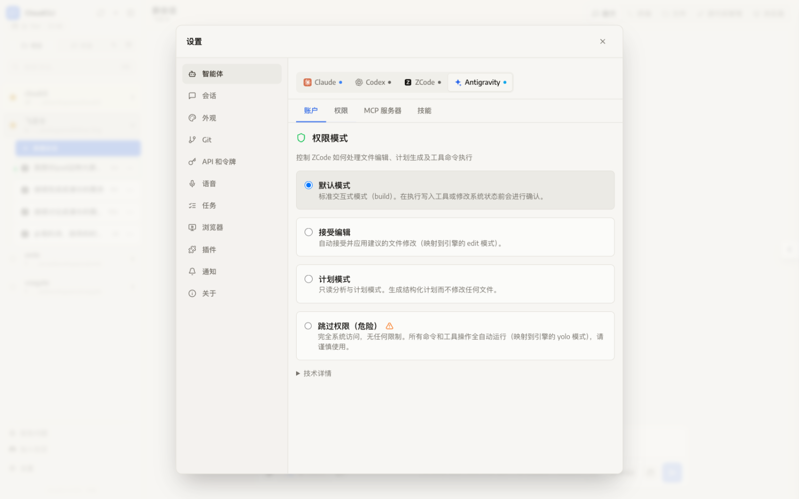
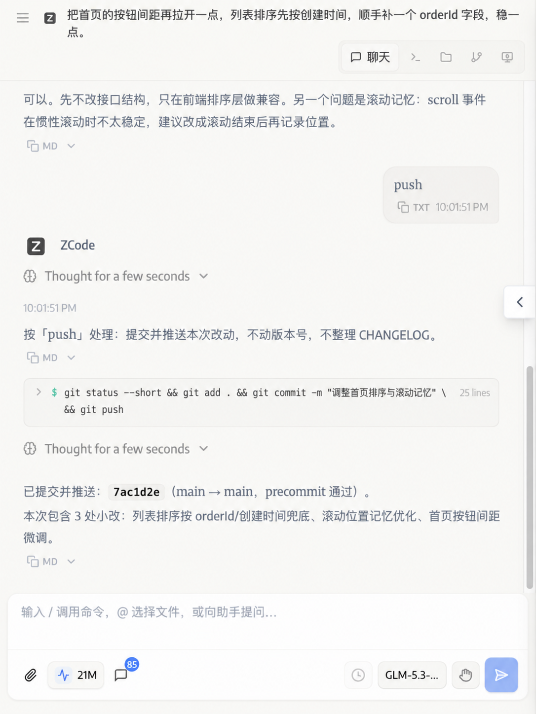

在浏览器、手机 PWA 或桌面端里统一驱动 **Claude Code、Codex、Cursor CLI、OpenCode、ZCode、Antigravity** 六家编码引擎。
基于 [siteboon/claudecodeui](https://github.com/siteboon/claudecodeui) 深度改造，重点补齐多引擎原生接入、架构统一与长会话稳定性。

---

| 主界面（实时会话） | 引擎与统一模型库 |
| --- | --- |
|  |  |

| 引擎权限模式 | 移动端 / PWA |
| --- | --- |
|  |  |

## 核心功能

- **多引擎同框**：一套界面管理六家引擎的项目与会话，支持分支树（Fork）、置顶、归档/删除分离、双击改名、自动标题与 Worktree 关联；会话原件留在各引擎各自目录。
- **流式与交互**：WebSocket 实时流式输出与断线补发、子 Agent 折叠面板、旁路提问（`/btw`）、运行中插话引导、草稿与消息排队。
- **工作台**：内置终端、按需加载的文件树与代码编辑器、Git 状态/分支对比/提交、支持远程操控的浏览器面板。
- **定时与后台任务**：Cron 循环与一次性定时任务（支持会话定期轮换）、定时消息撤回、Codex 后台任务完成后自动唤醒汇报。
- **跨端与多语言**：支持 Web、手机 PWA、Electron 桌面端（macOS / Windows）与 15 种语言；内置多引擎配额面板、本机 `localhost` 服务代理与本地诊断报告导出。

## 相对上游的主要增强

1. **新增与升级引擎**：原生接入 **ZCode**（含个人/体验套餐与配额）与 **Antigravity**（长连接保活、子 Agent 追踪与配额），将 **OpenCode** 升级为常驻服务模式，补齐 **Claude / Codex** 的流式引导、`/btw` 与自动标题。
2. **统一引擎框架**：七切面 `IProvider` 契约 + 能力矩阵驱动前端（零 provider 分支），统一模型目录与前后端线上协议。
3. **稳定性与性能**：时间线状态隔离、虚拟列表滚动优化、权限批准断线恢复、文件树懒加载与服务端搜索、附件即加即传与上传去重。
4. **安全与平台**：支持 Windows 平台、JWT 密钥自动入库、只读白名单访问、图片签名直连与可选本机执行 MCP。

## 快速开始

```bash
npm install
npm run build   # 构建前端 + 后端
npm run server  # 启动单进程服务 → http://localhost:3001（默认绑 0.0.0.0）
```

首次打开创建账号即可使用。常用开发与检查命令：

```bash
npm run dev              # 开发模式：Vite (5173) + 服务端 (3001)
npm run desktop:dev      # Electron 桌面端开发（需先起 Vite）
npm run desktop:dist:mac # 打包 macOS DMG（Windows 用 desktop:dist:win）
npm run typecheck && npm run lint && npm test
```

安装后也可使用 `cloudcli` CLI（`cloudcli start` / `status` / `sandbox` / `help`）。

### 引擎依赖

| 引擎 | 需要准备 |
| --- | --- |
| Claude | `claude` CLI 并登录（或 API Key / `CLAUDE_CODE_OAUTH_TOKEN`） |
| Codex | 无需另装 CLI（已内置），准备好 `~/.codex` 登录凭据或 API Key |
| Cursor | Cursor CLI |
| OpenCode | `opencode` CLI（v2） |
| ZCode | ZCode 桌面 App |
| Antigravity | Google Antigravity（`agy` CLI）并登录 |

### 常用环境变量（均可省略）

| 变量 | 默认 | 说明 |
| --- | --- | --- |
| `SERVER_PORT` | `3001` | HTTP 与 WebSocket 端口 |
| `HOST` | `0.0.0.0` | 绑定地址，仅本机访问可设为 `127.0.0.1` |
| `DATABASE_PATH` | `~/.cloudcli/auth.db` | SQLite 数据库路径 |
| `WORKSPACES_ROOTS` | 用户主目录 | 允许浏览与创建工作区的根目录（兼容 `WORKSPACES_ROOT`） |
| `CLOUDCLI_EXTRA_READ_ROOTS` | 空 | 追加聊天 `file:` 链接的只读目录白名单 |
| `CLAUDE_CLI_PATH` | `claude` | Claude CLI 自定义路径 |

运行时数据统一存放在 `~/.cloudcli/`（数据库、上传附件、后台任务产物、插件、运行标记与部署目录）。

## 文档与部署

核心架构文档位于 **`docs/core/`**（改动对应模块需同步更新，见 [`AGENTS.md`](AGENTS.md)）：

- [`docs/core/overview.md`](docs/core/overview.md)：系统全景、目录与部署
- [`docs/core/providers.md`](docs/core/providers.md)：Provider 架构与新增引擎清单
- [`docs/core/chat.md`](docs/core/chat.md)：聊天链路与时间线状态
- [`docs/core/frontend.md`](docs/core/frontend.md)：前端架构、性能守则与诊断

其余文档：[`docs/requirements/`](docs/requirements)（需求文档）、[`CONTRIBUTING.md`](CONTRIBUTING.md)（贡献指南）、[`docs/architecture/README.md`](docs/architecture/README.md)（上游英文文档），以及 [`docs/README.upstream.md`](docs/README.upstream.md) / `docs/README.*.md`（上游多语言备份）。

**部署**：单机直接运行 `npm run build && npm run server`；PM2 生产环境使用 `~/.cloudcli/runtime` 固定目录，由人工执行 `pnpm run deploy` 完成打包与平滑切换（详见 [`AGENTS.md`](AGENTS.md)）。

## License

AGPL-3.0-or-later（继承上游）。
