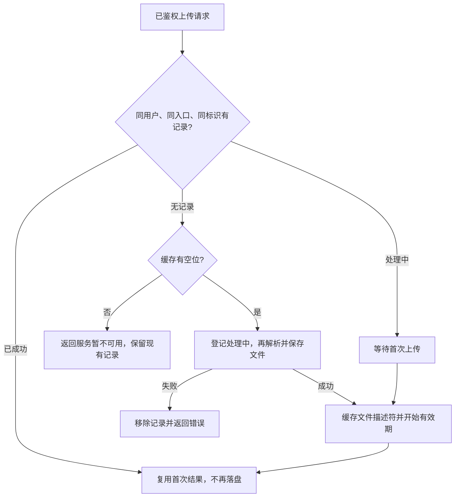
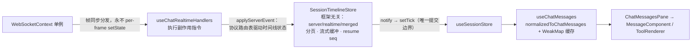

# 聊天链路（Chat Pipeline）

> 基准：2.11.0 / 2026-10-24
> **核心文档**：改动 `server/modules/websocket/**` 或 `src/modules/chat/**` 时**必须同步更新本文**。
> 普通 bug 修复不动架构的不需要更新（提交时走 `--no-verify`，见 `AGENTS.md`）。

一个值得先记住的模型：**同一段对话有两条路**。实时事件从 WebSocket 下来，持久化历史从 REST 上去，前端 store 把两者分数组保存、合并渲染。这个区域的大部分诡异行为（重复消息、闪空、乱序）都是两条路不一致造成的。

深度细节（帧表、握手、滚动、工具视图的逐文件分析）在上游自带文档 `docs/architecture/`（英文，6 篇）。**注意**：其中《04 message store》《05 scrolling》写作早于本 fork 的重构，消息存储与滚动以本文为准。

## 发送侧：一次 turn 的旅程（服务端）

| 步骤 | 位置 |
| --- | --- |
| 会话先创建（REST） | `POST /api/providers/sessions` → `sessionsService.createAppSession` → `sessionsDb`；app session id 是服务端生成的 `randomUUID`，URL/帧/store 全用它 |
| `chat.send` 入口 | `server/modules/websocket/services/chat-websocket.service.ts` 的 `handleChatSend`：`resolveSendTarget`（会话行以 DB 为准，不信任客户端）→ `dispatchRun`（附件过滤只放行 `~/.cloudcli/assets` 直接子文件、记录 model/effort） |
| 运行登记 | `chat-run-registry.service.ts`：`startRun` / `replayEvents` / `completeRunIfCurrent`；**run 属于服务端不属于 socket**——断线存活、多端同看、无观察者也能跑；完成后事件缓冲保留约 5 分钟供补发 |
| 统一分发 | `server/modules/providers/services/provider-runtime.service.ts` → `IProviderRuntime.run(command, options, writer, context)` |
| 出站写入 | `chat-session-writer.service.ts`（`ChatSessionWriter`）：**先过线上契约闸门**（`server/shared/normalized-message-contract.ts`：信封坏了整条丢、协议未声明的字段剥掉并点名记录，见 [providers.md](./providers.md)），再吞掉 `session_created`、把 provider 原生 id 重映射为 app session id、给每事件打**单调 `seq`**、扇出给所有 watching socket |
| 终态 | 每次运行**恰好一个 `complete`**（成功/失败/中止都是）；`error` 是信息性行，不终止 run |

### 非抢断式异步任务接续、排队消息与定时消息对比

服务端支持三种脱离用户直接点击的自主回合（Detached Chat Turn），它们在抢占策略上有着严格的架构边界：

- **定时消息（Scheduled Messages）**：采用**显式抢断**策略（`interruptActiveRun: true`）。调度到期后直接抢占当前正在执行的交互回合，确保定时指令准时送达。
- **排队消息（Queued Messages）**：采用**非抢断式空闲占用**策略，服务端是唯一发送方。页面经追加接口写入 `auth.db` 的 `session_drafts.queued_message`，服务端在事务中合并文字和附件，后提交的设置用于整条消息。主轮回复时等待；Claude 声明 `supportsInputAcceptance`，服务端可在后台任务继续运行时尝试原进程续轮。准备设置期间消息仍可编辑、追加或删除，提交前原子领取未变的快照；变化或不能安全续轮就继续等待。同一会话只有一次准备尝试。领取包装在原 JSON 列中保留已领取快照和后续追加，普通引擎起跑确认或支持输入确认的引擎由 SDK 消费输入后，只移除已领取消息；启动失败恢复原顺序。命令不能与其他消息合并，领取中的命令也不能追加普通消息。确认后广播 `queued_message_dispatched`，只带会话 id 和实际提交内容的 SHA-256 指纹，不广播正文；页面只回显指纹匹配的本地消息，其他内容由历史补齐，并重载服务端队列。进程重启恢复未确认领取，跨进程崩溃窗口不提供恰好一次投递保证。浏览器镜像只用于首屏恢复，旧 `queued_message_<sessionId>` key 不读不迁。
- **异步任务接续（Task Continuation）**：采用**非抢断式空闲占用**策略（`interruptActiveRun: false`）。后台长耗时命令执行完成并原子落库后，派发器（`task-continuation-dispatcher.service.ts`）在领取事件时检查 `chatRunRegistry.isProcessing(sessionId)`。若用户正在输入或当前有正在进行的运行，派发器**主动释放租约并退回 pending**，等待下一次会话空闲轮询；仅当会话完全空闲时才启动唤醒回合，并将任务结果（`toolOutput`）送入引擎，转录落盘为 `status_note` 消息行。集中开关默认关闭；关闭后不领取新投递，但继续保存任务结果并核对已经发送的回合。 Codex 驻留开启时还要检查引擎的完整活动状态，不能只看网关前台运行。管理模块在独占借用处再次判断；确定尚未提交的忙状态经运行时和网关返回 `busy`，派发器把事件从 sending 退回 pending，不转成人工核对。接续使用管理模块创建的一次性进程恢复原生线程，工具结果回合结束后关闭；普通聊天继续跨轮驻留。

### 排队消息与草稿协议

草稿文本保存只修改文本，不能携带队列副本，也不能因本地为空删除其他页面的排队消息。文本保存失败时保留本地文本并重试，重载时仍采用服务端权威队列；追加与清空请求按作用域串行。旧 PUT 携带非空 `queuedMessage` 快照时返回 `LEGACY_QUEUE_WRITE`，不修改数据；携带 null 时只保存文本，保留服务端队列。旧草稿 DELETE 也只清文本。拒绝旧快照或保留旧页面试图取消的队列时，经会话通道提示复制输入文字和排队内容后刷新确认；提示不结束当前回合，断线后可重放。尚无会话的新聊天草稿可以继续安全保存。

编辑、删除和立即发送固定使用点击时的会话和消息快照，服务端在事务中核对；消息已领取或被其他页面修改时返回冲突，页面保留或重新加载卡片。编辑和立即发送先恢复附件，再等取消确认；附件读取或取消失败就保留原队列。立即发送失败时尝试重新排队，无法重新排队则恢复可编辑文字和附件。排队失败将文字放回原会话，置于等待时新输入的文字之前；输入同步按会话保存，返回会话时读取当前草稿，失败缓存只保存浏览器附件。退出登录后，上传、取消和失败恢复的迟到结果不能重新写入旧用户数据。追加没有收到服务端确认时不自动重试，错误提示要求同时核对排队卡片和对话记录。卡片显示最终权限，说明追加时最新设置作用于整条排队消息。

领取包装保存在原 JSON 列中，旧版本派发器不能识别。回滚旧版本前须暂停领取并处理未确认的领取记录；没有表结构迁移不代表可以直接切回旧派发器。

### 一次提交只产生一次发送

从点击发送到消息被后端接收之间存在一段异步窗口：附件上传、以及新会话在 `POST /api/providers/sessions` 里分配 id。窗口期内会话 id 还不存在，因此一次提交被重放就会各自开出一个新会话。以下闸门共同保证"一次提交 = 一个会话 = 一次 run"：

- **composer 闩**（`src/modules/chat/hooks/useChatComposerState.ts`）：`submittingScopesRef` 按草稿作用域（会话 id，新会话未分配 id 前是 `project:<id>`）同步挡住窗口期内同一作用域的重复提交（第二次点击、再按一次 Enter、排队卡片的立即发送）。闩只锁发起提交的那个作用域：新会话还在等 session id 时切到别的会话，那边照常能发；新会话拿到 id 后，这个 id 也加进闩里，直到本次提交结束。同一项目里再开一个新会话共用 `project:<id>`，在前一个拿到 id 之前仍被挡住，发送按钮保持转圈，输入框里的文字不丢。提交被接受的瞬间就清空输入框并把发送按钮切成 spinner，点击立刻可见。提交失败时在唯一的 catch 里把消息放回它来的地方——手动提交回输入框，排队消息回队列——并渲染一条 error 行，不允许静默丢消息。`handleSubmit` 返回「本次提交是否被受理」，提交失败也返回 false，排队卡片的立即发送据此决定是否放回队列；排队消息只作为参数传入，从不写进输入框，用户正在输入的下一条消息因此不受影响。socket 未连接时提交直接失败（不分配会话、不回显、不发帧），文字留在输入框并给出 error 行，因为断开的 socket 会静默丢掉发送帧。
- **附件上传幂等**（`server/modules/assets/services/upload-replay.service.ts`）：一次上传生成一个标识，同一次上传的自动重试复用该标识；普通发送与排队发送走同一上传函数。后端在解析 multipart、写入文件前登记上传，按已鉴权用户和上传入口隔离，同标识的并发请求等待首次结果，成功响应丢失后也复用已存文件。
- **会话网关幂等**（`sessionsService.createAppSession`）：每次提交携带一个 `clientRequestId`，短 TTL 内重复请求返回首次分配的同一个 session（若该会话已被删除则重新分配）。这挡的是前端闩看不见的重放——请求重试、另一个标签页。
- **run 登记**（`chatRunRegistry.startRun`）：同一会话已有 run 在跑时，重复的 `chat.send` 得到 `RUN_IN_PROGRESS` 协议错误而不是第二次运行。

`POST /api/providers/sessions` 的 `initialMessage` 只作标题来源，客户端只发前缀，不发整条消息——它正处在用户等待的那段窗口里。

### 附件上传与恢复

聊天通过 `src/shared/api.ts` 的 `uploadChatAttachments` 上传文件，功能模块只编排重试。请求头 `X-Upload-Request-Id` 表示一次上传；服务端在边界校验标识，首次结果是该标识对应的权威结果，同一标识不得用于另一批文件。`/api/assets/files` 与兼容图片入口 `/api/assets/images` 共享去重机制，但互不复用结果。不带标识的旧客户端按独立请求处理。

缓存只保留文件描述符和进行中的 Promise，不保存文件内容；成功记录按有效期释放，进行中的上传不因时间到期被移除；上传中途断线时，存储适配器终止写流、清理未完成文件后释放失败记录，容量满时拒绝新标识而不驱逐仍有效的结果。容量、有效期以服务实现为准。缓存属于当前进程，重启和成功记录过期后无法复用；文件本身保留，历史消息路径不受缓存清理影响。这不是跨进程、永久去重协议。

浏览器只重试网络传输异常和明确列出的临时 HTTP 状态，错误文案不参与重试判断；成功响应的读取中断也可重试。无效成功数据、取消操作和普通客户端错误直接失败。重试用完后仍由 composer 恢复文本和附件，排队草稿回到队列。重传可能消耗额外带宽，去重保证缓存有效期间不重复保存。文件树上传使用独立 XHR 和项目文件语义，未接入聊天上传重试。

### 模型选择与分组呈现（ComposerModelMenu）

- 输入框底部的模型菜单按 `ProviderModelOption` 呈现；当选项带有 `group` 字段时，前端以 `ComposerMenuHeading` 划分展示区块（如个人套餐与体验套餐分组），消除同名模型混淆。
- 选项标识与展示解耦：底层 `value` 允许包含 Provider 前缀（例如 `account:bigmodel-start-plan/GLM-5.3-Flash`）以保障后端唯一路由；触发器与折叠标题通过友好前缀截断与 `label` 解析，保证用户可见区域始终展示人类可读的友好名称，绝不泄露底层内部原始 ID。

### 子 agent 卡片只认 `Agent`

前端把工具名等于 `Agent` 的 `tool_use` 行渲染成子 agent 面板（`useChatMessages` 的 `isSubagentContainer`，常量来自 `shared/protocol/subagent.ts`），不按引擎分支，也不看 `Task`：`Task` 只指任务清单类工具。面板的状态先看历史行上的 `subagent`：它给出 `running` 以外的状态就是定论；否则看 `task_status` 事件（实时，按 `toolUseId` 折回这张卡）；两者都没有时才看工具结果：结果带错误标记（引擎拒绝了这次派发，例如 agent 类型不存在）读作 `failed`，其余有结果读作完成，没有结果读作运行中。状态文案和 `stopped` 的提示语走 `chat` 命名空间的 `subagent.*` 键。面板的 `subagent`、`subagentActivity` 由转换函数从后端行的 `subagent`、`subagentTools` 原样带上；直播送来的、`parentToolUseId` 指向某张 `Agent` 卡的行（工具调用、定稿文本、思考，含对应工具结果）不进主线程，而是折成这张卡的时间线，历史行自带 `subagentTools` 时以历史为准。转换缓存按被折进的子行（含它们的结果）是否变化失效。

折叠的归属规则：行的 `parentToolUseId` 沿父链找到最外层的 `Agent` 调用，行就折进那张顶层卡；agent 里再派的 agent 只是外层卡时间线里的一步，它名下的行也折进同一张外层卡。父链沿途的非 agent 调用不影响结果（取最外层的 `Agent`），父链成环时在闭合处截断，环里的 agent 仍是卡片。父链走不到任何 agent 且止于本页没有的调用时：会话还在运行（有前台回复或后台工作）且这是直播行（带 `seq`）才先不进主线程、等卡片到了再折入，避免先出现在主线程又跳走；历史行（卡片可能在未加载的页里）和会话已经结算后的行照常显示在主线程，不会永远消失；父调用存在但不是 `Agent`（Bash、workflow）的行照常留在主线程。

运行中的卡片（后端和直播都没给出结算状态）在折叠的标题下多一行进度：步数和最新一步（`Bash: npm test` 这样的“工具名: 输入要点”，由 `describeLatestStep` 生成）；展开时显示最新的步骤，更早的收在“显示更早的 N 步”后，结算后恢复为从头显示。卡片默认仍是折叠的。

批准和提问卡片的 `context.subagent`（`toolUseId`、`description`）由 provider 在边界填入，横幅在卡片上方显示“来自子 agent：<description>”。一轮成功结束（`complete`）时，带 `context.subagent` 的卡片保留（派它的后台 agent 可能还在跑，要撤回由服务端发 `permission_cancelled`），其余卡片随这一轮清掉；失败或中止的结束清掉全部。没有前台回复在跑时到达的批准卡片只把会话记成后台工作（`onSessionProcessing(id, { awaitingApproval: true })`），不会让它变成前台“处理中”。各引擎怎样把自家的派 agent 形态翻成 `Agent` 行、怎样保证结算，见 [providers.md](./providers.md)「子 agent 卡片」。

## 断线恢复

`chat-run-registry.service.ts` 在网关进程启动时生成 `streamEpoch`，并为每个会话跨回合续增 `seq`；序号、受众和重放缓存挂在会话通道上，回合的 writer 与会话级发布入口共用这条通道。传输事件身份是 `(streamEpoch, sessionId, seq)`，重放保留原身份，引擎不能指定网关代次。历史行继续使用引擎行 ID 和 `providerRowKey`，不参加传输事件账。

例如，页面已连续处理到事件 931，再收到事件 818，`SessionTimelineStore.applyServerEvent` 会直接退出，文字、思考和完成指令都不再执行。页面仅处理到 817 却先收到 931 时，Store 委托 `sessionEventReplay.ts` 暂存后续事件并补订阅。缺口补齐后，每条事件先改状态、登记成功，再执行对应指令，然后处理下一条。状态应用失败不前进游标。

`chat.subscribe` 携带已确认代次和连续应用游标。`chat_subscribed.lastSeq` 是服务端产生进度，不能当作页面应用进度；`replayFromSeq` 声明完整重放窗口下界。缺口超出窗口、缓存超限或服务端重启时，Store 关闭旧流段，保留可见输出，使用确认中的后台任务和权限快照对账，并通过历史刷新建立恢复基线。历史失败不推进基线。完成态不补事件，确认声明需要历史对账的位置。共享预算以 `shared/protocol/frames.ts` 的 `CHAT_REPLAY_LIMITS` 为准。

恢复失败会保留错误提示并退避重试；成功后清除提示。观察者通知失败不重复应用已提交状态，也不阻断后续连续缓存；错误仍沿接收链报告。

新 socket 的确认建立代次，确认前的事件有界暂存；同连接代次冲突报告错误并补订阅。没有代次的旧服务端保留旧接收行为，不启用新过滤。完整修复需要前后端同时更新，旧页面需要重载。

- WS 鉴权用 query token 或 Authorization 头（`websocket-auth.service.ts`）；30s 心跳在 `websocket-server.service.ts`。
- `websocket_reconnected` 帧是前端 `src/shared/context/WebSocketContext.tsx` 本地合成的，用于各订阅方追赶。

## 权限批准

- 引擎运行时发 `permission_request` 帧 → 前端 `src/modules/chat/context/PermissionContext.tsx` → 用户应答 `chat.permission-response` → `chat-websocket.service.ts` `handlePermissionResponse` → `providerRuntimeService.resolveToolApproval` 广播到各引擎的 `permissions` 网关（`server/shared/types.ts` `ProviderRuntimePermissionGateway`）。
- `chat.subscribe` 应答（`chat_subscribed`）携带处理中状态与挂起权限，多标签/重连后权限卡不丢（历史教训：挂起列表裸字符串契约破裂产生"僵尸权限卡"，已由形状校验 + `toolCallId` 缓存键收口）；已应答或撤回的请求通过 `permission_resolved` / `permission_cancelled` 实时及重放撤销，防止旧卡片死灰复燃。
- 引擎侧：claude 走 SDK 的 `canUseTool` 回调；zcode 走引擎权限桥 + 四档权限模式映射（`chat.send` 的 `options.permissionMode` → 引擎 set_mode）；codex 走 app-server 的反向 JSON-RPC 请求（`item/{commandExecution,fileChange,permissions}/requestApproval`），该请求在被应答前整个 turn 都是阻塞的，因此**必须**应答——run 结束时仍挂着的一律发 `permission_cancelled` 并按拒绝收尾。能力有无由矩阵的 `supportsPermissionRequests` 表达。
- 批准记忆（`rememberEntry`）各引擎语义不同：claude 往 `allowedTools` 追加一条规则，codex 改答 `acceptForSession`（由引擎自己记住本会话）。
- **谁来复核由引擎配置决定，适配器不覆盖**：codex 的 `approvals_reviewer`（`user` / `auto_review` / `guardian_subagent`）决定请求是否在到达客户端前就被自动裁决；在 `thread/start` 里写死这个值等于悄悄推翻用户自己的设置。

权限卡片的推送通知由网关统一发（`ChatSessionWriter.send` 看到 `permission_request` 就调用通知服务），各引擎适配器不再各自发一份；没有前台回复在跑时到达的卡片（后台 agent 在一轮结束后发出的请求）不会把会话记成“处理中”，只记成后台工作。

## 后台任务与输入排队

- **跨轮常驻的开关**：网关组装运行参数时带 `residentBetweenTurns: true`，告诉运行时这个会话的后续轮次也从这里进来，可以把引擎进程留到下一轮（Claude 的空闲常驻，见 providers.md「Claude 后台任务生命周期」）。`/api/agent`、提交信息生成这类一次性调用方不带这个参数，进程照旧在回合结束时退出。
- **引擎后台驻留契约**：Claude 等引擎支持在回合中开启后台执行（如后台 `Bash`、Agent 或定时唤醒）。广播任务条的引擎是 Claude、Antigravity、Codex、ZCode；OpenCode 没有后台登记，不发任务条。当前轮次的文本回复完成后发出 `complete`，但底层后台进程仍在运行，引擎 runtime 保持挂起。`TaskCreate` 只创建待办项，不属于后台执行。
- **状态同步与广播**：
  - `ActiveBackgroundTask` 表示输入框需要展示的执行任务，具体字段以共享协议为准。
  - `chat_subscribed` 握手帧与 `status(background_tasks)` 同时携带卡片列表 `backgroundTasks` 和后台等待状态 `backgroundWorkPending`，供实时更新与重连恢复；归一化网关放行两者。
  - 两种帧还说明新消息要不要等这批工作：状态帧和订阅确认都用 `backgroundWorkQueuesInput`，缺省为要等。Claude 发 `true`，页面保留队列直到原进程完成输入确认，不能安全续轮就继续等待（见 providers.md「Claude 后台任务生命周期」）。
  - 两种帧还说明这批工作能不能用 `chat.abort` 停：状态帧用 `canInterrupt`，订阅确认用 `backgroundCanInterrupt`。字段缺省按能停处理；ZCode 一轮结束后 agent 还在跑，此时发 `false`，后台阶段的活动不给停止按钮，排队照旧。
  - 卡片描述任务本身，等待状态还包括任务完成后的汇报回复。任务完成或唤醒到期时卡片立即消失，后续回复结束后才解除等待。未提供等待字段的引擎按卡片列表判断。
- **输入防打断与智能排队**：
  - 新消息要不要排队由 `useChatSessionState` 的 `isInputBlocked` 决定：主轮正在回复时一定排队；只剩后台工作时，按该会话的 `backgroundWorkQueuesInput` 决定。要排队时发送转入 `queuedDraft`，阻止新一轮打断后台子进程；Claude 的后台阶段先排队，服务端确认原进程可续轮并由 SDK 消费输入后才移除排队卡，任务条和活动指示照常显示。Codex 只剩宿主任务（`cloudcli_task_run` 起的命令）时同样不排队，见 providers.md「Codex 异步任务结果续开」。任务条的提示跟着走：主轮回复中写“本轮结束后发送”，后台工作挡输入时写“任务完成后自动发送”，不挡时写“可直接发送，后台任务继续运行”。
  - **自动释放**：后台执行和后续回复均结束且无新状态阻塞时，由服务端调度器发出排队消息（见上文「排队消息」），页面不发送。服务端的后台驻留检查也包含后续回复；关掉页面、切走会话或断线都不改变等待条件，也不会让消息丢失。排队卡片跟随草稿存储：服务端发出后卡片消失，其他设备排的队也会显示。
  - **强制发送逃生通道**：排队卡片提供 `forceSendQueuedDraft`（`isForced: true`），允许用户显式跳过等待立即发送。只有主轮已经结束、只剩后台工作时才给这个按钮（`canForceSendQueuedDraft`）：主轮还在回复时服务端拒绝第二个运行（`RUN_IN_PROGRESS`），按钮只会失败。服务端不读请求里的 `forceInterrupt`。Claude 不提供强制发送按钮，原进程能续轮时由服务端自动提交，不能续轮时继续等待。ZCode 回合结束后 agent 还在跑时提供此按钮，ZCode 新开一轮不停 agent，所以按钮写“立即发送，后台任务继续运行”。
  - **会话忙状态与取消**：主轮还在回复时到达的任务条帧（Codex、ZCode 在轮内派出又收回的 agent）只更新卡片，不把会话改记成后台活动，也不触发完工提示；轮结束后是否进入后台阶段由 `complete` 决定。实时完成帧和订阅确认在后台等待期间保留会话的后台活动，切走会话的自动发送也等到后续回复结束。后台结束帧只清后台活动，不清新主轮的活动；这条判定不依赖时钟，两个阶段在同一毫秒交接也成立。
  - **停止入口**：任务卡保留启动调用的身份，独立停止使用引擎提供的停止句柄，两者不可混用。后台任务栏仅在所有卡片均有停止句柄时提供中止，逐个发送 `chat.stop-task`，不打断同时运行的主轮。顶部停止和 Esc 共用会话取消入口：主轮正在响应时发送 `chat.abort`。本轮起的后台工作是否保留由引擎决定：Claude 只打断这一轮，后台 Bash 继续跑、后台 agent 由 CLI 停掉（见 providers.md「Claude 后台任务生命周期」）；Antigravity、Codex 的后台工作随这一轮结束；仅剩可单独停止的后台任务时逐个停止；没有独立句柄或只剩汇报回复时发送 `chat.abort` 结束驻留会话。服务端接受仍有后台工作的完成态会话取消，不重复发送主轮的完成帧。卡片和排队状态都等待引擎确认，停止请求本身不清状态，失败仍显示错误。
  - **停止失败**：找不到运行任务、缺少任务句柄、引擎拒绝停止和会话取消失败均保留现有活动，不解除排队；发送被 `RUN_IN_PROGRESS` 拒绝时同样保留，因为拒绝本身说明还有运行在进行。异常响应携带所属会话；`TASK_STOP_FAILED` 与 `ABORT_FAILED` 分别表示任务停止和会话取消的引擎异常，错误仍进入聊天记录。
  - **可视化呈现**：输入框上方通过 `BackgroundTaskIndicator` 实时展示运行中的后台任务（工具名、命令、动态已用时间）。提交按钮只在停止能起作用、且输入框里没有可以直接发出的内容时显示成停止；会话忙但停不了时保持发送按钮，空输入时禁用，输入内容后点击即排队；Claude 后台阶段输入了内容，点击发送会先排队。
  - **完工庆祝防误报**：`useChatRealtimeHandlers` 在收到 `complete` 时，若会话仍有后台等待，则暂不触发完工音效与窗口标题提示；待后台等待解除时统一触发。卡片消失本身不表示汇报回复已结束。

## run 的结束原因（诊断契约）

每个 run 无论怎么结束，都只从 `chat-run-registry.service.ts` 里 `complete` 那一个分支离开，
所以结束原因在那里**统一记录一次**，与引擎无关：`engine_completed` / `engine_failed` /
`client_abort` / `superseded` / `dispatch_failed`。前三个之外的两个由调用方在发出终止
`complete` 前标记（`completeRun` / `completeRunIfCurrent` 的 `reason` 是必填参数），
引擎自己结束的则按 exitCode 判定。

为什么必须是这条契约：引擎落盘的 transcript 只能记下「这一轮被中断了」，永远说不出是谁中断的——
用户按了停止、调度消息抢占、派发阶段抛错、还是引擎进程自己没了，在它眼里长得一模一样。
少了这个字段，一次「聊着聊着就断了」的报障就只能靠猜。

记录进 `server/modules/diagnostics`（有界内存日志 + 进程日志），`GET /api/diagnostics/runs`
读出来，前端诊断报告把它和自己那半边证据合成一份文件（见 [frontend.md](./frontend.md)）。
跨引擎一致性由 `chat-run-registry.test.ts` 对四个在用引擎逐一钉住。

## 落盘同步（run 之外的第二条持久化路）

run 结束 → `sessions-watcher.service.ts`（chokidar，watch 根由各引擎 `getSessionWatchTarget()` 声明）→ `session-synchronizer.service.ts` `synchronizeFile` → `sessionsDb` upsert → `session-upserted-broadcast.service.ts` 推 `session_upserted`（侧边栏增量，归 projects 状态管，不归 chat；会话摘要带 `isPinned`，增量插入的行也能排到置顶组）。会话离开活跃列表（归档：自动归档手动/定时、单会话归档；强制删除）由同一服务推 `session_removed`（批量 `sessionIds` 一帧，前端按 id 从 projects 树剔除，幂等）。历史读取走 `GET /api/providers/sessions/:sessionId/messages`（尾偏移分页：`offset: 0` 是最新一页），读密集缓存见 `session-history-cache.service.ts`。

后台聊天完成时，`showCompletionTitleIndicator` 在浏览器标题前添加 `[Done]`。工作区的基础标题更新与提醒共用共享工具；自动名称晚于完成通知到达时保留标记，用户返回后按通知期限清除，切换会话则清除上一会话的标记。

`session_upserted` 带一个可选的 `metadataOnly` 标记：只带新名字的增量（OpenCode 引擎名称或 Codex 自动标题）打这个标记。带标记的增量只许改名字，不许重读消息、不许打待看标记、不许改列表排序与活跃时间；不带标记的增量保持原义（会话有动静，客户端要重新看）。产生方必须能确认变化来源，不能靠「两个推送里的名字不同」反推。前端收到带标记的增量后，当前会话的副本要换新对象才能带上新名字；重读消息的副作用因此只能挂在会话 id 上，不能挂在会话对象上。

## 接收侧：WS 帧 → React 的四层

- **`src/shared/context/WebSocketContext.tsx`**：全局单例，`subscribe(listener)`；帧绝不直接进 React state。帧类型 `ServerEvent` 是按 `kind` 判别的联合（`shared/protocol/frames.ts`，无索引签名），读字段前必须先用 `frameNarrowing.ts` 的谓词确定帧种类，详见 [frontend.md](./frontend.md)。
- **`src/modules/chat/hooks/useChatRealtimeHandlers.ts`**：纯副作用层——外来帧（`websocket_reconnected`/侧边栏事件）前置分发，其余全部交给 store 的 `applyServerEvent`，按返回的副作用指令执行（通知音、权限列表、processing/idle、补刷）。
- **`src/modules/chat/utils/sessionTimelineStore.ts`**（`SessionTimelineStore`）：不 import React。每会话一个 slot（`serverMessages` / `realtimeMessages` / `merged` + 分页元数据 + 流式分段缓冲 + 重连 resume seq）。`applyServerEvent` 是时间线状态的唯一入口：内部路由表 `SERVER_EVENT_ROUTES` 一行定义一个 kind 的 flush 门/持久化/动作，并产出副作用指令。
- **`src/modules/chat/hooks/useSessionStore.ts`**：React 适配器，每次应用挂载建一个 store，`notify` 触发重渲染——**非 React → React 的唯一提交边界**。
- **渲染层对引擎无感**：`MessageComponent` 等共用渲染组件**不得**按引擎名分支。引擎的私有包装在各自适配器归一化掉（例如 Codex 的 `<proposed_plan>` 由适配器拆成与 Claude 一致的 `ExitPlanMode` 计划卡，实时/会话读取/持久化三条路都做），详见 [providers.md](./providers.md)。
- **渲染层**：空态/加载态由 ChatInterface 直接渲染（无消息时 Pane 不挂载）；`ChatMessagesPane` 只承载 transcript——它把状态层给的 `transcriptItems` 交给 virtua 虚拟化渲染，自己不再决定显示哪些行。`ChatMessage` 是纯视图模型：`type` 为 `user|assistant|error` 三值联合，assistant 子形态靠 `isToolUse`/`isThinking` 等 is* 旗标区分，由 convertRow 每次从 NormalizedMessage 重建，不落盘（JSON 导出是唯一序列化面）。

### 两条硬不变量（store 与渲染器的契约，方法实现必须保持）

1. **行身份复用**：前翻旧页或替换尾部时，字节等价的行对象必须复用缓存实例——React memo、转换缓存、DOM 锚定全靠它。
2. **更新只有两种形态**：按消息 id / toolId 的原地 upsert（思考、tool_use、流式行），或保持等价行身份的全量替换。没有第三种。

模块内的次级排序契约见 `sessionTimelineStore.ts` 头注释：内容帧先 flush 流式缓冲再落表（路由表的 flush 门），但带 `parentToolUseId` 的子代理步骤不过这道门——它们画在 Agent 卡片里，是另一个代理的活，五个引擎都会把它们实时插进父会话的流；让它们 flush，父回复会被切成"每个子步骤一截"，正式行只能认领最后一截，其余碎片和正式行并排成重复。同理，子代理的 `text` 行也不认领父会话的流式占位行或乐观用户行；服务端覆盖剪枝必须先于内容级短路；旧页拉取期间的偏移漂移要先做一次有界最新页校准；流式行时间戳锚定在分段开始且不刷新。

**判重只有一条依据：`id` 相等。** 转录行（`text`/`thinking`/`tool_use`/`tool_result`/
`task_notification`）的 `id` 由引擎自己的记录推导，同一条记录在实时路与历史路、读多少遍都字节
相同（契约与逐引擎依据见 [providers.md](./providers.md)）。于是"这条实时行是不是已经落盘"是一次
集合查找：`serverIds.has(row.id)`。不比正文、不看时钟、不数下标、不重建回合。

前端只有三类行没有引擎 id，它们各自有**有界**的退场方式，绝不靠猜：

| 行 | 为什么没有 id | 怎么退场 |
| --- | --- | --- |
| 乐观用户行 `local_*` | 发送时引擎还没写任何东西 | 与发送时刻之后出现的第一条持久化用户行配对 |
| 流式占位行 `__streamed_*` | 增量是还不存在的那一行的碎片 | 引擎随后发来的正式行就地顶替；或按 `providerRowKey` 由更完整的持久化行接管 |
| 合成结算行 `__finalized_*` | 本端为未收到结果的工具卡补的 | 随它结算的那张卡一起退场 |

**乐观用户行按 id 锚点配对，不用行数、不用时钟、不看正文。** 发送时把当时转录的**最后一行 id**
记进 slot 的 `pendingPrompts`；此后出现在该行之后的第一条持久化用户行就是它的副本，一对一认领。
用 id 而不是行数，是因为这个数组会被整页刷新替换、被旧页前插——行数戳在这两种情况下会静默失配，
而失配的结果是乐观行永远退不了休，与自己的持久化副本并排显示到会话结束。发送时转录为空则没有锚点：
此时配对仍然进行（宁可乐观行早退，也不要重复），但这种配对**不算已证明**，不能用来给工具卡定位回合。
锚点行被 fork/编辑改写而消失时，`complete` 是兜底期限——run 结束后允许与任意未认领的用户行配对，
以保证重复不会变成永久。
**配对一旦做出就不再重算**（编辑截断会整体清空重来）：配对记在 slot 的 `retiredOptimisticUserAnchors` 里，每次对账先原样带上这些配对并占住它们认领的行，只给还没配对的乐观行找副本。
长会话只加载最新一页转录，早期轮次的副本会滑出窗口；如果每次从头配对，锚点为空或锚点已滑出窗口（走 `complete` 兜底）的早期乐观行会去认领后面轮次的用户行，
后面的乐观行跟着一路下错，最新一条无行可认，和自己的副本并排显示。旧配对和新配对按同一标准判"已证明"：锚点在窗口里，且配对行在锚点之后。

**一条实时行的 id 就是它的身份，实时之间也一样。** 转录行的 id 由引擎自己的记录推导，因此两帧同 id = 同一行（后一帧是前一帧的增长或更正），`appendRealtime` 按 id 顶替而非追加，并保留首次落位的时间戳以免被后到的帧重排。逐帧新造的 `vol_` id 不参与（它对跨帧不作任何承诺）。**正文流式必须走 `stream_delta`**：把整段正文当 `text` 行逐帧重发，等于每个片段各占一条消息——codex 曾这样发过一版，时间线里留下了一串"我 / 我先 / 我先核…"。

**引擎回显的用户行同样是"顶替"而非"并排"。** codex 会在实时流里回显用户消息（`UserMessage` 项，id 与 rollout 里同一项相同），claude 不会
（实测：SDK 的 query 输出只有 system/assistant/user(tool_result)/result，没有提示词回显）。
回显行带引擎 id，到达时直接顶替尚未配对的乐观行，于是这条行从那一刻起就有了真身份和编辑/Fork 锚点。

**两路合并的排序依据按 `源内顺序 > 因果锚点 > 时间戳` 取，时间戳永不单独裁决跨路先后。** 各路内部顺序本身就是权威的（服务端是转录序，实时是到达序），需要裁决的只有交错位置；而两路的时间戳来自不同机器（流式行由浏览器打戳，历史行由引擎落盘时打戳），拿它定跨路先后会让时钟偏斜直接变成乱序。因此每条实时行取两个因果下界中较晚的一个，有下界时时间戳不参与：

- **回合锚点**——实时行属于其上方最近一条用户行开启的回合。该用户行的持久化副本（乐观行的配对结果，或引擎回显行自己的 id）即成为这一回合所有实时行的下界。这条路径覆盖"服务端还没跟上"。
- **到达锚点**——实时行首次出现时服务端数组的末行，记在 slot 的 `realtimeArrivalAnchors` 上，只记一次不修正。当时已在转录里的行必然发生在它之前。这条路径覆盖"服务端早已有"（他端标签页、重连后补看的会话没有乐观行可锚）。

因此剪枝阶段**必须保留乐观用户行**：它是回合边界的唯一记录，隐藏它是合并阶段的职责。两个锚点都不适用的行才退回时间戳排列。

**`providerRowKey` 处理"同一行、两边正文不一样长"。** 流式缓冲从 delta 到 `__streaming_`、再到定稿占位行全程保留该 key；key 变化以及有 key/无 key 的切换都会先闭合旧段，避免相邻 provider 行或普通 stdout 被拼成一条。历史刷新只在 provider、会话、key 唯一对应时裁决：完整历史接管；历史明确截断而实时完整时实时接管；两边都明确截断时保留较长正文。正文不参与身份判断。Antigravity 的纯 assistant 正文使用原生 `step_index` 派生 key。

**工具卡：先 id，再原生 call id，最后才是指纹兜底。** 引擎在两路用同一 id 命名的调用由上面的 id 判重直接解决（codex 现在属于这一类：两路都读同一个 ThreadItem，`exec-<uuid>` 两边同值）；两路行 id 不同但原生 call id 相同的走 `toolIdentity.ts` 的精确匹配。两者都没有的引擎才落到"规范工具名 + 完整参数指纹"的一对一认领，且**只在已证明的同一回合内**生效：回合证明来自乐观行的已证明配对或非空 `transcriptAnchorId`，证明不了就两张卡都留着（宁可重复一张卡，不可吞掉用户真跑过的命令）。Edit/Write 的指纹包含修改内容；仅当实时 Edit/Write 的两侧 diff 都未到达、历史端有完整 diff 时，才按路径与顺序一对一认领。

**已知缺口（不伪造，写在这里）**：zcode 的 thinking 行两路 id 不同（实时是开段事件的 `${id}_reasoning`，落盘是 `(message_id, part_id)`），目前仍靠 `sessionThinkingRows.ts` 的整段正文相等来判重。要彻底收口需要引擎在 reasoning 事件上带出 part id——它的 `tool_result` 事件已经带了 `resultPartId`，文本与推理事件没有对应字段。zcode 的 assistant **正文**不受此影响：两路都发布 `zcode-message:<message_id>` 作为 `providerRowKey`，走身份对账。

**压缩行在转换之后统一折叠。** 各引擎的压缩行（带 `compact`）与摘要行（`isCompactSummary`）见 [providers.md](./providers.md)。
`normalizedToChatMessages` 逐行转换完后由 `foldCompactionRows` 走一遍：摘要折进紧邻的压缩行（历史里摘要在后、实时可能在前，两种顺序都折），
结束行顶替紧邻上方的进行中行并带走已折入的摘要，另丢掉摘要的未标记副本（只看 assistant 行）和有真压缩行时 CLI 的单词 `Compacted`。
折叠放在转换之后而不是逐行做，是因为逐行缓存的输出会被复用，跨行改写只能产出新对象。

### 渲染性能优化

- 思考块按稳定 id 归组 upsert（`src/modules/chat/utils/sessionThinkingRows.ts`）。
- 流式文本由 `transcript/StreamingMarkdown.tsx` 渲染：按 `streamingMarkdown.ts` 切"已定稿前缀 + 待定尾块"两段 `MarkdownBody`，前缀字节稳定命中 memo，每 100ms tick 只重解析尾块。
- **转录是虚拟列表**：`ChatMessagesPane` 用 virtua 的 `Virtualizer` 渲染，只有视口附近的行在 DOM 里；行高由 virtua 实测，估高与真高的差值由它改写滚动偏移吸收。这取代了原先「服务端分页 + `visibleMessageCount` 切片 + 懒挂载占位」三层各管一段、互相错拍的结构——现在「渲染哪些行」只有 `transcriptItems` 一个来源。
- 视口行为归 `hooks/useTranscriptViewport`：贴底跟随、距顶两屏预取旧页、按下标跳转。它不做任何位置补偿——补偿是 virtua 的职责，业务层再补一次只会打架。前插旧页的那一次提交带 `shift`，请求发出时置位、请求结束且该次提交渲染后复位（只按行数复位会在空页时卡住，把下一次追加误当历史）。
- 搜索跳转按 `searchTargetLocator.ts` 在**分组后的行**上解析命中下标（-1 即确定性放弃），再交给 `scrollToIndex` 居中；不再需要渲染窗口，也不再有 DOM 查找和多段定时器。分组会折叠工具行、丢弃隐藏行，所以消息下标与行下标不是一回事，定位必须在行空间做。
- 工具卡片按 toolId upsert，服务端把引擎的流式参数增量累积成稳定快照再发。
- `transcript/Markdown.tsx` 的链接分三类：工作区文件路径在编辑器里打开；指向服务器本机端口（而页面自身不在那台机器上）的链接改走本机服务代理，机制与安全边界见 [overview.md](./overview.md#认证与安全边界)；其余按普通外链新标签打开。
- 虚拟化与滚动的硬约束见 [frontend.md](./frontend.md) 的性能守则；端到端闸门是 `scripts/perf/chat-scroll-up-stability.mjs`，它断言屏幕上的行走了多远，而不是 `scrollTop` 变了多少。

## 扩展检查单

| 要做什么 | 改哪里 |
| --- | --- |
| 新增服务端 → 客户端事件 | `server/shared/types.ts` 的 `ServerEventKind` + 引擎归一化层产出 + store 路由表 `SERVER_EVENT_ROUTES` 加一行（时间线状态；需要应用反应时在 `useChatRealtimeHandlers` 的指令 switch 加副作用）+ 更新本文 |
| 新增客户端 → 服务端帧 | `chat-websocket.service.ts` 的消息类型 switch；需要鉴权/限流语义时看 `resolveSendTarget` 的模式 |
| 新增工具卡片渲染 | `src/modules/chat/tools/configs/toolConfigs.ts` 注册（配置驱动，**禁止散落条件分支**），复杂内容加 ContentRenderer；见 `src/modules/chat/tools/README.md`。工具别名/展示分类/命令提取/各引擎路径与改动字段的读取统一在 `toolTaxonomy.ts`，别再拷贝名单。引擎原生工具名（agy、opencode）只需在别名表登记一行：`getToolConfig` 先找原名配置，找不到就用规范名的配置；只有输入或结果形状确实不同才单独注册 |
| 新增权限相关能力 | 引擎 runtime 的 `permissions` 网关 → 矩阵自动推导 `supportsPermissionRequests` → 前端按矩阵渲染 |
| 改历史分页 | `src/modules/chat/utils/sessionMessagePagination.ts` + store 的序列化测试（`sessionTimelineSequences.test.ts`）必须跟着改 |

## 重连缓存的容量

例如一个工具返回一张内嵌截图，writer 广播的是图片资源引用，registry 不保留图片正文。registry 同时限制单条事件、单个运行和所有运行的缓存字节数，并保留条数限制。预算常量以 `chat-run-registry.service.ts` 为准；字节数按序列化消息计费，与 Node 实际堆占用不同。

**会话活动有两种忙。** 运行中的回合，和已提交但引擎还没起回合的等待。引擎是唯一知道排队输入有没有被取走的一方，所以服务端把"在等引擎"和"引擎在跑自己的汇报回合"作为标志带在 `running-sessions` 载荷里，页面据此把等待和干活分开显示：等待时标签是"排队中——等引擎空闲"，停止按钮说明它取消的是排队中的消息。

这个状态不只靠轮询。引擎接管回合和开始跑它的时刻，运行时都发一帧活动状态（`status` 帧的 `activityState`），页面立刻改标签；`running-sessions` 的 5 秒轮询只负责断线重连后把状态补齐。

**两套受众各管各的。** 运行（round）的受众是这一轮开始时就在看的那些 socket：这一轮结束后才打开会话的标签页不接收这轮的迟到事件，它靠重放补上。会话通道的受众是订阅了这个会话的 socket：引擎在用户那一轮结束后还在发的事件走这条通道，订阅着的标签页都要收到。Codex 常驻引擎的自发汇报回合、OpenCode 后台 agent 的过程和它结束后引擎起的汇报回合都属于这一类。运行在跑、或会话还有后台工作时，socket 同时进两套受众。

单条超预算事件仍发给当前在线客户端，但不进入重放缓存。缓存不足时先裁掉较早会话的旧事件。每个会话记录最大的缺失序号，客户端订阅序号早于缺失位置时收到 `stale: true`，包括从零订阅、缓存已空和中间单条事件被跳过的情况。重放缓存与序号属于**会话**而不是某一次运行：新一轮只换运行记录，不换会话通道，这样引擎在回合结束后自发的汇报回合也有唯一序号、有受众、可重放。运行过期和测试清空释放对应字节账目。运行过期后，客户端序号落后于会话水位时仍标记缺口，避免断线期间完成的结果被漏掉。全局预算只约束 registry 的缓存，不代表整个服务进程的内存上限。

## 本机执行 MCP 的会话

execution 模块复用聊天运行登记和应用会话映射，外部派发的会话可在界面查看并处理审批。
执行模块等待引擎回合结束与后台工作收尾后，才向 `chatRunRegistry` 发送最终 complete；
MCP 客户端连接断开不关闭会话。运行记录与查询游标由 execution 模块保存，规则见 providers.md「本机执行 MCP」。
