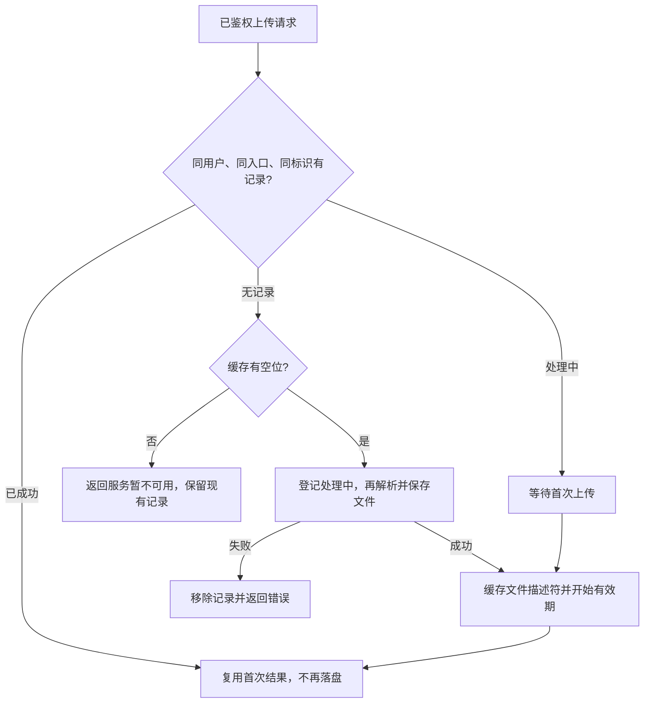
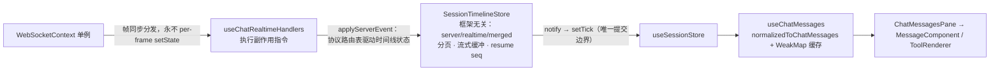

# 聊天链路（Chat Pipeline）

> 基准：2.9.0 / 2026-10-17
> **核心文档**：改动 `server/modules/websocket/**` 或 `src/modules/chat/**` 时**必须同步更新本文**。
> 普通 bug 修复不动架构的不需要更新（提交时走 `--no-verify`，见 `AGENTS.md`）。

一个值得先记住的模型：**同一段对话有两条路**。实时事件从 WebSocket 下来，持久化历史从 REST 上去，前端 store 把两者分数组保存、合并渲染。这个区域的大部分诡异行为（重复消息、闪空、乱序）都是两条路不一致造成的。

深度细节（帧表、握手、滚动、工具视图的逐文件分析）在上游自带文档 `docs/architecture/`（英文，6 篇）。**注意**：其中《04 message store》《05 scrolling》写作早于本 fork 的重构，消息存储与滚动以本文为准。

## 发送侧：一次 turn 的旅程（服务端）

| 步骤 | 位置 |
| --- | --- |
| 会话先创建（REST） | `POST /api/providers/sessions` → `sessionsService.createAppSession` → `sessionsDb`；app session id 是服务端生成的 `randomUUID`，URL/帧/store 全用它 |
| `chat.send` 入口 | `server/modules/websocket/services/chat-websocket.service.ts` 的 `handleChatSend`：`resolveSendTarget`（会话行以 DB 为准，不信任客户端）→ 会话已有 run 时先试 `injectIntoRunningTurn`（runtime `injectInput`，见下）→ `dispatchRun`（附件过滤只放行 `~/.cloudcli/assets` 直接子文件、记录 model/effort） |
| `chat.compact` 入口 | 同一文件的 `handleChatCompact`：同样的 `resolveSendTarget` 与 run 登记，但执行走 runtime 可选切面 `IProviderRuntime.compact(options, writer, context)`（能力矩阵 `supportsCompaction` 不满足则 `protocol_error: COMPACTION_UNSUPPORTED`）。前端由 `/compact` 菜单项发出（composer 不落用户气泡），压缩完成后照样以 `complete` 结束 → 前端按既有 complete 路径刷新历史，压缩摘要随历史页回来。压缩刚结束时引擎还报不出新占用（见 [providers.md](./providers.md) 的 `compacted` 约定），前端收到后清空占用百分比（`ContextUsageBar`），`TokenUsageSummary` 改用 `summaryBytes` 显示压缩摘要的大小，等下一个回合的刷新再显示真实 K 数与百分比 |
| 运行登记 | `chat-run-registry.service.ts`：`startRun` / `replayEvents` / `completeRunIfCurrent`；**run 属于服务端不属于 socket**——断线存活、多端同看、无观察者也能跑；完成后事件缓冲保留约 5 分钟供补发 |
| 定时任务入口 | `scheduled-jobs` 模块的调度器到点调 `runDetachedChatTurn`（与一次性定时消息同一条无附着通道）：`reuse` 任务跑在绑定会话、`new` 任务先 `createAppSession` 再跑；`reuse` 设了 `rotateAfterDays` 时，绑定会话满龄（按会话 `created_at`）的那次先新建会话、改绑任务、归档旧会话再跑——侧边栏只留一个活会话，历史载入成本不随时间无限增长（压缩不缩短 transcript），在跑中的会话不轮换；会话忙时记 `skipped`，**永不打断**在跑回合（一次性消息的 interrupt 语义只属于用户手选的时刻）。任务分 cron 循环与 `runAt` 仅一次两种：仅一次的认领事务里直接置 `enabled=0`，跑完读作已完成，composer 卡片随该会话 run 结束时的重新拉取而消失。agent 侧同一能力经受管 MCP `cloudcli-scheduled-tasks` 暴露（`cron` / `runAt` 二选一），默认绑定调用它的会话；整个功能由 Settings 的全局开关驱动，关闭后任务不触发、Tab 与 composer 任务入口隐藏 |
| 统一分发 | `server/modules/providers/services/provider-runtime.service.ts` → `IProviderRuntime.run(command, options, writer, context)` |
| 出站写入 | `chat-session-writer.service.ts`（`ChatSessionWriter`）：**先过线上契约闸门**（`server/shared/normalized-message-contract.ts`：信封坏了整条丢、协议未声明的字段剥掉并点名记录，见 [providers.md](./providers.md)），再吞掉 `session_created`、把 provider 原生 id 重映射为 app session id、给每事件打**单调 `seq`**、扇出给所有 watching socket |
| 终态 | 每次运行**恰好一个 `complete`**（成功/失败/中止都是）；`error` 是信息性行，不终止 run |

### 非抢断式异步任务接续与定时消息对比

服务端支持两种脱离用户直接点击的自主回合（Detached Chat Turn），两者在抢占策略上有着严格的架构边界：

- **定时消息（Scheduled Messages）**：采用**显式抢断**策略（`interruptActiveRun: true`）。调度到期后直接抢占当前正在执行的交互回合，确保定时指令准时送达。
- **异步任务接续（Task Continuation）**：采用**非抢断式空闲占用**策略（`interruptActiveRun: false`）。后台长耗时命令执行完成并原子落库后，派发器（`task-continuation-dispatcher.service.ts`）在领取事件时检查 `chatRunRegistry.isProcessing(sessionId)`。若用户正在输入或当前有正在进行的运行，派发器**主动释放租约并退回 pending**，等待下一次会话空闲轮询；仅当会话完全空闲时才启动唤醒回合，并将任务结果（`toolOutput`）送入引擎，转录落盘为 `status_note` 消息行。集中开关默认关闭；关闭后不领取新投递，但继续保存任务结果并核对已经发送的回合。

这两者都是 cloudcli **主动发起**的自主回合。还有一个**引擎单方面发起**的方向（opencode）：后台子代理完成后，引擎给已空闲的会话投递合成消息并自行续跑，没有任何客户端提示词。这类执行过去完全游离在网关之外——无 run、无帧、无终态，交互卡（`permission.asked` / `form.created`）连实时都到不了 UI，刷新也没有可回放；现在 runtime 在事件流上发现「只可能发生在执行中」的事件且该会话无活跃 run 时，经 `server/index.ts` 注入的 adopter 调 `chatRunRegistry.adoptExternalRun` 开一个 `connection: null` 的 run（与定时消息同一条无附着通道），帧、权限/提问卡与终态 `complete` 全部走普通 run 的管线（seq/回放/保留/RunOutcome 不变）；`chat.subscribe` 记下的空闲订阅者会在收养时挂上该 run 的 writer，正开着页面的用户无需刷新即可看到续跑与卡片。机制细节与边界见 [providers.md](./providers.md) 的 OpenCode 一节。

### 一次提交只产生一次发送

从点击发送到消息被后端接收之间存在一段异步窗口：附件上传、以及新会话在 `POST /api/providers/sessions` 里分配 id。窗口期内会话 id 还不存在，因此一次提交被重放就会各自开出一个新会话。以下闸门共同保证"一次提交 = 一个会话 = 一次 run"：

- **composer 闩**（`src/modules/chat/hooks/useChatComposerState.ts`）：`submitInFlightRef` 同步挡住窗口期内的任何重复提交（第二次点击、再按一次 Enter、排队草稿的 flush）。提交被接受的瞬间就清空输入框并把发送按钮切成 spinner，点击立刻可见。提交失败时在唯一的 catch 里把消息放回它来的地方——手动提交回输入框，排队消息回队列——并渲染一条 error 行，不允许静默丢消息。`handleSubmit` 返回「本次提交是否被受理」，排队草稿的 flush 据此决定保留还是清空；flush 只把草稿作为参数传入，从不写进输入框，用户正在输入的下一条消息因此不受影响。
- **附件上传幂等**（`server/modules/assets/services/upload-replay.service.ts`）：一次上传生成一个标识，同一次上传的自动重试复用该标识；普通发送与排队发送走同一上传函数。后端在解析 multipart、写入文件前登记上传，按已鉴权用户和上传入口隔离，同标识的并发请求等待首次结果，成功响应丢失后也复用已存文件。
- **会话网关幂等**（`sessionsService.createAppSession`）：每次提交携带一个 `clientRequestId`，短 TTL 内重复请求返回首次分配的同一个 session（若该会话已被删除则重新分配）。这挡的是前端闩看不见的重放——请求重试、另一个标签页。
- **run 登记**（`chatRunRegistry.startRun`）：同一会话已有 run 在跑时，重复的 `chat.send` 得到 `RUN_IN_PROGRESS` 协议错误而不是第二次运行。唯一例外是带 `injectInput` 切面且 `inputWhileBusy: 'always'` 的引擎（当前无；opencode 迁移前曾如此）：网关先把消息交给 `injectInput`，成功则不登记新 run——消息搭原 run 的 writer 输出、由原 run 的 `complete` 一并收尾，发送方 socket 补挂到该 run；返回 false（回合已结束/已中止）才回落到 `dispatchRun`。
- **引擎自发的回合**（`chatRunRegistry.adoptExternalRun`）：常驻引擎（codex / claude 的 idle 常驻、opencode 从 inbox 恢复）会在用户没有发送的情况下自己开一轮汇报。runtime 在事件流里发现后向网关要一个 run；网关按正常 run 登记（无属主 socket、`isProcessing` 对所有人可见、可回放），再把当前订阅者接到 writer 上，页面因此看到的是正常时间线而不是刷新后才出现的孤儿消息。会话 id 映射不到行、行已归档、provider 不符或已有 run 在跑时返回 null，runtime 不重试。
- **订阅与频道**（`chatRunRegistry.attachConnection`）：`chat.subscribe` 总是把 socket 挂到会话的 audience，`includeRun` 只决定它是否同时挂到当前 run 上——常驻引擎在 run 结束后仍会往会话频道上报（后台 agent 的后续、晚到的批准），把 socket 提前摘掉就会丢帧。

`POST /api/providers/sessions` 的 `initialMessage` 只作标题来源，客户端只发前缀，不发整条消息——它正处在用户等待的那段窗口里。

### 附件上传与恢复

聊天通过 `src/shared/api.ts` 的 `uploadChatAttachments` 上传文件，功能模块只编排重试。请求头 `X-Upload-Request-Id` 表示一次上传；服务端在边界校验标识，首次结果是该标识对应的权威结果，同一标识不得用于另一批文件。`/api/assets/files` 与兼容图片入口 `/api/assets/images` 共享去重机制，但互不复用结果。不带标识的旧客户端按独立请求处理。

缓存只保留文件描述符和进行中的 Promise，不保存文件内容；成功记录按有效期释放，进行中的上传不因时间到期被移除；上传中途断线时，存储适配器终止写流、清理未完成文件后释放失败记录，容量满时拒绝新标识而不驱逐仍有效的结果。容量、有效期以服务实现为准。缓存属于当前进程，重启和成功记录过期后无法复用；文件本身保留，历史消息路径不受缓存清理影响。这不是跨进程、永久去重协议。

浏览器只重试网络传输异常和明确列出的临时 HTTP 状态，错误文案不参与重试判断；成功响应的读取中断也可重试。无效成功数据、取消操作和普通客户端错误直接失败。重试用完后仍由 composer 恢复文本和附件，排队草稿回到队列。重传可能消耗额外带宽，去重保证缓存有效期间不重复保存。文件树上传使用独立 XHR 和项目文件语义，未接入聊天上传重试。

### 模型选择与分组呈现（ComposerModelMenu）

- 输入框底部的模型菜单按 `ProviderModelOption` 呈现；当选项带有 `group` 字段时，前端以 `ComposerMenuHeading` 划分展示区块。同名模型的区分靠每行的 `description`（如 OpenCode Zen / Go 网关、zcode 引擎目录的 `providerLabel`），折叠行与每个选项都显示。目前 zcode 的模型目录取自引擎（`settings.model.available`），不带 `group`。
- 选项标识与展示解耦：底层 `value` 允许包含 Provider 前缀（例如 `account:bigmodel-start-plan/GLM-5.3-Flash`）以保障后端唯一路由；触发器与折叠标题通过友好前缀截断与 `label` 解析，保证用户可见区域始终展示人类可读的友好名称，绝不泄露底层内部原始 ID。

## 断线恢复

- `seq` 由 run registry 按 session 维护单调水位：跨 run 续数、不随缓冲驱逐失效，服务端单方定义，客户端只透传（取 max 对账）。重连后发 `chat.subscribe`（带 `lastSeq`）→ 活跃 run 从缓冲精确补发；ack 带权威 `lastSeq` 与 `stale` 标志——`stale: true` 表示 `lastSeq` 已落在缓冲窗之前（5000 条上限 / 5 分钟保留），客户端补一次 REST 刷新。完成态 run 不 replay，走 REST。
- WS 鉴权用 query token 或 Authorization 头（`websocket-auth.service.ts`）；30s 心跳在 `websocket-server.service.ts`。
- `websocket_reconnected` 帧是前端 `src/shared/context/WebSocketContext.tsx` 本地合成的，用于各订阅方追赶。

## 权限批准

- 引擎运行时发 `permission_request` 帧 → 前端 `src/modules/chat/context/PermissionContext.tsx` → 用户应答 `chat.permission-response` → `chat-websocket.service.ts` `handlePermissionResponse` → `providerRuntimeService.resolveToolApproval` 广播到各引擎的 `permissions` 网关（`server/shared/types.ts` `ProviderRuntimePermissionGateway`）。
- `chat.subscribe` 应答（`chat_subscribed`）携带处理中状态与挂起权限，多标签/重连后权限卡不丢（历史教训：挂起列表裸字符串契约破裂产生"僵尸权限卡"，已由形状校验 + `toolCallId` 缓存键收口）；已应答或撤回的请求通过 `permission_resolved` / `permission_cancelled` 实时及重放撤销，防止旧卡片死灰复燃。
- **挂起询问的兜底重读**：provider 的事件流可能丢事件（opencode 的引擎事件流明确"volatile"：消费慢就断流，断流期间的事件永久丢失），丢掉的 `permission.asked` / `form.created` 不会出现在任何回放里，模型就会等一张 UI 永远看不到的卡。因此 `chat.subscribe` 对**仍在处理中**的会话额外调 `reconcilePendingInteractions`（runtime 可选切面 `ProviderRuntimePermissionGateway.reconcilePending?`，经 `provider-runtime.service.ts` 广播到各引擎），由引擎（opencode：`GET /api/session/:id/form` + `/permission`）重读自己内存里的挂起集合，把多出来的卡补发成 `permission_request` 帧；按 requestId 幂等，所以事件流每次重连后对每个活跃 run 也会跑一遍。打开会话即可回答，不再只有"中断"一条路。
- 引擎侧：claude 走 SDK 的 `canUseTool` 回调；zcode 走引擎权限桥 + 四档权限模式映射（`chat.send` 的 `options.permissionMode` → 引擎 set_mode）；codex 走 app-server 的反向 JSON-RPC 请求（`item/{commandExecution,fileChange,permissions}/requestApproval`），该请求在被应答前整个 turn 都是阻塞的，因此**必须**应答——run 结束时仍挂着的一律发 `permission_cancelled` 并按拒绝收尾。能力有无由矩阵的 `supportsPermissionRequests` 表达。
- 批准记忆（`rememberEntry`）各引擎语义不同：claude 往 `allowedTools` 追加一条规则，codex 改答 `acceptForSession`（由引擎自己记住本会话）。
- **谁来复核由引擎配置决定，适配器不覆盖**：codex 的 `approvals_reviewer`（`user` / `auto_review` / `guardian_subagent`）决定请求是否在到达客户端前就被自动裁决；在 `thread/start` 里写死这个值等于悄悄推翻用户自己的设置。

## 后台任务与输入排队

- **引擎后台驻留契约**：Claude 等引擎支持在回合中开启后台执行（如后台 `Bash`、Agent 或定时唤醒）。当前轮次的文本回复完成后发出 `complete`，但底层后台进程仍在运行，引擎 runtime 保持挂起。`TaskCreate` 只创建待办项，不属于后台执行。
- **状态同步与广播**：
  - `ActiveBackgroundTask` 表示输入框需要展示的执行任务，具体字段以共享协议为准。
  - `status(background_tasks)` 帧携带卡片列表 `backgroundTasks`；`chat_subscribed` 握手帧另带后台等待状态 `backgroundWorkPending`（由带 `backgroundTasks.isPending` 切面的引擎回答：opencode 的子会话与 antigravity 的后台任务实现该切面；claude 以任务列表为准，切面报 false）。归一化网关放行两者。
  - 卡片描述任务本身，等待状态还包括任务完成后的汇报回复。任务完成或唤醒到期时卡片立即消失，后续回复结束后才解除等待。未提供等待字段的引擎按卡片列表判断。
- **输入防打断与智能排队**：
  - `useChatComposerState` 监听 `hasActiveBackgroundTasks`：在后台任务执行期间（即使主轮次已发出 `complete`），用户发送新消息自动转入 `queuedDraft` 排队，阻止过早发送打断正在运行的后台子进程。是否排队由能力矩阵 `inputWhileBusy` 决定：`backgroundWorkQueuesInput` = 有后台任务且为 `queue`；`turnQueuesInput` = 回合进行中且不是 `always`；两者之或即 `queuesInput`，composer 的排队、flush 与按钮形态都只看它。claude（`background`）后台任务期间直接注入活进程、任务条照常显示但不排队；opencode 随 client-mode 迁移后为 `queue`（回合中途插话暂缺），`always` 目前无引擎使用。注意 `useChatSessionState` 的 `isProcessing`（即 composer 的 `isLoading`）只表示"正在产出回复"，只剩后台任务的 `background` 活动条目不算——否则 `background` 档永远被回合排队吞掉；`hasActiveBackgroundTasks` 同时认这种条目，保证 `queue` 档照旧排队。
  - `/compact` 不走 `inputWhileBusy`：压缩是一轮独立 run，网关在会话已有 run 时一律回 `RUN_IN_PROGRESS`，所以回合进行中发出的 `/compact` 写 `queued_compact_<sessionId>` 落盘排队（composer 显示"压缩已排队"、可取消），本轮 `complete` 后由当前会话的 flush 或 app 级 `useQueuedMessageAutoSend`（切走/未查看时）先发压缩帧；排队草稿随其后，等压缩这轮结束再发。存储键是两边共用的 claim，先清后发避免重复。
  - 停止语义对齐 Claude Code 的 Esc：停止按钮只打断回合，后台任务由任务条单独停（表头停全部、每行停一个，都走 `chat.stop-task`）。只剩后台工作（`background` 条目）时停止按钮也发 `chat.abort`：服务端没有 running 的 run 但 `hasBackgroundWork` 为真时仍转给 `runtime.abort`，用来打断任务完成后 CLI 自己推的 follow-up 回合。
  - **自动释放**：后台任务结束且无新状态阻塞时，composer 的 flush 效应自动解冻排队草稿并发出。
  - **强制中断逃生通道**：排队卡片提供 `forceSendQueuedDraft`（`isForced: true`），允许用户在需要时显式跳过等待立即发送；新 run 会顶替仍在保活的进程，后台任务随之结束（`forceInterrupt: true` 只是随消息带上的标记，服务端不读）。
  - **停止失败**：找不到运行任务、缺少任务句柄、引擎拒绝停止和会话取消失败均保留现有活动，不解除排队。异常响应携带所属会话；`TASK_STOP_FAILED` 与 `ABORT_FAILED` 分别表示任务停止和会话取消的引擎异常，错误仍进入聊天记录。
  - **可视化呈现**：输入框上方通过 `BackgroundTaskIndicator` 实时展示运行中的后台任务（工具名、命令、动态已用时间）；每行可点击，跳转到转录里对应的卡片（先整段取历史，再按渲染行索引滚动 + 高亮，与搜索跳转共用同一条路；渲染层虚拟化，卡片不在 DOM 里，只能按索引定位）。任务条列表只由 `status(background_tasks)` 帧和 `chat_subscribed` 回放整体替换；另有一条前端兜底：带 `toolUseId` 的非 `running` `task_status` 帧会立刻摘掉同 id 的条目（条目 id 即启动调用），清空帧丢了也不会挂到刷新。
  - **完工庆祝防误报**：`useChatRealtimeHandlers` 在收到 `complete` 时，若会话仍有后台等待，则暂不触发完工音效与窗口标题提示；待后台等待解除时统一触发。卡片消失本身不表示汇报回复已结束。

## run 的结束原因（诊断契约）

每个 run 无论怎么结束，都只从 `chat-run-registry.service.ts` 里 `complete` 那一个分支离开，
所以结束原因在那里**统一记录一次**，与引擎无关：`engine_completed` / `engine_failed` /
`client_abort` / `superseded` / `dispatch_failed`。前三个之外的两个由调用方在发出终止
`complete` 前标记（`completeRun` / `completeRunIfCurrent` 的 `reason` 是必填参数），
引擎自己结束的则按 exitCode 判定。

为什么必须是这条契约：引擎落盘的 transcript 只能记下「这一轮被中断了」，永远说不出是谁中断的——
用户按了停止、调度消息抢占、派发阶段抛错、还是引擎进程自己没了，在它眼里长得一模一样。
少了这个字段，一次「聊着聊着就断了」的报障就只能靠猜。

记录进 `server/modules/diagnostics`（有界内存日志 + 进程日志），`GET /api/diagnostics/runs`
读出来，前端诊断报告把它和自己那半边证据合成一份文件（见 [frontend.md](./frontend.md)）。
跨引擎一致性由 `chat-run-registry.test.ts` 对四个在用引擎逐一钉住。

## 落盘同步（run 之外的第二条持久化路）

run 结束 → `sessions-watcher.service.ts`（chokidar，watch 根由各引擎 `getSessionWatchTarget()` 声明）→ `session-synchronizer.service.ts` `synchronizeFile` → `sessionsDb` upsert → `session-upserted-broadcast.service.ts` 推 `session_upserted`（侧边栏增量，归 projects 状态管，不归 chat）。会话离开活跃列表（归档：自动归档手动/定时、单会话归档；强制删除）由同一服务推 `session_removed`（批量 `sessionIds` 一帧，前端按 id 从 projects 树剔除，幂等）。计划任务的任何增删改（REST 与 agent MCP 同走 `scheduledJobsService`）以及调度器触发后，同一服务推不带数据的 `scheduled_jobs_changed`，`useScheduledJobs` 收到后各自按自己的范围重新拉取（断线重连后也拉一次）——否则 agent 在别的会话里删掉任务，被绑定会话的输入框横幅不会知道。这类不属于任何会话的网关帧必须同时登记进 `GATEWAY_KINDS`、时间线路由表（`action: 'none'`）和 `useChatRealtimeHandlers` 的放行名单，漏掉任何一处，未知帧兜底就会把它当消息插进正在看的会话。历史读取走 `GET /api/providers/sessions/:sessionId/messages`（尾偏移分页：`offset: 0` 是最新一页），读密集缓存见 `session-history-cache.service.ts`。

## 接收侧：WS 帧 → React 的四层

- **`src/shared/context/WebSocketContext.tsx`**：全局单例，`subscribe(listener)`；帧绝不直接进 React state。帧类型 `ServerEvent` 是按 `kind` 判别的联合（`shared/protocol/frames.ts`，无索引签名），读字段前必须先用 `frameNarrowing.ts` 的谓词确定帧种类，详见 [frontend.md](./frontend.md)。
- **`src/modules/chat/hooks/useChatRealtimeHandlers.ts`**：纯副作用层——外来帧（`websocket_reconnected`/侧边栏事件）前置分发，其余全部交给 store 的 `applyServerEvent`，按返回的副作用指令执行（通知音、权限列表、processing/idle、补刷）。
- **`src/modules/chat/utils/sessionTimelineStore.ts`**（`SessionTimelineStore`）：不 import React。每会话一个 slot（`serverMessages` / `realtimeMessages` / `merged` + 分页元数据 + 流式分段缓冲 + 重连 resume seq）。`applyServerEvent` 是时间线状态的唯一入口：内部路由表 `SERVER_EVENT_ROUTES` 一行定义一个 kind 的 flush 门/持久化/动作，并产出副作用指令。
- **`src/modules/chat/hooks/useSessionStore.ts`**：React 适配器，每次应用挂载建一个 store，`notify` 触发重渲染——**非 React → React 的唯一提交边界**。
- **渲染层对引擎无感**：`MessageComponent` 等共用渲染组件**不得**按引擎名分支。引擎的私有包装在各自适配器归一化掉（例如 Codex 的 `<proposed_plan>` 由适配器拆成与 Claude 一致的 `ExitPlanMode` 计划卡，实时/会话读取/持久化三条路都做），详见 [providers.md](./providers.md)。
- **渲染层**：空态/加载态由 ChatInterface 直接渲染（无消息时 Pane 不挂载）；`ChatMessagesPane` 只承载 transcript——它把状态层给的 `transcriptItems` 交给 virtua 虚拟化渲染，自己不再决定显示哪些行。`ChatMessage` 是纯视图模型：`type` 为 `user|assistant|error` 三值联合，assistant 子形态靠 `isToolUse`/`isThinking` 等 is* 旗标区分，由 convertRow 每次从 NormalizedMessage 重建，不落盘（JSON 导出是唯一序列化面）。

### 两条硬不变量（store 与渲染器的契约，方法实现必须保持）

1. **行身份复用**：前翻旧页或替换尾部时，字节等价的行对象必须复用缓存实例——React memo、转换缓存、DOM 锚定全靠它。
2. **更新只有两种形态**：按消息 id / toolId 的原地 upsert（思考、tool_use、流式行），或保持等价行身份的全量替换。没有第三种。

模块内的次级排序契约见 `sessionTimelineStore.ts` 头注释：内容帧先 flush 流式缓冲再落表（路由表的 flush 门）；服务端覆盖剪枝必须先于内容级短路；旧页拉取期间的偏移漂移要先做一次有界最新页校准；流式行时间戳锚定在分段开始且不刷新。

**子代理容器只有一条判定，时间线只有两个来源。** 判定发生在 `useChatMessages`：`tool_use` 行带后端归一化的 `subagent` 元数据，或其工具名属于引擎的启动族（Claude `Task`/`Agent`、OpenCode `subagent`/v1 `task`、Antigravity `invoke_subagent`；`manage_task`/`manage_subagents` 这类管理工具不算），该行就必须画成子代理卡而非普通工具行。时间线有两个来源，互斥成事实上的同一阴影：**历史**把子代理子会话自身的消息翻成 `subagentTools`/`subagent` 挂在启动行上（服务端归一化，见 providers.md）；**实时**里子代理行带 `parentToolUseId` 流入，投影把按同 id 流的正文/思考增量折成一条 activity、并把 `tool_result` 按 toolId 挂到对应工具上——这些行**永不**作为顶层消息渲染，且实时列表与历史列表取较长者（中途刷新时一边可能只拿到一半）。容器行缓存必须以"折叠进它的最新一行"为失效键，否则新到的子代理行不会重绘。

**判重只有一条依据：`id` 相等。** 转录行（`text`/`thinking`/`tool_use`/`tool_result`/
`task_notification`）的 `id` 由引擎自己的记录推导，同一条记录在实时路与历史路、读多少遍都字节
相同（契约与逐引擎依据见 [providers.md](./providers.md)）。于是"这条实时行是不是已经落盘"是一次
集合查找：`serverIds.has(row.id)`。不比正文、不看时钟、不数下标、不重建回合。

前端只有三类行没有引擎 id，它们各自有**有界**的退场方式，绝不靠猜：

| 行 | 为什么没有 id | 怎么退场 |
| --- | --- | --- |
| 乐观用户行 `local_*` | 发送时引擎还没写任何东西 | 与发送时刻之后出现的第一条持久化用户行配对 |
| 流式占位行 `__streamed_*` | 增量是还不存在的那一行的碎片 | 引擎随后发来的正式行就地顶替；或按 `providerRowKey` 由更完整的持久化行接管 |
| 合成结算行 `__finalized_*` | 本端为未收到结果的工具卡补的 | 随它结算的那张卡一起退场 |

**乐观用户行按 id 锚点配对，不用行数、不用时钟、不看正文。** 发送时把当时转录的**最后一行 id**
记进 slot 的 `pendingPrompts`；此后出现在该行之后的第一条持久化用户行就是它的副本，一对一认领。
用 id 而不是行数，是因为这个数组会被整页刷新替换、被旧页前插——行数戳在这两种情况下会静默失配，
而失配的结果是乐观行永远退不了休，与自己的持久化副本并排显示到会话结束。发送时转录为空则没有锚点：
此时配对仍然进行（宁可乐观行早退，也不要重复），但这种配对**不算已证明**，不能用来给工具卡定位回合。
锚点行被 fork/编辑改写而消失时，`complete` 是兜底期限——run 结束后允许与任意未认领的用户行配对，
以保证重复不会变成永久。

**一条实时行的 id 就是它的身份，实时之间也一样。** 转录行的 id 由引擎自己的记录推导，因此两帧同 id = 同一行（后一帧是前一帧的增长或更正），`appendRealtime` 按 id 顶替而非追加，并保留首次落位的时间戳以免被后到的帧重排。逐帧新造的 `vol_` id 不参与（它对跨帧不作任何承诺）。**正文流式必须走 `stream_delta`**：把整段正文当 `text` 行逐帧重发，等于每个片段各占一条消息——codex 曾这样发过一版，时间线里留下了一串"我 / 我先 / 我先核…"。

**引擎回显的用户行同样是"顶替"而非"并排"。** codex 会在实时流里回显用户消息（`UserMessage` 项，id 与 rollout 里同一项相同），claude 不会
（实测：SDK 的 query 输出只有 system/assistant/user(tool_result)/result，没有提示词回显）。
回显行带引擎 id，到达时直接顶替尚未配对的乐观行，于是这条行从那一刻起就有了真身份和编辑/Fork 锚点。

**两路合并的排序依据按 `源内顺序 > 因果锚点 > 时间戳` 取，时间戳永不单独裁决跨路先后。** 各路内部顺序本身就是权威的（服务端是转录序，实时是到达序），需要裁决的只有交错位置；而两路的时间戳来自不同机器（流式行由浏览器打戳，历史行由引擎落盘时打戳），拿它定跨路先后会让时钟偏斜直接变成乱序。因此每条实时行取两个因果下界中较晚的一个，有下界时时间戳不参与：

- **回合锚点**——实时行属于其上方最近一条用户行开启的回合。该用户行的持久化副本（乐观行的配对结果，或引擎回显行自己的 id）即成为这一回合所有实时行的下界。这条路径覆盖"服务端还没跟上"。
- **到达锚点**——实时行首次出现时服务端数组的末行，记在 slot 的 `realtimeArrivalAnchors` 上，只记一次不修正。当时已在转录里的行必然发生在它之前。这条路径覆盖"服务端早已有"（他端标签页、重连后补看的会话没有乐观行可锚）。

因此剪枝阶段**必须保留乐观用户行**：它是回合边界的唯一记录，隐藏它是合并阶段的职责。两个锚点都不适用的行才退回时间戳排列。

**`providerRowKey` 处理"同一行、两边正文不一样长"。** 流式缓冲从 delta 到 `__streaming_`、再到定稿占位行全程保留该 key；key 变化以及有 key/无 key 的切换都会先闭合旧段，避免相邻 provider 行或普通 stdout 被拼成一条。历史刷新只在 provider、会话、key 唯一对应时裁决：完整历史接管；历史明确截断而实时完整时实时接管；两边都明确截断时保留较长正文。正文不参与身份判断。Antigravity 的纯 assistant 正文使用原生 `step_index` 派生 key；zcode 的实时流只发 delta，用 `zcode-message:<message_id>` 对账；opencode 在 client-mode 下实时与历史行 id 不同源（见 [providers.md](./providers.md) 的身份表），assistant 正文改由 `opencode-part:<消息id>_text:<正文段序号>` 对账（序号由引擎在 `session.text.*` 事件里给出，历史侧按同一序数数正文块），工具行靠 toolId 指纹层配对。

**工具卡：先 id，再原生 call id，最后才是指纹兜底。** 引擎在两路用同一 id 命名的调用由上面的 id 判重直接解决（codex 现在属于这一类：两路都读同一个 ThreadItem，`exec-<uuid>` 两边同值）；两路行 id 不同但原生 call id 相同的走 `toolIdentity.ts` 的精确匹配。两者都没有的引擎才落到"规范工具名 + 完整参数指纹"的一对一认领，且**只在已证明的同一回合内**生效：回合证明来自乐观行的已证明配对或非空 `transcriptAnchorId`，证明不了就两张卡都留着（宁可重复一张卡，不可吞掉用户真跑过的命令）。Edit/Write 的指纹包含修改内容；仅当实时 Edit/Write 的两侧 diff 都未到达、历史端有完整 diff 时，才按路径与顺序一对一认领。

**已知缺口（不伪造，写在这里）**：zcode 的 thinking 行两路 id 不同（实时是开段事件的 `${id}_reasoning`，落盘是 `(message_id, part_id)`），目前仍靠 `sessionThinkingRows.ts` 的整段正文相等来判重。要彻底收口需要引擎在 reasoning 事件上带出 part id——它的 `tool_result` 事件已经带了 `resultPartId`，文本与推理事件没有对应字段。zcode 的 assistant **正文**不受此影响：两路都发布 `zcode-message:<message_id>` 作为 `providerRowKey`，走身份对账。

**压缩行在转换之后统一折叠。** 各引擎的压缩行（带 `compact`）与摘要行（`isCompactSummary`）见 [providers.md](./providers.md)。
`normalizedToChatMessages` 逐行转换完后由 `foldCompactionRows` 走一遍：摘要折进紧邻的压缩行（历史里摘要在后、实时可能在前，两种顺序都折），
结束行顶替紧邻上方的进行中行并带走已折入的摘要，另丢掉摘要的未标记副本（只看 assistant 行）和有真压缩行时 CLI 的单词 `Compacted`。
折叠放在转换之后而不是逐行做，是因为逐行缓存的输出会被复用，跨行改写只能产出新对象。

### 渲染性能优化

- 思考块按稳定 id 归组 upsert（`src/modules/chat/utils/sessionThinkingRows.ts`）。
- 流式文本由 `transcript/StreamingMarkdown.tsx` 渲染：按 `streamingMarkdown.ts` 切"已定稿前缀 + 待定尾块"两段 `MarkdownBody`，前缀字节稳定命中 memo，每 100ms tick 只重解析尾块。
- **转录是虚拟列表**：`ChatMessagesPane` 用 virtua 的 `Virtualizer` 渲染，只有视口附近的行在 DOM 里；行高由 virtua 实测，估高与真高的差值由它改写滚动偏移吸收。这取代了原先「服务端分页 + `visibleMessageCount` 切片 + 懒挂载占位」三层各管一段、互相错拍的结构——现在「渲染哪些行」只有 `transcriptItems` 一个来源。
- 视口行为归 `hooks/useTranscriptViewport`：贴底跟随、距顶两屏预取旧页、按下标跳转。它不做任何位置补偿——补偿是 virtua 的职责，业务层再补一次只会打架。前插旧页的那一次提交带 `shift`，请求发出时置位、请求结束且该次提交渲染后复位（只按行数复位会在空页时卡住，把下一次追加误当历史）。
- 搜索跳转按 `searchTargetLocator.ts` 在**分组后的行**上解析命中下标（-1 即确定性放弃），再交给 `scrollToIndex` 居中；不再需要渲染窗口，也不再有 DOM 查找和多段定时器。分组会折叠工具行、丢弃隐藏行，所以消息下标与行下标不是一回事，定位必须在行空间做。
- 工具卡片按 toolId upsert，服务端把引擎的流式参数增量累积成稳定快照再发。
- `transcript/Markdown.tsx` 的链接分三类：工作区文件路径在编辑器里打开；指向服务器本机端口（而页面自身不在那台机器上）的链接改走本机服务代理，机制与安全边界见 [overview.md](./overview.md#认证与安全边界)；其余按普通外链新标签打开。
- 虚拟化与滚动的硬约束见 [frontend.md](./frontend.md) 的性能守则；端到端闸门是 `scripts/perf/chat-scroll-up-stability.mjs`，它断言屏幕上的行走了多远，而不是 `scrollTop` 变了多少。

## 扩展检查单

| 要做什么 | 改哪里 |
| --- | --- |
| 新增服务端 → 客户端事件 | `server/shared/types.ts` 的 `ServerEventKind` + 引擎归一化层产出 + store 路由表 `SERVER_EVENT_ROUTES` 加一行（时间线状态；需要应用反应时在 `useChatRealtimeHandlers` 的指令 switch 加副作用）+ 更新本文 |
| 新增客户端 → 服务端帧 | `chat-websocket.service.ts` 的消息类型 switch；需要鉴权/限流语义时看 `resolveSendTarget` 的模式 |
| 新增工具卡片渲染 | `src/modules/chat/tools/configs/toolConfigs.ts` 注册（配置驱动，**禁止散落条件分支**），复杂内容加 ContentRenderer；见 `src/modules/chat/tools/README.md`。工具别名/展示分类/命令提取统一在 `toolTaxonomy.ts`，别再拷贝名单 |
| 新增权限相关能力 | 引擎 runtime 的 `permissions` 网关 → 矩阵自动推导 `supportsPermissionRequests` → 前端按矩阵渲染 |
| 新增由能力矩阵驱动的 UI 差异 | 静态能力进 `provider-capabilities.catalog.ts`，前端只读矩阵、不写 provider 分支：`supportsCompaction` 决定 `/compact` 是否出现，`editRevertsFiles` 决定编辑横幅说"已修改的文件不会被还原"还是"会一并还原"（会还原文件类引擎标 true），`supportsNativeScheduling` 决定定时任务表单是否提示"引擎自带会话内调度"。提问卡（`AskUserQuestionPanel`）文案与引擎无关，用 `chat:misc.*` 中性串 |
| 改历史分页 | `src/modules/chat/utils/sessionMessagePagination.ts` + store 的序列化测试（`sessionTimelineSequences.test.ts`）必须跟着改 |
