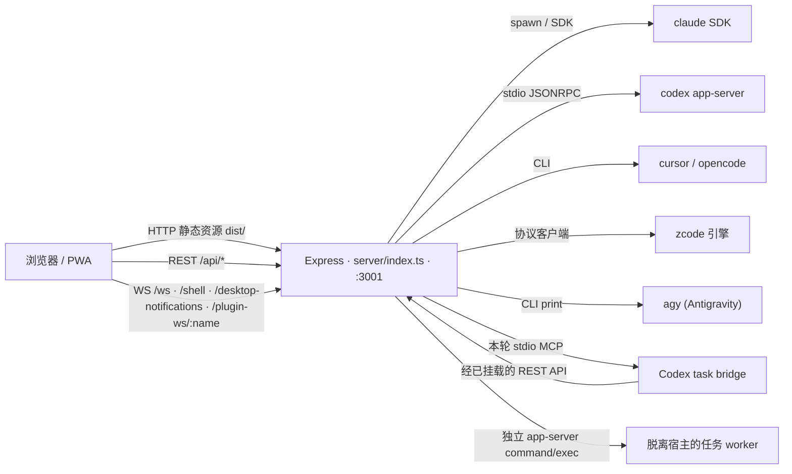

# 系统全景（Overview）

> 基准：2.9.0 / 2026-10-17

> **核心文档**：本文描述整个系统的进程拓扑、目录地图、数据分布与部署方式。
> 改动 `server/index.ts`、数据库 schema、构建产物结构或部署方式时**必须同步更新本文**。
> 普通 bug 修复不动架构的不需要更新（提交时走 `--no-verify`，见 `AGENTS.md`）。

其他核心文档：[providers.md](./providers.md)（引擎接入）· [chat.md](./chat.md)（聊天链路）· [frontend.md](./frontend.md)（前端架构）

## 进程拓扑

整个产品是**一个 Node 进程**：Express 同时提供静态资源、REST API 和 WebSocket。



要点：

- **服务端是引擎的宿主**，不是代理。引擎子进程/SDK 由服务端拉起，会话原件落盘在各引擎自己的数据目录，服务端只做索引、归一化与转发。
- 入口 `server/index.ts`：组装 Express、挂全部 REST 路由、挂 WS（`server/modules/websocket`）、托管 `dist/`、SPA fallback、启动异步任务恢复与派发、优雅停机。异步任务 worker 是脱离宿主生命周期的子进程。优雅停机同时关掉常驻引擎进程（Codex 驻留会话、Claude 空闲常驻与为后台工作留着的进程、ZCode 协议客户端），不让引擎活过宿主。
- 装配层把网关的事件发布入口交给 provider 运行时：常驻引擎在回合结束后自发汇报回合时，事件经 `chatRunRegistry` 的会话通道发出，运行时自己不发包、不编号。装配层也把任务桥接的登记入口与凭证的签发、作废交给运行时，并单独挂载桥接入口 `/api/tasks/mcp/invoke`（在通用 API Key 中间件之前，自行鉴权）。宿主任务的任务条也在这里接线：`setCodexHostTaskSource` 把任务模块的卡片列表和停止交给 Codex 运行时，`setTaskActivityListener` 在任务开始或结束时经会话通道重发整张任务条（机制见 providers.md「Codex 异步任务结果续开」）。
- 端口：`SERVER_PORT` 默认 **3001**，`HOST` 默认 `0.0.0.0`；开发模式 Vite 跑 5173 并把 API 代理到 3001（`vite.config.js`）。
- HTTP 连接配置：`server/http-timeouts.ts` 在监听前配置 origin 的连接空闲时间；默认覆盖常见代理的默认空闲池时间，但自定义代理仍需保证其空闲池先于 origin 过期。`HTTP_KEEP_ALIVE_TIMEOUT_MS` 可覆盖默认值，单位为毫秒，必须是 Node 定时器范围内的正整数；非法配置使启动失败。请求头接收超时保持大于连接空闲超时。默认值与校验范围以实现为准，PM2 实例的覆盖值写在 `~/.pm2/ecosystem.config.cjs`。
- 启动标记：`~/.cloudcli/local-server.json`（host/port/pid/appRoot），用于 CLI 与健康检查定位实例。
- 异步任务入口只在本次 Codex 运行配置 stdio MCP；宿主凭可信运行上下文登记任务，再以独立 app-server `command/exec` 按原沙箱执行。敏感运行凭证只进 MCP 子进程环境，并从命令环境排除。管理 CLI 使用用户 JWT 调用认证接口。

## 目录地图（两层）

```
server/
  index.ts                 进程入口：路由挂载、静态资源、WS、监听与停机
  load-env.ts              最早加载 .env；DATABASE_PATH 默认 ~/.cloudcli/auth.db
  modules/
    providers/             ★ 引擎接入层（registry + 6 家 provider + services），见 providers.md
    websocket/             ★ WS 网关（/ws 聊天、/shell 终端、通知、插件代理），见 chat.md
    task-continuations/    ★ 异步任务接续（任务登记、隔离 worker、事务型发件箱、状态机、非抢断派发器与崩溃恢复）
    auth/                  JWT 注册/登录/刷新 + authenticateToken 中间件
    database/              better-sqlite3 连接、schema、migrations 与 repositories
    assets/                聊天上传资产（~/.cloudcli/assets）的上传与读取
    agent/                 无头 Agent API（API key / 平台模式鉴权）
    notifications/         Web Push（VAPID）+ 桌面通知 WS
    plugins/               插件注册表、插件子进程、WS 代理
    scheduled-messages/    定时消息与排队消息（调度器 → 无附着 chat turn）
    browser-use/           浏览器自动化 service + 本地 MCP 桥接
    local-proxy/           把服务器本机端口上的服务转发给远程浏览器（票据 + 会话 cookie）
    voice/  cli/  git/  file-tree/  worktrees/  projects/  settings/  system/  user/
                           其余领域模块（每个 = routes + services 的薄模块）
  shared/                  interfaces.ts（IProvider 契约）、types.ts（NormalizedMessage、
                           ServerEventKind、AsyncTaskRecord 等）、message-unification.ts、utils.ts
src/
  modules/
    chat/                  ★ 聊天前端（composer、transcript、tools、实时 hooks、store、导出）
    project-workspace/     工作区外壳（布局、标签页、项目/会话列表状态）
    sidebar/  settings/  auth/  provider-auth/  mcp/  skills/  git-panel/  file-tree/
    code-editor/  shell/  standalone-shell/  i18n/  plugins/  browser-use/
    voice/  task-master/  command-palette/  onboarding/  quick-settings-panel/  …
  shared/                  api.ts（fetch 封装）、types.ts、context/（全局 Context）、ui/（通用组件 + 引擎 Logo）
  App.tsx                  路由：/ 与 /session/:sessionId 两个工作区路由
docs/
  core/                    ★ 本套核心文档（中文）
  architecture/            上游自带的聊天运行时深度文档（英文，6+1 篇）
  README.upstream.md       上游原始英文 README 备份
```

## 数据与持久化

| 数据 | 位置 | 说明 |
| --- | --- | --- |
| SQLite（账号/会话元数据/配置/任务） | `~/.cloudcli/auth.db`（`DATABASE_PATH` 可改） | 连接单例 `server/modules/database/connection.ts`，表定义 `schema.ts`，迁移 `migrations.ts` |
| 异步任务目录与产物 | `~/.cloudcli/tasks/<taskId>` | 后台命令日志 `output.log` 与原子结果 `result.json`，支持宿主断电/崩溃重启后自动扫描补录入库 |
| 聊天上传资产 | `~/.cloudcli/assets` | `server/modules/assets`；聊天发送只信任该目录**直接子文件**（`chat-websocket.service.ts` 过滤） |
| 插件本体与启用状态 | `~/.cloudcli/plugins` + `~/.cloudcli/plugins.json` | `server/modules/plugins`（注册表扫描 + 子进程管理）；首次访问时从旧 `~/.claude-code-ui` 一次性自动迁移（`migrateLegacyPluginPaths`） |
| 各引擎会话原件 | `~/.claude` / `~/.codex` / `~/.cursor` / `~/.local/share/opencode` / `~/.zcode` / `~/.gemini/antigravity*` | 云 CLI 不复制、不改写；同步器只读解析后把元数据 upsert进 SQLite（`sessions` 表含 `jsonl_path`）；会话名跟随引擎标题，用户在应用内改过名的行带 `name_locked=1` 永不被引擎覆盖 |
| 运行结束记录 | 服务进程内存（有界，约百条） | `server/modules/diagnostics`：每个 run 为什么结束（见 [chat.md](./chat.md)）。刻意不入库——它服务于"刚刚出了什么事"，重启即弃；`GET /api/diagnostics/runs` 读出，前端诊断报告把它和浏览器侧证据合成一份文件 |
| 前端构建产物 | `dist/`（vite build） | Express 静态托管 + SPA fallback |
| 服务端构建产物 | `dist-server/` | `tsc + tsc-alias` 先产出 `dist-server.next`，`scripts/promote-dist-server.mjs` 原子晋升（保留 `dist-server.old`；`preserver` 钩子启动前自愈） |

**数据库改动规则**：改 `schema.ts` 必须同时写 `migrations.ts` 增量迁移（初始化走 INIT_SCHEMA_SQL，存量库走迁移链），并更新本文。


## 认证与安全边界

- **JWT**：`server/modules/auth/auth.middleware.ts`。密钥取 env `JWT_SECRET`，否则自动生成入库（`app_config.jwt_secret`）。token 7 天有效，半衰期自动刷新（响应头 `X-Refreshed-Token`）。WS 走 query string 或 Authorization 头鉴权（`websocket-auth.service.ts`）。
- **可选 API key**：`validateApiKey` 作用于全部 `/api`；agent 模块另走 API key / 平台双模鉴权。
- **上传白名单**：`chat.send` 的附件只放行 `~/.cloudcli/assets` 直接子文件，防止任意路径读。
- **`file:` 链接白名单**：会话里引擎产出的本地文件链接走只读端点，目录白名单含各引擎数据根与系统临时目录（`server` 侧 fileLink 相关服务），防止越权读盘。
- **本机服务代理**（`server/modules/local-proxy`）：聊天里出现的 `http://localhost:<port>/…` 只在服务器那台机器上可达，远程浏览器打不开。前端（`src/modules/chat/utils/localProxyLink.ts`）在"链接指向本机、而页面自身不是本机地址"时改走代理：先用 JWT 换一张 60 秒一次性票据，首个文档请求用票据换 `HttpOnly` 会话 cookie（`Path=/api/local-proxy`，8 小时）并 302 把票据从地址栏抹掉，之后页面的子资源靠该 cookie 放行——浏览器不会给它们带 Authorization 头。转发只允许 GET/HEAD，目标 host 固定 `127.0.0.1`，禁服务自身端口；请求侧丢掉 `cookie`/`authorization`，响应侧剥掉 `set-cookie`/CSP/HSTS 并把 `Location` 改写回代理前缀。页面里写死的根绝对路径资源由 `localProxyAbsolutePathFallback` 按 `Referer` 送回对应端口，该中间件必须排在静态资源处理之前。
- **代理的固有代价**：任何已登录用户都能读到服务器本机任意端口的 GET 内容；被代理页面运行在 cloudcli 同源下，其脚本能访问本源的 `localStorage`。代理的对象是用户自己机器上的本地服务，以此为前提接受这两点。

## 构建与部署

```bash
npm run build        # build:client (vite → dist/) + build:server (tsc → dist-server 原子晋升)
npm run server       # node dist-server/server/index.js —— 生产启动就这一个进程
npm run dev          # tsx 跑 server(3001) + vite HMR(5173)，开发用
npm test             # 服务端测试（tsx --test server/**/*.test.ts）
npm run test:client  # 前端测试（vitest）
npm run lint         # oxlint src/ server/
npm run typecheck    # 前后端双 tsconfig --noEmit
```

- 本仓库生产实例用 **PM2** 托管，应用名为 `cloudcli`。`pnpm run deploy` 用部署锁串行执行，先构建 tarball，在独立的 `~/.cloudcli/runtime-next-<pid>` 完成生产依赖安装和原生依赖检查，再受控切换为 `~/.cloudcli/runtime`；服务入口固定为 `~/.cloudcli/runtime/node_modules/cloudcli/dist-server/server/index.js`，上一版保留在 `~/.cloudcli/runtime-previous`，启动或健康检查失败时自动恢复。首次从其他入口迁移时会重建 PM2 进程条目，固定入口生效后的部署只做原地重启。全局 `cloudcli` 命令稳定指向该运行目录。部署脚本启动时会把自己重新拉起成 detached 后台进程（日志 `~/.cloudcli/deploy.log`），调用方只跟读日志——终端关闭或 pm2 切换重启了托管调用方的服务，都不会让部署停在半路；中断时 exit 钩子清理暂存目录并明确告知线上未变更。PM2 配置在宿主机，不在仓库内；重启会切断在线 WebSocket（详见根目录 `AGENTS.md`）。
- 提交钩子：husky + lint-staged（oxlint）+ commitlint（Conventional Commits）+ 核心文档同步守卫（`scripts/hooks/check-doc-sync.mjs`）。

## 扩展检查单

| 要做什么 | 看哪里 |
| --- | --- |
| 新增 REST 领域模块 | 按 `.agents/skills/backend-module-standards` 的模块规范：`server/modules/<域>/`（routes + services），在 `server/index.ts` 挂路由 |
| 新增/改数据库表 | `database/schema.ts` + `migrations.ts` + `database/repositories/`，并更新本文 |
| 新增引擎 | [providers.md](./providers.md) 的六步清单 |
| 新增 WS 消息类型 | [chat.md](./chat.md) 的扩展检查单 |
| 新增前端大块 UI | [frontend.md](./frontend.md) + `.agents/skills/frontend-module-standards` |
