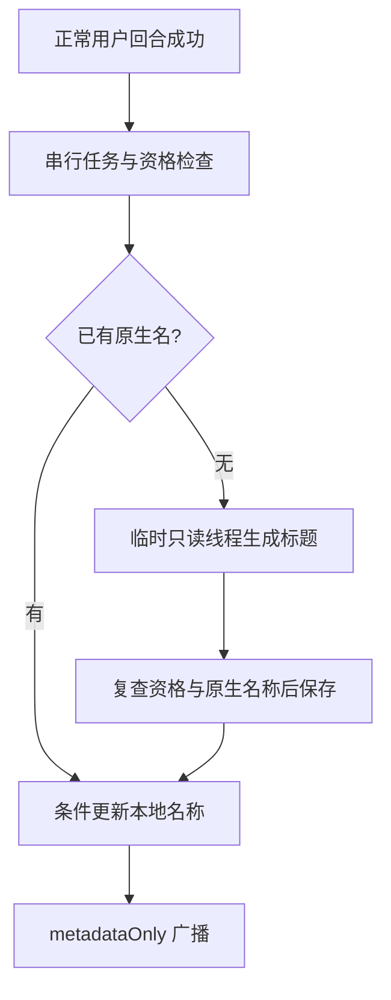
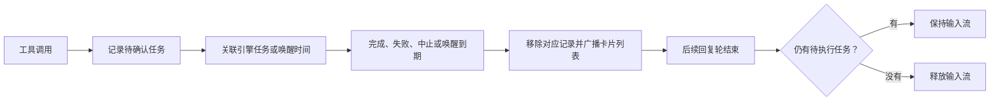
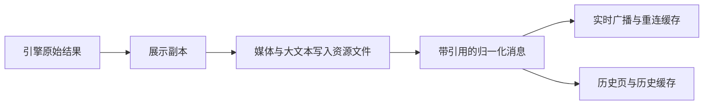

# Provider 架构与接入指南

> 基准：2.13.0 / 2026-10-24
> **核心文档**：改动 `server/modules/providers/**` 或 `server/shared/{types,interfaces}.ts` 时**必须同步更新本文**。
> 普通 bug 修复不动架构的不需要更新（提交时走 `--no-verify`，见 `AGENTS.md`）。
> 引用一律给"文件路径 + 符号名"，不用行号。

相关文档：[overview.md](./overview.md)（全景）· [chat.md](./chat.md)（运行时事件怎么流向前端）

## 现状：六家引擎

`claude | codex | cursor | opencode | zcode | antigravity`，联合类型定义在 `shared/protocol/chatEvents.ts` 的 `LLMProvider`（前后端共用同一份，见下文「线上契约」）。注册表 `server/modules/providers/provider.registry.ts` 用 `Record<LLMProvider, IProvider>` 硬编码六家实例——漏一家直接编译报错。

每家一个目录：`server/modules/providers/list/<name>/`，由 `<name>.provider.ts` 组装各切面。claude / cursor 的 runtime 是遗留 `.js` 适配器；opencode、codex、zcode / antigravity 是 TS（含协议客户端、运行生命周期等更多切面文件）。

## Codex 会话驻留：一个应用会话一个 app-server 进程

`codex-session-manager.ts` 按应用会话 id 持有驻留的 `codex app-server` 进程：同一会话的下一轮沿用同一个进程和同一个原生线程，不再每轮重启进程、重新加载历史。进程代次在宿主生命周期内单调递增，删除记录后重开也不会复用旧代次。旧进程的迟到回调只能清理自己那一条。初始化失败走统一销毁入口；初始化中关闭会话后，迟到的连接或线程应答不能重新登记进程。

**提交路径是引擎的线程队列，不是 `turn/start`。** 活跃回合上的第二次 `turn/start` 不会新建回合，而是把输入并进正在跑的那一回合——引擎自发汇报时，用户消息就会被汇报回合吞掉。线程队列没有这个问题：`thread/queue/add` 写入输入，引擎忙时拒绝启动（`thread already has an active or pending turn`），闲时把队列排空，每条输入单独起一个回合。引擎并不总是自己排空：回合被 `turn/interrupt` 打断后，它扣住队列里的每条输入，直到客户端用 `thread/queue/start` 点名启动（codex-cli 0.163.0 实测：打断后入队的输入 20 秒仍在队列里，`thread/queue/start` 一调就开跑）。所以本轮输入还在队列里、而线程没有在跑的回合时（提交之后，或线程上别的回合结束时），管理模块就调 `thread/queue/start` 启动它；没被扣住的线程在回 `thread/queue/add` 之前就取走了输入，不会发这次调用；被扣住的线程手动启动一轮之后恢复自己排空。线程上有别的回合时引擎拒绝启动，本轮接着排队，等那个回合结束再试。用户在启动请求途中按停止，停止先等启动结果：输入已被取走就等它的回合播报出来再打断，不去撤回一条已不在队列里的输入。本轮设置先经 `thread/settings/update` 写进线程（模型、推理强度、工作目录、沙箱、审批策略），再写队列。这几个队列方法是 experimental 方法，连接必须声明 `experimentalApi` 能力。

**一个原生线程同时只允许一个进程写入。** 引擎对已被占用的线程拒绝 `thread/resume`（`already has an active writer`），`thread/fork` 与 `thread/turns/list` 仍然可用。因此：替换进程（一次性进程接续、线程变化）必须等旧进程真正退出，新进程才能恢复同一个线程；读取线程历史时，遇到被占用的线程直接列举，不再尝试接管它。

**原生工具结果使用一次性进程。** 包内队列只接收用户输入，`turn/start.toolOutput` 仍会吸收进活跃回合。任务接续先检查完整活动状态：有初始化、回合、待判定事件、后台代理、汇报或审批时返回忙，持久投递队列稍后再试。管理模块在替换进程前再次同步检查活动状态；空闲时关闭旧驻留，创建一次性进程恢复同一原生线程。普通运行在准备输入时显式预留所属进程，提交与最终释放都核对进程代次。一次性借用从创建到释放都独占会话，普通聊天不能复用它，资源回收也不能淘汰它。原生工具结果只允许在这种进程提交；回合结束或失败时按进程代次释放。下一条普通消息另开驻留进程恢复同一线程。代价是每次结果接续需要进程启动与线程恢复；接续回复所启动的原生子代理也随一次性进程结束。

**辅助线程借用不进对话。** `borrowCodexAuxiliaryThread` 在同一个驻留进程上再开一条线程借给调用方（会话标题生成用它）。`thread/start` 一律带 `ephemeral: true`：引擎不落盘、不进线程列表，同步器也不会把它捞成会话。借用不改会话级回调；这条线程的事件和引擎请求只交给借用者，不进回合、不算引擎自发回合，页面不会因此显示忙碌；借用者没给请求处理器时，请求按不支持拒绝，不会落成对话里的审批卡。借用句柄返回 `startResult`，供调用方在发起模型请求前核验实际沙箱和权限档；句柄提供 `call`、`release`，不提供 `close()`。`call` 采用允许列表：全局只读配置与模型目录；辅助线程只提交或中断回合、退订和读取；跨线程只允许读取或命名同一驻留进程的正式线程。线程操作必须提供唯一的标准 `threadId`，不接受别名。辅助事件或请求处理器失败时只通知该借用者，后续事件留在辅助线程，借用者仍能中断和退订；正式聊天继续使用原进程。启动请求发出前就登记活动，借用期间进程算有活动，不被空闲回收、容量淘汰或归档；进程关闭时先通知借用者，句柄随之失效；`release` 只做登记注销，中断自己的回合和退订由借用者在释放前完成。管理模块按 `threadSource` 识别自己创建的临时线程，未指定来源时使用 `cloudcli_auxiliary`，标题使用 `thread_title`。启动应答回来前的公告暂存，成功借用登记后移除；全部并发启动请求结束后，未被借用者接管的线程会收到限时 `thread/unsubscribe`。启动 RPC 超时后才到的公告也走同样的收尾路径。退订只停止订阅，不承诺立即从引擎的已加载线程表移除。线程 id 同时从顶层 `threadId` 和 `thread.id` 读，别的线程的 `thread/started` 不会被当成本会话的事件。

**沙箱在协议里有两种形状，不能混用。** 线程取模式字符串（`workspace-write` / `danger-full-access`），回合取按 `type` 标记的策略对象（`workspaceWrite` / `dangerFullAccess` 加 `networkAccess`）。把策略对象发给 `thread/start` 会被引擎静默忽略，用户选的权限模式和实际生效的就不一致了。

**回合归属靠队列消费判定。** 引擎消费排队输入**早于**它报出该输入产生的回合，并以 `thread/queue/changed` 通知。宿主因此在队列项消失时"武装"本轮，此后第一个 `turn/started` 就是本轮的回合；引擎自己起的回合不消费任何队列项，永远算引擎工作，不会结束用户这一轮。归属未定的事件按回合分别暂存，确认后再按序投递；“最后一个”由通知顺序决定，不取异步队列查询的完成顺序。缓冲汇报与实时汇报共用生命周期登记，已缓冲的终态也会释放活动状态——引擎可以在用户输入还在排队时自己起一个汇报回合，两个回合不能共用一个暂存位。引擎按顺序起回合，所以只有最后那个待判定的回合可能是本轮的回合。

队列的读有四种结果：本轮已消耗（武装）、仍在队列（引擎自己起的回合）、读不出来（归属无法判定，本轮按状态不明结束，不无限等待）、本轮已经结束（什么都不做）。读不出来和本轮已结束必须分开，否则用户刚按停止就会收到一条"无法判断是哪个回合回答了这条消息"的错误。

**回收**：归档、空闲回收和容量淘汰使用同一个活动判断，覆盖初始化、运行时准备窗口预留、前台回合、待判定回合、后台代理、汇报、辅助线程借用与未回答的引擎请求。全部会话都在工作时明确报容量不足，不杀活跃会话来接另一条消息。空闲期限与容量默认值以管理模块为准，分别由 `CLOUDCLI_CODEX_RESIDENT_IDLE_MS` 和 `CLOUDCLI_CODEX_RESIDENT_MAX` 覆盖。进程关闭时它带的桥接凭证立即作废（凭证由管理模块持有，复用进程不会把作废的责任换给别人），它跑的 agent 也随进程一起结算为停止。驻留记录绑定可信用户与原生线程：换了用户或编辑重发换了线程，旧进程不能复用。

**一轮结束后的停止**：用户这一轮已结束、进程里还有 agent 或引擎自发的汇报回合时，`abort` 按归档的方式关闭会话的驻留进程和它名下的辅助进程，agent 随进程结算为停止，下一条消息在新进程里续接线程。上一次停止还在等引擎确认中断时，再按停止返回 false，不把优雅中断升级成关进程。协议里没有单停一个 agent 的请求；agent 卡在引擎的网络重试里、自己那一轮一直不结束时，停止按钮是唯一的出口。既没有 agent 也没有汇报回合时，`abort` 返回 false。

引擎自发回合的审批属于会话而不是某一轮：下一轮结束不能把它撤掉，进程关闭才撤。会话通道和回合通道都把用户决定转换成原生审批响应。请求必须先等对应原生回合的待判定事件处理完成，才能选择审批通道；用户输入仍在排队时，引擎汇报的审批仍归会话。撤销排队输入只在引擎确认删除时成功；无法确认时强制关闭所属进程，运行结果保持状态不明，提示用户核对执行结果和仍可能存活的独立任务。已开始回合的中断被拒绝或终态等待超过管理模块期限时同样处理；同一停止共享操作，真实终态撤掉该回合的强退计时器。归档或删除期间的准入检查在运行时入口，不只挡驻留路径的提交。驻留默认开启，`CLOUDCLI_CODEX_RESIDENT=0` 退回短连接：每轮自己开连接、自己 `turn/start`、结束即关。

**会话活动带"在等引擎"这一档。** 引擎是唯一知道排队输入有没有被取走的一方，所以宿主不猜：管理模块报出本轮是否还在队列里、引擎是否在跑自己的汇报回合，运行时切面经 `getSessionActivity` 交给网关，`running-sessions` 载荷带出这两个标志，页面据此把"正在回复"改成"排队中——等引擎空闲"，停止按钮也说明它取消的是排队中的消息。运行时在提交之后和引擎起回合时各发一帧活动状态，页面不用等下一次轮询。运行中会话轮询按聊天运行或登记的 agent 列出会话，所以最后一个 agent 结束后才开始的汇报回合，由 `listBackgroundWork()` 以空任务列表补上（`listCodexReportingOnlySessions`：引擎回合在跑、用户这一轮不在），否则汇报写进一个页面显示为空闲的会话。这类条目不带 `startedAt`，计时取网关保留的上一轮开始时刻。

**驻留进程满了退回短连接。** 驻留进程有数量上限，超限时管理模块报容量不足；这一轮退回短连接跑完，而不是让发送失败——常驻是优化，不是发送的前提。

**停止要等引擎确认。** 撤销排队输入只有引擎确认删除才算成功；确认不了（引擎可能已经跑了）就强退该会话的进程并保留"状态不明"。停止接口等这个确认回来才回成功，页面不会先显示成功再补一条错误。

**会话生命周期**：运行时切面回答四个问题——会话还有没有工作（`hasSessionWork`）、先关掉准入再确认（`closeSessionAdmission`）、释放会话占着的资源（`releaseSession`）、动作做完后重新开准入（`openSessionAdmission`）。归档与删除走同一套：手动操作遇到还有工作的会话直接报冲突（`SESSION_HAS_ACTIVE_WORK`），空闲会话先关准入、确认无活动、释放资源、再落库，最后重新开准入（删掉的会话不再开）；自动归档逐个会话按同样的顺序处理，跳过还有工作的会话而不是失败。宿主退出时统一关掉所有驻留进程。

**引擎自发的回合走会话通道**：引擎为汇报后台结果自己起的回合不属于用户那一轮，它的事件经 `chatRunRegistry` 的会话通道发出（见 chat.md 的会话通道），由装配层注入的发布入口交给网关编号和投递；运行时自己不向浏览器发包。

**常驻进程的宿主任务凭证走窄桥接**：常驻进程活过发起它的那一轮，进程环境里的每轮能力令牌会一直有效，所以常驻进程带的是一枚窄桥接凭证（绑定用户、应用会话与进程代次）。桥接凭证本身没有任何任务权限：MCP 把引擎自己的调用身份（`tools/call` 元数据里的 `callId`、`threadId` 与 `x-codex-turn-metadata.turn_id`）交给宿主，宿主只接受它确实观测到的那次引擎调用，并用那一轮的能力执行任务。调用快照包含进程代次、原生线程、回合、调用 id、工具名和参数摘要；JSON 对象键序不影响摘要，数组顺序保留。回调必须命中同一快照，登记幂等按原生调用身份决定，HTTP 或 stdio 请求序号不决定任务身份。重复事件不能改写既有快照，原生事件校验失败只关闭所属会话。旧轮次、别的线程、参数被替换、引擎没报过的调用一律拒绝；启用全局 API Key 时常驻进程不接触该 Key，桥接入口挂在通用 API Key 中间件之前并自行鉴权。任务续接开关关着时，每轮没有能力令牌，引擎调用不会登记；桥接入口先查开关，直接返回 `TASK_CONTINUATIONS_DISABLED`（409），不等待观测。MCP 把宿主错误体里 `error.code` 与说明原样带给模型。

## Codex 自动标题

例如用户完成“排查重复文字”的一轮聊天后，`codex-runtime.provider.ts` 将应用会话、原生线程、进程代次和模型目录交给 `codexSessionTitleService`，不等待命名完成。任务先读原生名称；已有名称只同步，没有名称才生成。新线程使用本轮首句，旧线程经历史切面按应用会话 id 读取最早的真实用户文字。

服务在进程内串行处理，同目标合并，从入队起计算总截止时间。资格检查覆盖开关、名称锁、归档、分支和线程映射。模型选择保留原生线程的实际提供方；满足账号和目录条件时使用 Luna，否则使用实际聊天模型。认证、模型配置、用户级 MCP、Codex 技能与历史目录统一经 `getCodexHome` 读取引擎的 `CODEX_HOME`，工作区内的配置目录保持工作区规则。

`codex-thread-title.ts` 从管理模块借独立的临时线程，关闭工具、MCP、技能、hooks、项目说明及其他扩展，清空动态能力入口，核对实际只读沙箱。只处理自己线程和回合的最终结构化输出。管理模块保留释放后晚到的启动应答清理责任，只中断标题回合，再退订；正式聊天进程继续使用。短连接成功后，管理模块创建临时工作进程，读写目标的名称但不恢复正式线程；工作进程不携带宿主任务凭证，不占普通驻留容量，完成后关闭。容量回退的正式聊天按短连接提交和清理。

标题生成后先复读原生名称，再经 `thread/name/set` 保存；应答不明时读回确认。`sessionsDb.applyAutomaticSessionName` 用条件更新再次核对资格，只改名称。随后通过 websocket 模块的 barrel 发送 `metadataOnly` 广播，不修改消息、活跃时间和项目归属。原生名称保存与本地写入不是事务，跨客户端读写竞争仍可能发生。失败日志使用 `[CodexTitle]`，只记录会话 id、原生线程 id、阶段和错误码。



需求与开关接口见 [Codex 会话标题](../requirements/Codex会话标题.md)。验证使用 providers 模块的标题客户端、任务服务和 runtime 测试，以及 `scripts/probe/codex-title-service.probe.ts` 的隔离引擎探针；探针支持可控模型、真实账号与临时工作进程路径。

## Codex 异步任务结果续开（Task Continuation）

Codex app-server（0.159.2+）在协议层面支持脱离父回合的工具结果续开。当长耗时后台任务在宿主完成且原聊天处于空闲时，`codex-runtime.provider.ts` 在新连接上执行 `thread/resume`，并在 `turn/start` 中直接传入：
```json
{
  "threadId": "<thread_id>",
  "input": [],
  "toolOutput": {
    "name": "cloudcli_task_result",
    "output": "<JSON 任务完成报告>"
  }
}
```
引擎以工具结果为契机唤醒新回合汇报。`codex-thread-items.ts` 只把名称为 `cloudcli_task_result` 的孤立 `FunctionCallOutput` / `functionCallOutput` 归一化为纯说明性质的 `status_note`，不生成缺失前置调用的残缺工具卡，也不伪造用户提问。其他工具的输出不会被误认成异步任务通知。其他引擎（Claude 等）保持其原生的输入流保持机制，第一版异步任务外部接续由 Codex 首发支持。

**宿主任务的任务条卡片与停止**：`cloudcli_task_run` 的命令跑在宿主起的独立 worker 里，引擎不知道它，所以卡片由宿主出。任务模块的 `task-host-cards.service.ts` 列出卡片：状态为 `running`、没有记录异常、且 worker 心跳新鲜的任务，才画一张 `Bash` 卡。心跳是任务目录里的 `worker.alive`：worker 在启动命令前写好、运行中每 5 秒刷新一次修改时间，超过 60 秒没刷新就当 worker 已死；卡片 id 和停止句柄都是任务 id。装配层通过 `setCodexHostTaskSource` 把列表和停止交给 Codex 运行时：运行时的任务条列表是引擎 agent 在前、宿主任务在后，所有任务条帧（包括进程回收时结算 agent 的那一帧）都由同一个函数组装、带全量，agent 的帧不会抹掉宿主卡；`stopBackgroundTask` 转给宿主。任务开始、结束、worker 异常退出或从磁盘补录结果时，任务模块通知装配层，由它在会话通道上重发整张任务条。

宿主任务不算引擎后台工作，不进 `listBackgroundWork`：续接派发、排队消息和定时消息都不等它，任务 A 的汇报不会被还在跑的任务 B 挡住。只剩宿主任务时，Codex 运行时回答 `queuesInput: false`（可直接发消息）和 `canInterrupt: false`（没有引擎运行可取消，只按卡片逐个停）；还有 agent 或引擎自发汇报时沿用引擎原规则。

停止走任务目录，不走信号：宿主只对显示着卡片的任务受理，在任务目录里建空文件 `stop`；worker 每 500 毫秒查一次，看到后对自己连接上的命令发 `command/exec/terminate`（实测会连同子进程一起结束，`command/exec` 随即以 137 返回）。terminate 失败（比如命令还没在 app-server 登记）时每 500 毫秒重试，20 次仍失败就关闭这条连接，app-server 退出时带走命令。被停下的命令记为 `cancelled`；结果进入任务记录前（实时回调和磁盘恢复两条路径），任务目录里有宿主写的 `stop` 请求的 `cancelled` 结果会先取消续接通知，卡片随结果收掉、不续开汇报轮。别处报来的 `cancelled`（没有 `stop` 请求）照常汇报。worker 按退出码判定：停止后命令以非 0 结束记 `cancelled`（停止前已经自行失败的命令也会这样记），以 0 结束记 `completed` 并照常汇报（包括捕获终止信号后以 0 退出的命令）。terminate 重试用尽、只能关连接时，结果同样记 `cancelled`，但写明停止未确认、命令可能还在运行（关连接只结束 app-server，不保证它起的命令一起退出）。宿主在线时 worker 退出会立刻收卡；宿主离线期间 worker 死掉，重启后最多再显示 60 秒旧卡，这期间点中止会被受理但没人执行。用文件和心跳，是为了宿主重启后照样能停、能判断 worker 死活，不依赖 pid，也就不会被复用了 pid 的别的进程骗过。升级前起的任务没有心跳，不显示卡片。

## Claude SDK 环境

运行时向 SDK 透传宿主环境，默认设置 `CLAUDE_CODE_ARTIFACT=1`，宿主显式值优先。后台等待上限继续由运行时设置；Artifact 工具沿用现有工具权限和引擎配置，环境默认值不替代工具可用性的实际核验。

## Claude 转录记录边界

Claude JSONL 同时保存真实对话和模型请求诊断快照。例如，`api-request-blob` 的 `message.role` 可以是 `user`，正文也可以完整复制原提问。快照不代表用户又发送了一次消息。

`server/shared/utils.ts` 的 `isClaudeConversationRecord` 只认顶层 `type` 与 `message.role` 相符的 `user`、`assistant` 记录。主历史、普通消息归一化、工具结果配对、后台通知、子代理活动和搜索共用这个判定。诊断快照不能生成消息身份、消耗压缩摘要标记，也不能改写工具结果或子代理状态。判定不要求 UUID，合法实时事件仍由各自明确的类型分支处理。

`ClaudeSessionsProvider` 的历史读取器另行保留 `last-prompt`、`progress`、`system`、`attachment` 和 `queue-operation`，分别供恢复分支、压缩边界和后台通知使用。整个转录不能只筛成普通对话。用户真实发送两次相同正文时，两条记录都保留；输入边界不按正文去重。

## Claude 后台任务生命周期

`list/claude/claude-background-work.ts` 是后台执行记录和输入框任务卡片的共同归属者。调用刚发出时先记录待确认任务，`task_started` 将引擎任务 id 关联到工具调用 id；CLI 自己转入后台的主线程调用（超过超时的前台 `Bash`）调用里没有后台标记，在 `task_started` 时按任务信息补出卡片，否则订阅确认和任务条帧会报"有等待、无卡片"，页面把后台阶段画成回复进行中；完成通知、终态更新和工具失败都收掉同一条记录，并立即广播当前列表。子代理内部启动的任务保留停止句柄，但不进入父会话的卡片列表。`TaskCreate` 只写待办项，不属于后台执行。

卡片身份使用启动工具调用的 id，独立停止使用引擎任务 id。停止句柄既可以由任务启动事件提供，也可以由工具的结构化返回提供；收到句柄时替换并广播卡片快照，实时流和订阅确认使用同一投影。没有停止句柄的等待项只能通过会话取消结束驻留进程，不能把工具调用 id 传给引擎的停止任务接口。

`ScheduleWakeup` 按工具返回的 `scheduledFor` 等待：成功重排替换旧唤醒，失败保留旧唤醒，停止或循环到期取消待唤醒记录。计时器只移除到期的等待卡片，不关闭 Claude 输入流；唤醒后的回复仍需运行。`CronCreate` 按返回的任务 id 关联，成功 `CronDelete` 只移除对应任务。定时任务和没有返回 `scheduledFor` 的唤醒不会发出完成事件，它们在发起回合之后的下一个回合结束时一并收掉，循环定时任务也不会一直占着会话。

主轮结束时，尚未完成的执行任务、子代理内部任务和待唤醒任务共同决定是否保持输入流打开。后台任务切面的 `isPending` 还包含卡片清理后的汇报回复阶段，供消息排队和重连使用。只有主线程自己发起的任务正常结束才进入汇报回复阶段；子代理内部任务、引擎自启任务和被停止的任务都不会触发回复，也不会让会话进入等待。没有实现 `isPending` 的引擎（如 Codex）不会在订阅确认里报告后台等待，因为它们不广播能解除等待的状态帧。任务完成后的回复轮结束，进程转入空闲常驻（见下文）；后台工作一直不汇报时，进程最多驻留到连续 2 小时没有任何消息（`BG_WAIT_CEILING_MS`，同时作为 `CLAUDE_CODE_PRINT_BG_WAIT_CEILING_MS` 传给 CLI），每条消息和每次续轮都会清零计时；取消标记绑定具体引擎实例，等待中止返回后只移除仍由该实例持有的会话。旧运行被新运行接替后，其迟到事件和退出清理都不得修改新运行的任务状态，新运行负责广播当前列表。

取消分两种，判断依据是取消时本轮回复是否已经结束。回复还在进行、且本轮起的后台工作没跑完时，`abortClaudeSDKSession` 只调用 `interrupt()`，不关输入流、不移除会话，和 CLI 里按 Esc 一样只打断这一轮。实测（agent SDK 驱动 claude CLI）：`interrupt()` 后 CLI 立即发出 `subtype: error_during_execution` 的 `result`；此前后台启动的 Bash 继续运行，结束时照常发 `task_notification`，CLI 再自己跑一轮汇报；后台 agent 则由 CLI 当场停掉并发 `task_notification stopped`，卡片随之收掉。CloudCLI 这边额外杀掉后台工作的只有关闭输入流，所以只打断回合时不关。运行循环收到这条被打断的 `result` 时清掉取消标记、视为本轮已结束，之后进入普通的驻留流程。回复已结束、只剩后台工作或汇报回复时取消，仍然中断并关闭输入流，结束全部后台工作。

后台工作挂着进程时，会话的下一轮不起新进程，而是写进同一个输入流（`continueOnHeldProcess` → 驻留运行的 `continueTurn`）。实测：同一个 CLI 进程能接着收消息，每条成为一轮，各有自己的 `init` 和 `result`；后台 Bash 活过这些轮次；回合中写入的消息会并进当前这一轮。拥有进程的那次 `queryClaudeSDK` 继续跑消息循环，把按轮次计的状态（writer、`turnCompleteSent`、空闲重发判定、会话名）换绑到新一轮，新一轮的 `result` 到达时只给它发 `complete`，续轮那次调用的 promise 随之兑现；进程结束时兑现所有还在等的续轮。CLI 正在自己跑汇报轮时到达的一轮，等那一轮的 `result` 之后再写入，不并进汇报轮。模型、权限模式、效果档位变了，先调 `setModel` / `setPermissionMode` / `applyFlagSettings({ effortLevel })` 再写入；三者都实测下一轮即生效（档位是在 API 前放日志代理看请求体的 `output_config.effort` 核实的，中途下发能盖过启动参数 `--effort`；换到不分档位的 haiku 后 CLI 自己不再发档位）。进出 plan 模式只切权限模式，`canUseTool` 读的 `allowedTools` 随之增减 plan 模式放行的工具。切换超过 10 秒或被拒时，仍有后台执行或汇报回复就返回 `PROVIDER_INPUT_DEFERRED`，保留原进程和排队消息；没有后台工作才允许新开进程。仍要起新进程的情况：启动时定死的选项（`heldProcessCompatibilityKey`：工作目录、用户的工具许可、MCP、ultracode 设置等）变了；编辑重发、从头重来；离开进程启动时所在的 plan 模式（启动参数已放行那批工具，中途收不回）；打开跳过权限（实测 CLI 拒绝把未带 `--dangerously-skip-permissions` 启动的进程切到 `bypassPermissions`）；进程带 `--effort` 启动而这一轮回到默认档位（`effortLevel: null` 只会回落到启动参数）。这些情况遇到尚未完成的后台工作时同样等待，不能为了发消息自动停止后台任务；后台执行和汇报回复结束后才允许按接替逻辑新开进程。用户停掉回复后、被打断的一轮还没出 `result` 时发来的一轮，也等那条 `result` 之后写入；一轮已交给驻留进程但还没写入时用户点停止，只撤回这一轮，进程、汇报轮和后台工作都不动。驻留进程的 `result.modelUsage` 是整个进程累计的数，令牌预算只在没有逐条助手用量时才读它。Claude 的任务条帧和订阅确认带 `backgroundWorkQueuesInput: true`，页面先保留排队卡。运行时通过 `supportsInputAcceptance` 声明可安全尝试续轮：设置切换结束后调用可信的 `onBeforeInputAccepted` 原子领取仍未修改的排队消息；消息被修改或删除时放弃旧快照，不提交输入。SDK 从输入流消费完本轮消息后调用 `onInputAccepted`，网关才广播已发送。这个确认表示 SDK 已消费输入，不保证远端模型已经开始回复。

**空闲常驻**：没有后台工作的一轮结束后，进程同样留下来接下一轮，走上面同一条续轮通道。例子：用户在一个 18MB 的会话里连发三条，第一轮新开进程续接整份记录；第二、三轮直接写进这个进程，不再新开进程、不再续接（实测经 runtime 走真实 CLI，第二、三轮到首条回复 3.4 秒和 2.5 秒，关掉常驻时是 44.9 秒和 57.1 秒，接口本身波动很大，量级可信、秒数不准）。`result` 时没有后台工作、没有待写入的下一轮，运行时进入空闲常驻：输入流不关，起空闲计时，登记进空闲进程表，并让拥有进程的那次 `queryClaudeSDK` 立即返回——调用方无事可等，`touchSession` 也不会拖到进程退出才执行。空闲常驻不发后台任务条、不算会话在忙；`getClaudeSDKSessionStartTime` 此时返回 null，历史读取把没汇报的后台 agent 读作已停止（空闲即没有后台工作，不可能还有 agent 在跑）；进程离开空闲接下一轮时，起始时间改为这一刻，之前各轮发起的 agent 照旧读作已停止。空闲进程自己退出（被杀、内存不足）不算任何一轮失败：只记日志，不给上一轮发错误、不推送运行失败。离开空闲常驻的路有五条：下一轮写入（或 CLI 自己起一轮，以 `system/init` 为准）；空闲计时到期；空闲进程数超过上限，最久没用的被关；下一轮不能续用，新进程按接替逻辑结束它；会话归档、删除或宿主关机。空闲时长与上限默认 10 分钟、4 个，由 `CLOUDCLI_CLAUDE_RESIDENT_IDLE_MS`、`CLOUDCLI_CLAUDE_RESIDENT_MAX` 覆盖，前者设为 0 即回到每轮退出；一个常驻进程连同它拉起的 MCP 子进程约 700MB；只有带 `residentBetweenTurns` 的调用方（聊天网关）会常驻，一次性调用方照旧每轮退出；只有空闲进程计入上限，为后台工作留着的进程不计入、不被淘汰。空闲重发（`pendingIdleResend`）的那一轮不常驻，进程照旧退出后在新进程上重发。

常驻拉长了进程寿命，续用判断多了两条。第一条是配置：续用前比较 `readClaudeConfigFingerprint` 读到的修改时间（用户级与项目级的 settings、CLAUDE.md、`.mcp.json`、已装插件清单，工作目录往上每一级的 CLAUDE.md 与 CLAUDE.local.md，skills / commands / agents / rules 目录往下一层，含每个技能的 `SKILL.md`），任何一个变了，下一轮新开进程——实测空闲期间写入的 CLAUDE.md 常驻进程看不到，新进程能看到。只约束空闲常驻的进程：为后台工作留着的进程不看指纹，不会因为改了 CLAUDE.md 杀掉后台工作。更深一层的文件和 `@path` 引入的文件看不出来，要等空闲到期。第二条是别的进程接着聊了同一会话：进入空闲时记下记录文件（`context.resolveTranscriptPath`，即会话行的 `jsonl_path`）的字节长度，续用前读之后新增的行，出现本进程没在流上报过 uuid 的 `user` / `assistant` 行，或出现 `continued-in`（终端把会话转去了后台任务），就放弃续用、关掉旧进程、新开进程续接。依据：实测空闲进程不往记录里写任何东西；终端 `claude -p --resume` 把整轮追加在同一个文件末尾，`entrypoint` 同样是 `sdk-ts`，不能按写入方区分；本进程写的助手行 uuid 都在流上出现过，自己的提示词行在回合开始时就已写入、早于记下的长度。实测脚本是 `scripts/probe/claude-resident.probe.mjs`（引擎行为）与 `scripts/probe/claude-resident-runtime.probe.ts`（经 runtime 的耗时对比）。

生命周期切面与 Codex 一致：`hasSessionWork` 在回复进行中、有后台工作或汇报回复、有已交接未写入的一轮时为真，空闲常驻为假；`closeSessionAdmission` 之后 `queryClaudeSDK` 直接回错误和 `complete`，不起进程；`releaseSession` 关掉会话的进程；宿主关机时 `closeClaudeResidentSessions` 关掉全部 Claude 进程。



## 子 agent 卡片：六家引擎的共同约定

一条 `tool_use` 只有工具名等于 `Agent` 时才是子 agent 卡片，前端只认这一个名字（常量 `SUBAGENT_TOOL_NAME`，定义在 `shared/protocol/subagent.ts`，前后端 import 同一份）。`Task` 只指任务清单类工具（`TaskCreate`、`TaskUpdate`、`manage_task`）。各家引擎派 agent 的原生形态不同，适配器在边界把它翻成两样东西，前端零引擎分支：

1. 一条工具名为 `Agent` 的 `tool_use` 行。历史读取和实时流用同一个构造函数生成，所以刷新后重建出的就是直播画过的那张卡。
2. 状态：历史行上挂 `subagent`（`SubagentInfo`），实时流用 `task_status` 事件按 `toolUseId` 折回这张卡。

每张卡必须有结算的那一刻。引擎给得出结束信号就用它；给不出，适配器在能确定"不会再有消息"的时刻（轮次结束、进程退出、会话丢失）把它结算成 `stopped`，前端显示为 "no result"。

| 引擎 | 原生形态 | 适配层做什么 | 结算点 |
| --- | --- | --- | --- |
| Claude | `Agent` 工具；老记录里叫 `Task` | 历史与实时共用 `canonicalClaudeSubagentToolName`，把老名字 `Task` 翻成 `Agent`；`claude-background-work.ts` 认两个名字；历史按调用结果里的 `agentId` 挂 `subagent` 和子时间线 | 同步 agent 用调用结果；后台 agent 用 SDK 的任务通知；进程没了、或进程空闲常驻时读作 `stopped` |
| ZCode | `Agent` 工具，名字原样透传 | 引擎在父会话上发 `subagent_spawned` / `subagent_stopped`，翻成 `task_status`；历史读 agent 旁车 `cli/agents/<父会话>/<agentId>/metadata.json`，再按旁车里的 `childSessionId` 读子会话的消息行（与父会话同一个归一化器）作子时间线，条数上限 `MAX_TRANSMITTED_SUBAGENT_ACTIVITIES`，`activityCount` 报总数 | `subagent_stopped`（`completed` / `failed` / `stopped`）；引擎进程死掉（`SESSION_LOST_METHOD`）时对登记簿里每个 agent 补发 `stopped`；旁车里仍写 `running` 的，只有登记簿里还有该 agent 才算运行中，否则读作 `stopped` |
| Codex | `SubAgentActivity` 或 `CollabAgentToolCall` 派发回执 | 活动记录生成 `Agent` 行；派发回执按接收者线程关联原卡片；同一 agent 的开始与结束靠线程 id 配对 | agent 自己线程的 `turn/completed` 按回合状态结算（`completed` / `failed` 带错误原因 / `interrupted` 读作 `stopped`），父线程的 `completed` / `interrupted` 活动也结算；被父线程再次叫醒的 agent 由它线程的 `turn/started` 回到原卡片继续 `running`；短连接的 app-server 随每一轮结束被杀，轮次结束时仍登记的 agent 一律结算为 `stopped`；历史与实时同口径：`completed` 活动在案就读作 `completed`（它的 FINAL_ANSWER 可能缺失或是读不出的加密消息），否则 `interrupted` 活动和 `turn_aborted` 都读作 `stopped`，父线程没有结束记录的 agent 只有登记簿里还有它才算 `running`，否则按它自己 rollout 末轮的结局读（`task_complete` 带 `error` 为 `failed`、不带为 `completed`，`turn_aborted` 为 `stopped`），末轮没有结局读作 `stopped` |
| OpenCode | `subagent` 工具，输入 `{agent, description, prompt, sessionID?}`，结果 metadata 带子会话 id | 实时翻译器和历史读取共用 `opencode-subagent.ts`：名字翻成 `Agent`，`agent` 翻成 `subagent_type`；历史有子会话 id 时读子会话的 `session_message` 作子时间线 | 前台调用看工具自身的状态（`completed` / `error`）；运行结束时翻译器对没等到结果的调用补 `stopped`；历史里停在 `pending` / `running` 的调用，只有所属会话还没进入 idle 才算运行中，否则读作 `stopped`。`background: true` 的调用立即以 `completed` 返回、metadata 仍是 `running`，这只表示已启动：结果看引擎在 agent 结束时写进父会话的合成通知（`completed` / `cancelled`→`stopped` / 其余→`failed`），还没有通知时运行时登记簿里有它就是 `running`，否则是 `stopped`（见下文 OpenCode 的后台工作） |
| Antigravity | `invoke_subagent`，一次调用派 N 个 agent | 一次调用拆成 N 条 `Agent` 行，`toolId` 为 `<调用 id>:<conversation_id>`，每个 agent 一张卡，卡头的描述取提示词首行（不是角色名，否则会显示 "角色 / 角色"）；实时取 `step_type: "subagent"` 的 DONE 步骤，历史取规划条目里的角色与提示词、再从下一步的回执文本取 `conversationId`；子时间线读 agent 自己的 transcript | agy 在所有 agent 汇报完之后才给出 `result`。实时在 `result` 到达时、历史在读取时，用同一个判定 `judgeAntigravityAgent`：父会话里有该 agent 的汇报（`sender=<conversationId>`）即 `completed`；否则读 agent 自己的 transcript 的最后一条有效行：`ERROR_MESSAGE` 为 `failed`，不再请求工具的规划回复为 `completed`，其余（工具未返回、没有 transcript）为 `stopped`。进程退出或中止时一律 `stopped`。回执步骤还没写入时，历史采用运行时登记簿里同一次调用的 conversationId 和 `running` 状态，刷新前后是同一批卡 |
| Cursor | 本机没有 Cursor 转录，不能确认有派 agent 的工具 | 未接入；若转录里出现派 agent 的工具，按上面的方式翻成 `Agent` 行 | — |

`agent` part 在 OpenCode 里是用户在提示框里 @ 某个 agent 的标记（提示文本已含这段 @ 文字），不是派发，所以不画成卡片。

Codex、ZCode、Antigravity、OpenCode 共用 `shared/background-work/background-work-registry.ts`（`BackgroundWorkRegistry`）：按应用会话 id 登记仍在跑的后台工作（agent；OpenCode 还有放到后台的命令）。运行时切面的 `listBackgroundWork()`（返回 `SessionBackgroundWork[]`）直接读它，供运行中会话轮询给活动指示和侧栏使用；历史读取用 `has` 区分"进程还活着的 agent"和"进程已死、永远等不到结束记录的 agent"。输入框上方的后台任务条也从它来：各家的 `backgroundTasks.list` 都返回 `listStripTasks(会话)`，供订阅确认恢复；登记簿每次增减后，运行时用 `createBackgroundTasksStatusMessage` 广播完整列表（清空时发空列表，否则任务条不会消失）。`taskType` 为 `local_bash` 的登记项在任务条上叫 `Bash`（命令），其余叫 `Agent`。只有调用方给 `listStripTasks` 传了停止句柄的登记项才带 `taskId`，任务条只给带 `taskId` 的项逐个中止：Codex、ZCode、Antigravity 没有单独停一个 agent 的接口，不传；OpenCode 的 agent 能单独停（中断它的子会话），传子会话 id，命令不能停，不带。`clearSession` 返回被清掉的登记项，调用方据此给每张卡补发结算。每家各有一个模块级实例（`codex-background-work.ts`、`zcode-background-work.ts`、`antigravity-subagent.ts`、`opencode-background-work.ts`），因为同一进程里只有它们自己的引擎子进程能产生这些工作，登记簿里没有的工作不可能还在跑。`shared/background-work/task-status.ts` 的 `createTaskStatusMessage` 是 `task_status` 事件的唯一构造函数，`TaskUsage` 的三个字段都可缺省：引擎没上报的数字留空，不填 0。

**Codex 短连接**的进程模型决定了它的结算点（短连接的任务条只在轮次进行中出现，`settleOutstandingAgents` 清空登记簿时同时广播空列表，发在 `complete` 之前）：`queryCodex` 在轮次结束时 `connection.close()` 会杀掉 app-server，它派出的 agent 随之消失，完成事件永远到不了。所以 agent 只在轮次进行中被登记：活动记录在 `started` 时发卡、发 `task_status started`、按线程 id 登记；派发调用在完成回执确认接收者后发卡并登记，多接收者各用独立卡片；`completed` / `interrupted` 通过线程 id 找回登记项，发 `task_status`（完成 / 停止）并注销；找不到登记项（服务重启期间开始的 agent）就不发，因为没有卡片可收。短连接结束时对还登记着的 agent 逐个补发 `stopped` 并清空，且发在终态 `complete` 之前，页面不会看到轮次已结束而卡片还在转。`interacted` 是 agent 之间的往来，不画。

**ZCode** 的引擎进程比一轮对话活得久，后台 agent 在 `complete` 之后还在跑。一轮结束时运行时摘掉自己的监听器，若该会话还有登记在册的 agent，就留下一个只认 subagent 生命周期事件的窄监听器（`subagentWatchers`），后台 agent 迟到的 stop 由它转发并注销登记。窄监听器和运行中监听器走同一个出口 `context.normalizeMessage`，载荷里不带 `parentToolCallId` 的事件丢弃，因为没有卡片可落。下一轮开始时，`run()` 在第一个 await 之前就撤掉窄监听器、挂上本轮监听器，所以订阅、设模式、解析模型这三次异步等待期间到达的事件只进本轮的 writer；本轮在发出提示词之前不接受 `complete` / `error`，因为那时到达的终态只可能属于上一轮。被新一轮取代的旧监听器在旧轮次的 100ms 轮询发现自己被取代之前，除引擎死亡通知外一律不转发。引擎死亡时，运行中监听器和窄监听器都调用 `settleAgentsOfLostEngine`，先对登记簿里每个 agent 发 `stopped` 再清空。一轮结束后 `abort` 已经找不到运行可停（`session/stop` 针对的是运行，协议里没有单停 agent 的请求），所以窄监听器接手时会重发一次任务条并带 `canInterrupt: false`，`backgroundTasks.canInterrupt` 在订阅确认里给出同样的答案，页面不显示一个只会报 `ABORT_FAILED` 的停止按钮。引擎的失败 stop 不带 token 和工具调用总数，这两个字段在 `task_status.usage` 里直接缺省。

**OpenCode** 的服务进程比一轮对话活得久，`subagent` 和 `shell` 都能带 `background: true` 调用，工作在回合结束后接着跑。以一次后台评审为例（v2.0.31 实测）：模型调用 `subagent`（`background: true`），引擎为它建子会话，调用立即返回 `tool.success`，metadata 是 `{ sessionID: 子会话, status: "running" }`；翻译器认出这是后台启动（`opencode-background-work.ts` 的 `readBackgroundLaunch`：metadata 仍是 `running`，agent 带子会话 id、命令带 `shellID`），不把卡片结算成完成，而是发 `task_status started`（状态 `running`），工具结果带 `toolUseResult.isAsync`；登记表按子会话 id 登记这项工作并广播任务条。父会话随后进入 idle，这一轮照常发 `complete`，但会话还在 `listBackgroundWork()` 里，侧栏和活动药丸显示后台工作，`hasSessionWork` 挡住归档和删除。子会话接着干活，它的行仍带 `parentToolUseId` 折进那张卡。agent 结束时，引擎往父会话的收件箱放一条合成通知（`session.inbox.enqueued`，`item.type: "synthetic"`，`payload.metadata` 为 `{ source: "subagent", childID, state }`；命令为 `{ source: "shell", shellID, state }`），同一条通知也作为 `synthetic` 消息写进 `session_message`。翻译器把它读成结算，登记表发 `task_status`（`completed` / `cancelled`→`stopped` / 其余→`failed`）、注销登记、重发任务条。紧接着引擎为汇报自己起一轮（`session.execution.started`），这时没有 cloudcli 发起的运行，登记表把它记作引擎回合：`getSessionActivity` 报 `reporting: true`，会话以空任务列表出现在 `listBackgroundWork()` 里，汇报的行照常发出，直到这一轮的终态。工作在父回合结束前就完成时，通知并进正在跑的那一轮，不另起一轮。

为此 `opencode-run-registry.ts` 按会话而不是按运行管理：会话在运行进行中、后台工作未完、引擎回合未完这三种情况下存活，三者都没了才遗忘（连同子会话归属表）。运行在跑时帧发给运行的 writer；运行结束后会话改用会话通道（`context.publishSessionEvent`，见 chat.md 的会话通道），交互桥随之改挂到会话通道上，后台 agent 的批准卡片在运行结束时不撤回、改绑到会话通道，回复仍发给子会话。用户在汇报回合中发消息时，引擎把消息并进正在跑的那一轮，新运行接管这个会话，在这一轮的终态结束。没有运行时，`abort` 中断汇报回合和每个后台 agent 的子会话；`stopBackgroundTask` 中断一个 agent 的子会话（引擎随后发 `cancelled` 通知并起一轮汇报）。放到后台的命令没有停止接口：`DELETE /api/shell/:id` 实测返回 204 但管的是另一套 shell，后台命令照跑。因此只剩命令时 `backgroundTasks.canInterrupt` 为 false，运行中会话条目的 `canInterrupt` 取这个值。服务进程退出时，每项后台工作都结算为 `stopped`。事件流断线期间错过的通知，在重连时从 `opencode.db` 的 `synthetic` 消息里补读（`readOpenCodeSyntheticNoticeMetadata`）；断线期间结束的引擎回合按会话快照的 `time.idle` 对账。新消息不打断后台工作，所以 `backgroundTasks.queuesInput` 为 false，实时任务条帧也带 `backgroundWorkQueuesInput: false`（`createBackgroundTasksStatusMessage` 的第四个参数）：订阅确认和实时帧必须说同一句话，否则没刷新过的页面会把新消息排队到汇报结束。汇报回合的条目带自己的 `startedAt`（回合开始时刻），页面的计时不从早已结束的那一轮算起。这一轮结束、会话里什么都不剩时，运行时发 `notifyBackgroundWorkCompleted`（与 Claude 同一事件 `run.background_completed`），父回合结束时那条 `run.stopped` 照常发。OpenCode 不实现 `isPending`：汇报回合的结束没有能清掉页面等待状态的帧，活动以运行中会话轮询为准。

### 子 agent 的请求和过程归谁

子 agent 发出的批准卡片、提问和每一步过程，必须送到派它的那个根会话上。五家引擎的情况不同，下面是逐家核实的结论。

- **OpenCode**：引擎为每个子 agent 新建一个子会话，它的事件和 `permission.asked` 都带子会话 id。`opencode-run-registry.ts` 从 `session.created.parentID` 和父会话上 `session.tool.progress` 的 `metadata.sessionID` 建立"子会话 → 根会话"的归属表。每个子会话记着派它的调用（`spawnCallId`，同一子会话被后一次调用再派时跟随最新的调用）；它的行属于哪张卡，是在分发时顺着祖先链走到根会话下最上面那个子会话、取它的派发调用得出的，孙会话因此总是落到用户看得见的那张外层卡，即使孙会话比它的祖先更早被登记。卡片还不明时的帧先存着（每个子会话上限 500 条，超出时记一条警告日志）。批准和提问卡片按根会话显示，回复仍发给子会话（`opencode-interaction-bridge.ts` 通过 `resolveChild` 找到根会话），卡片的 `context.subagent` 带上这张 `Agent` 卡（`toolUseId` 和派发调用的 `description`）。子会话的事件由它自己的翻译器翻成行，带上 `parentToolUseId`（派它的那次 `Agent` 调用）发给根会话当前的 writer（运行在跑时是运行的 writer，否则是会话通道）；派发调用还没被报告出来之前的行先存着，调用报告出来后补发；流式增量不发，只发定稿行。子会话的结束事件不结算父会话这一轮。根运行结束时，前台子会话里没等到结果的嵌套 agent 调用补发 `stopped`，后台 agent 的子会话还在干活，不补；归属表随会话一起遗忘。
- **Claude**：子 agent 与主线程共用同一个 `canUseTool` 回调（SDK 的回调参数带 `toolUseID` 和 `agentID`），请求自然到达页面，请求 id 就是回复键。回调只给出发起调用的 id，不给卡片：`claude-subagent-origin.ts` 的追踪器在流上记下每个工具调用的 `parent_tool_use_id`（嵌套 agent 解析到最外层那张卡）和各 `Agent` 调用的任务行，请求据此带上 `context.subagent`；等待中的卡片（重连回放用）保存同一份上下文。请求和流是两条路，实测流领先请求约 1ms，但顺序没有保证，所以请求先到时 `whenObserved` 最多等 1.5 秒让流把这次调用交代出来，再取来源。一轮的进程结束时，`cancelRunApprovals` 撤回这一轮还没回答的卡片（交互类工具如 `AskUserQuestion` 不设超时，子 agent 的请求也活得比派它的那一轮久），不依赖 SDK 是否在进程退出时中止信号。直播里子 agent 的行带 `parent_tool_use_id`，进入下面的"过程折进卡片"机制。
- **Codex**：子 agent 跑在同一个 app-server 连接的另一条线程上。审批是连接级的服务端请求（`onRequest`），不看线程 id，所以子 agent 的批准能到页面。子线程的 `item/completed` 通知此前被丢弃，现在按线程 id 在登记簿里找到那张卡，用与历史相同的行渲染器（跳过 agent 自己的提示词和生命周期条目）发出，带 `parentToolUseId`；不是本次运行派出的线程忽略。

  agent 是否在跑，以它自己线程的回合为准，不以父线程的活动记录为准。引擎只在父线程等待 agent 时写 `subAgentActivity completed`；父回合先失败（例如撞上额度上限）就没人写，agent 会一直显示在跑。实测本机全部子 agent 记录：同一 agent 一轮结束后又被父线程叫醒跑下一轮很常见，额度失败后再被叫醒也出现过，所以一轮结束只表示 agent 空闲，不表示它没了。运行时因此在子线程 `turn/completed` 时注销登记、按回合状态结算卡片，并记住这张卡；同一线程再出 `turn/started` 时按原卡片重新登记。父线程的 `started` 活动常常晚于 agent 自己这一轮的结束：驻留会话要等确认父线程事件属于哪一轮才处理它们，子线程事件则立即处理。所以运行时记住每个 agent 末轮的结局，下一轮开始时清掉；`started` 活动登记时若末轮已有结局，立即结算。父线程在 agent 新一轮开始前就记下叫醒时，卡片先结算一次，到 agent 那一轮开始再转回 `running`。停止或关进程结算掉的 agent 同样记住卡片，新进程叫醒它时回到原卡片。审批请求的 `threadId` 是子线程时，卡片的 `context.subagent` 取自同一条登记项。`collab_spawn` 的 `completed` 只表示派发调用完成；回执以异步结果表示，接收者线程继续登记，直到自己的回合结束。
- **ZCode**：引擎的 `createSubagentInteractionBroker` 会把子 agent 的权限请求改写到父会话 id，并带上 `origin`（`kind: "subagent"`、`agentId`、`agentType`、`description`、`parentToolCallId`、`childSessionId`），所以只要父会话有一轮在跑，请求就按父会话找到对应运行；卡片的 `context.subagent` 取自 `origin.parentToolCallId` 和 `origin.description`。父会话这一轮结束后后台 agent 仍可能请求批准，此时没有运行可找，请求曾被当场拒绝。现在 `ZCodeRunLifecycle.adoptIdleTarget` 让窄监听器把自己的 writer 登记为该会话的临时目标，批准和提问卡片发给它，回复和撤回卡片走同一条路。agent 停止时，它名下尚未回答的卡片会被撤回（先于临时目标的释放），引擎那边挂着的请求按拒绝应答；引擎死亡时撤回该会话所有子 agent 的卡片。直播过程不需要订阅子会话：真实引擎把 agent 的工具调用镜像在父会话的流里（`tool.updated`，载荷带 `source: "subagent"`、`parentToolCallId`、`agentId`、`childSessionId`、`childToolCallId`），归一化器给这些 `tool_use` 行加上 `parentToolUseId`；agent 的文字不在父会话流里，刷新后由历史（子会话）补上。
- **Antigravity**：`agy` 以非交互方式运行，权限只靠启动参数（`--mode`、`--dangerously-skip-permissions`），运行时没有批准卡片，子 agent 也没有请求可送。子 agent 的过程不在 `agy` 的流里，只写在它自己的 transcript（brain 目录，按 conversationId）；agent 登记期间，`antigravity-agent-tail.ts` 用 `fs.watch` 加定时轮询重读该 transcript（与历史同一个读取器，行和 id 一致），把新增或变化的步骤（工具调用、文字、思考）带上 `parentToolUseId` 发出。轮次结果到达、进程退出或出错时，先等每个 agent 最后一次读取发完，再发结算帧和 `complete`，所以最后的步骤不会落在结算之后；`conversationId` 不合法的 agent 只警告一次、不再轮询。实时流里 `invoke_subagent` 的原始 `tool_use` / `tool_result` 不再发出（agent 卡片已代表这次调用），与历史一致。

**过程折进卡片（前端）**：前端把 `parentToolUseId` 指向某张 `Agent` 卡的行，不再当作主线程的行，而是折成这张卡的时间线（`normalizedToChatMessages`）。历史行自带 `subagentTools` 时以它为准，否则用直播送来的行。这样历史和直播是同一种形状，Claude 也走这条路（此前直播的子 agent 行会混在主线程里，刷新后才收进卡片）。嵌套的 agent 和它名下的行都折进最外层那张卡；父卡尚未到达的行先不进主线程。五家引擎里，Claude、OpenCode、Codex、ZCode、Antigravity 都按这个机制送直播行，各家的来源见上面各条。

**批准卡片的通知**：任何引擎的 `permission_request` 帧都经过 `ChatSessionWriter.send`，推送通知（`permission.required`）在这里统一发出，用应用会话 id 和 `requestId` 去重；引擎适配器自己不再各发一份。

## IProvider 七切面

契约在 `server/shared/interfaces.ts`，基类在 `server/modules/providers/shared/base/abstract.provider.ts`：

| 切面 | 职责 | 关键成员 / 消费服务 |
| --- | --- | --- |
| `runtime` | 拉起/中止引擎执行 | `run(command, options, writer, context)`、`abort(sessionId)`；可选 `permissions`（权限批准网关）、`backgroundTasks`（输入框任务条列表；`isPending` 含汇报回复阶段；`canInterrupt` 为 false 表示这批工作 `abort` 已停不了，运行中会话轮询里只剩后台工作的条目也取它）→ `providerRuntimeService` |
| `models` | 模型目录 | `getSupportedModels()`（引擎目录或预置目录）、`getCurrentActiveModel()`（只读兜底）→ `providerModelsService`。每轮起跑前都会读目录，所以要查 CLI 的目录（antigravity、opencode、codex）用 `createStaleWhileRefreshValue`（`server/shared/utils.ts`）：只有首次读取等查询，过期后先用旧目录、后台刷新；Claude 自带同样的处理 |
| `auth` | 安装/登录状态 | `getStatus()`（"未安装/未登录"是数据不是异常）；可选 `getQuota()`（配额）→ `providerAuthService` |
| `mcp` | 引擎原生 MCP 配置读写 | `McpProvider` 基类（scope/transport 校验）→ `providerMcpService` |
| `skills` | 技能发现/写入 | `SkillsProvider` 基类（SKILL.md 扫描）→ `providerSkillsService` |
| `sessions` | 事件归一化 + 历史 | `normalizeMessage`、`fetchHistory`；可选 `getTokenUsage` / `resolveEditAnchor`（编辑锚点）/ `rewindSession`（codex 分支式回退）/ `cleanupSession` → `sessionsService` |
| `sessionSynchronizer` | 落盘索引 | `getSessionWatchTarget()`（声明 watch 根）、`synchronize()`、`synchronizeFile()` → `sessionSynchronizerService` + `sessions-watcher.service.ts` |
| `fork?`（可选） | 会话分支复制 | `forkSession()`；**缺省即"该引擎无 fork 能力"** |

**可选成员就是能力开关**，这是整个框架的核心设计。

## 能力矩阵：推导而非手写

`server/modules/providers/services/provider-capabilities.service.ts`：

- `deriveCapabilities` 从注册表里的切面**推导**能力——`runtime.permissions` 存在 ⇒ `supportsPermissionRequests`；`sessions.resolveEditAnchor` 存在 ⇒ `supportsMessageEditing`；`fork` 存在 ⇒ `supportsSessionForking`；`sessions.getTokenUsage` 存在 ⇒ `supportsTokenUsage`。
- 静态部分（权限模式列表、图片/文件/中止/effort/压缩）来自 `provider-capabilities.catalog.ts` 的 `PROVIDER_CATALOG`。
- `provider-capabilities.test.ts` 把推导结果钉在显式基线上：切面增删会以"评审过的测试差异"呈现，而不是静默改能力。
- **前端零 provider 分支**：composer/设置页完全按 `GET /api/providers/capabilities` 渲染。首屏与请求失败时的回退镜像在 `src/shared/providerCatalogFallback.ts`（`PROVIDER_FALLBACK_CATALOG`），由跨树 parity 测试（`server/modules/providers/tests/provider-catalog-parity.test.ts`）钉住与后端目录一致；**其 key 顺序就是全应用的引擎规范顺序**。

## 共享基础设施（写新引擎前先看）

都在 `server/modules/providers/shared/`：

- `engine-path/cli-engine-path.ts`：引擎二进制定位工厂——env 覆盖 → PATH → 平台安装路径，带 TTL 正/负缓存。配套 `installation/cli-installation-probe.ts` 探测原语。zcode / antigravity 有各自薄封装（`list/zcode/zcode-engine-path.ts` 等）。
- `sessions/sqlite-session-synchronizer.provider.ts`：`SqliteSessionSynchronizer<Row>` 模板方法基类——watch 过滤、高水位增量、只读短连接、pending-app-session 绑定、工作树认亲。zcode / antigravity / opencode 共用；claude / codex 解析 JSONL，cursor 读 store.db，各自实现。
- `sessions/workspace-admission.ts`：会话入库前的工作区准入闸门，见下节。
- `sessions/session-worktree-placement.ts`：会话目录的工作树认亲改判，见下节。
- `mcp/mcp.provider.ts`、`skills/skills.provider.ts`：MCP 与技能的校验/扫描基类。
- `background-work/background-work-registry.ts`：`BackgroundWorkRegistry`——按应用会话登记引擎里仍在跑的后台工作（codex / zcode / antigravity / opencode 的子 agent，以及 opencode 放到后台的命令），运行时切面的 `listBackgroundWork()` 从它作答，见上文「子 agent 卡片」。
Codex 的模型目录由 `codex-models.provider.ts` 通过 `codex-app-server.client.ts` 的连接读取。例如 CLI 的 `model/list` 只返回当前可见模型时，选择器只显示这些模型，不会补回写死的旧型号。查询使用对话运行时同一份内置 `@openai/codex`，不使用终端 PATH 上的另一份 CLI。适配器读取所有分页，过滤隐藏模型，按模型 ID 去重，并使用引擎返回的名称、说明、推理强度和默认模型；没有默认标记时使用首个可见模型。自定义模型由 `provider-models.service.ts` 合并。同 ID 的自定义记录与引擎目录只显示一项，保留用户名称和可编辑记录，并继承引擎的推理强度。引擎收录已有自定义 ID 后，用户仍可修改名称；创建或修改为其他已存在 ID 仍会被拒绝。删除已被引擎收录的自定义记录只移除用户名称，型号继续显示，已有会话的型号与强度保持不变；删除仅存在于自定义记录中的型号才切换到默认型号并清空强度。

成功目录缓存五分钟，并发查询共用一次加载。缓存过期后，下次查询触发刷新；失败会记录错误，保留最近成功目录，十秒后允许重试。首次加载失败、空目录、格式异常或分页游标循环会报错，前端沿用模型加载失败的重试入口，不补入静态模型列表。每次查询结束都关闭 app-server 子进程。缓存只在当前服务进程内保存；页面已经加载的目录不会由服务端主动推送更新。能力表里的默认型号只供目录加载前显示，没有用户选择记录时采用动态默认；已保存且仍在目录里的选择继续保留。前端按引擎分别重试目录加载失败，其他引擎成功不会掩盖 Codex 的错误。已有会话保存的型号独立于可见目录，不因目录隐藏而自动替换。

Claude 的模型目录由 `claude-models.provider.ts` 向对话所用的同一个 Claude Code 二进制（`resolveClaudeCodeExecutablePath`）查询：调 SDK 的 `query().supportedModels()`，传入一个永不产出消息的输入流，初始化握手应答后立即关闭进程。因为没有开始任何一轮，CLI 不写会话 JSONL。查询加载用户、项目、本地三级设置，否则 CLI 返回全部历史型号而不是 `/model` 选择器里的那几项；同时带 `disableAllHooks` 和 `strictMcpConfig`，因为实测不带时用户的 SessionStart hook 会执行、所有已配置和插件自带的 MCP 服务会被拉起。CLI 2.1.303 会在选择器条目后追加钉死版本号的型号（如 `claude-opus-4-8`），这类条目的 `value` 与 `resolvedModel` 相同；适配器把它们滤掉，只留别名或带后缀的条目（`opus`，以及 CLI 曾返回过的 `claude-fable-5-1[1m]`）。钉死版本号可以加成自定义模型，但自定义条目不带强度档位，选了它不会下发 `--effort`。代价：Bedrock/Vertex 这类只暴露具体 ID 的部署，若 CLI 返回的全是钉死条目则全部保留，只有一部分是钉死条目时这部分会被滤掉。名称、说明、推理强度都用 CLI 返回的值，重复 `value` 只保留第一项；强度含 `xhigh` 的型号额外提供 `ultracode`。目录缓存五分钟，单次查询 20 秒超时；过期后先返回旧目录、在后台刷新，所以每次发送做的强度校验不会等 CLI 冷启动。刷新失败保留旧目录；首次加载失败报错，前端走重试入口，不补静态列表（静态列表缺少用户存过的型号时，页面会把本地保存的选择重置成默认）。两种失败之后 30 秒内都不再起 CLI 进程。`CLAUDE_PREDEFINED_MODELS`（默认、Opus、Fable、Sonnet、Haiku，与 CLI 选择器一致，不含 1M 变体）只在运行时拿不到目录时用于强度校验。老会话和浏览器里存的 `opus[1m]`、`sonnet[1m]` 按基础条目对待：实测 2.1.303 的 `opus`、`sonnet`、`default` 本身就是 1M 上下文（`modelUsage.contextWindow` 为 1000000），所以前端 `findCatalogModelOption` 把保存的选择改写成 `opus` / `sonnet`、菜单勾选对应条目，运行时 `resolveClaudeEffort` 按基础条目校验强度（`ultracode` 也保留）；会话里记录的型号本身不改，CLI 照常接受 `opus[1m]`。完全不在目录里的型号（`opusplan`）放行 CLI 认得的五档强度，实测 CLI 对没有档位的型号传 `--effort` 照常运行。

- 引擎专属协议设施（在各自目录内）：zcode 的协议客户端三件套 `zcode-protocol.client.ts`（单例 facade）= `zcode-codec.ts`（编解码）+ `zcode-engine-supervisor.ts`（子进程守护/崩溃熔断）+ `zcode-request-router.ts`（请求关联）；codex 的 `codex-app-server.client.ts`（JSON-RPC，**codex 的唯一对话传输**：`thread/start` / `thread/resume` / `turn/start` / `turn/interrupt` / `thread/fork`，这些请求产生的 item 通知流，以及反向的审批请求）。Codex 运行时开启 `features.defer_mailbox_preemption = true` 延缓 mailbox 抢占，避免子代理并发消息打断父会话推理；并在 `onNotification` 强制过滤非主会话 `threadId`，防止子代理事件流串线。
- zcode 工具结果：实时事件的 `tool.updated`（旧名 `tool_call_scheduled`）在 `kind=result` 时直接携带 `result.content` 与 `result.success`，`kind=error` 携带 `error`。`ZCodeLiveEventNormalizer` 将它们与 `model_streaming` 的 `tool_result/tool_error` 共用一条转换路径，按原生 `toolCallId` 把输出或错误送回已有工具卡；空字符串是有效的成功输出。实时显示不依赖历史拉取或 SQLite 落库时序。没有内容的异常结果事件记录警告；失败事件即使没有错误正文也发送失败标记，只有索引的成功事件不生成结果正文。独立 `tool_result` 同时携带顶层和嵌套的错误标记，供前端配对与历史卡片使用；历史结果仍由持久化工具记录的 `state.output/state.error` 恢复。
- zcode 附件通道：上传描述符在 runtime 内映射为 `session/send` 的原生 `attachments` 项（`{kind, filename, mimeType, sizeBytes, localPath}`，localPath 必须绝对；引擎静默丢弃无法映射的形状），不走其余五家的 `<files_input>`/`<images_input>` 文本标签。
- zcode 发送链路（引擎 0.16.9）：每 turn 的模型选择随 `session/send` 下发（`modelSelection` + `modelExecution`，均 optional——本地 `cli/config.json` 配置不完整时降级省略，由引擎默认模型执行，不阻断发送）；引擎所需的 personal provider registry 由服务端从 `cli/config.json` 物化为 `~/.zcode/cli/cloudcli-provider-config.json` 并随 spawn env 注入，环境继承的 `ZCODE_*_PROVIDER_CONFIG_FILE`（ZCode App 会话残留）一律剥离，注入以 cloudcli 的解析为权威。
- zcode 账号套餐：个人分组模型目录按白名单提取 `GLM-5.3` 和 `GLM-5.3-Flash`。有唯一且可解密的个人套餐 API Key 时，个人分组的模型值使用 ZCode 原生 `account:bigmodel-individual-coding-plan/模型名`，旧会话保存的 `bigmodel-coding-plan` 和 `builtin:bigmodel-coding-plan` 模型引用在发送时也解析到该账号；同名自定义 provider 保持自身路由。没有该凭证时保留本地 provider 路径。有可解密的 `zcodejwttoken` 时，体验分组模型清单由 `zcode-start-plan-catalog.ts` 从套餐账务接口 `billing/current` 的权益推导：每个生效套餐 `capabilities` 里的 `model:*` 条目即一个模型，`show_name` 提供规范大小写，跨套餐按大小写不敏感的模型 id 去重；读取带 30 秒 TTL 缓存，读不到（无凭证、网络失败、无有效权益）时回退到钉死的 `account:bigmodel-start-plan/GLM-5.3-Flash`。`buildZCodeSendModelParams` 和 `interaction/requestProviderRuntimeHeaders` 为各账号套餐使用对应凭证；显式账号套餐缺少凭证时发送失败，不降级到引擎默认模型。引擎启动时账号类 provider 默认未授权；`ZCodeProtocolClient` 根据凭证同步可用套餐的 entitlement，进程重启后重新同步。恢复会话时，本次选择与引擎保存的选择不一致就同步会话模型，供子代理继承。多份个人套餐 Key 无法确定账号时，不自动选择其中一份。
- 运行期统一分发：`services/provider-runtime.service.ts`（`providerRuntimeService`：`run` / `abort` / `getRunner` / `resolveToolApproval` / `getPendingApprovalsForSession`）。

## OpenCode 服务客户端（v2）

opencode 的对话不走一次性子进程，而是连一个 cloudcli 自养的常驻服务（官方 `run --standalone` 同款配方，针对 v2.0.31 实测钉契约）。各构件在 `list/opencode/` 下：

- `opencode-service.ts`：监管器，懒启动 `opencode serve --stdio --port 0`，随机密码经 `OPENCODE_PASSWORD` 传入、Basic 认证（账号固定 `opencode`）；就绪行是 stdout 上的 `{"url":…}`；**stdin 就是所有权租约**——cloudcli 退出服务随之退场，崩溃退避重启。v1 引擎在聊天时报错（历史读取的双格式兼容不受影响）。
- `opencode-api.client.ts`：会话创建（`location.directory` 锚定项目目录）、模型/角色/权限规则切换、prompt、interrupt、权限与表单答复。模型引用是对象 `{providerID, id, variant}`（variant 即推理力度，`provider/model#effort` 解析）。
- `opencode-event-stream.ts`：一条全局 `GET /api/event` SSE，按 `data.sessionID` 分发；每次（重）连都重新解析端点，跟随重启换端口的服务；断线退避重连并广播重连事件。
- `opencode-event-translator.ts`：会话事件 → 时间线帧（text.delta→stream_delta、text.ended→正式 `text` 行+stream_end、reasoning.delta→同 id thinking、tool.*→tool_use/tool_result、execution.*→运行终态与回合开始；后台启动和合成通知另行报给登记表）。事件词表钉在测试夹具里，未知事件类型忽略，防版本漂移。
- `opencode-interaction-bridge.ts`：`permission.asked` → 权限卡（Allow/记住/拒绝 → `once`/`always`/`reject`）；`form.created`（question 表单）→ `AskUserQuestion` 卡（服务的 `multiselect` 翻译成面板的 `multiSelect`；答复按问题文本映射回 `q0/q1` 字段键，多选按 `", "` 拆分——选项文案含该序列是已知边界）。跳过/拒绝=取消表单并附留言，模型继续而非整步作废。对话里的 `question` 工具调用由 `opencode-question.ts` 翻成同一张 `AskUserQuestion` 卡：`multiple` 翻成 `multiSelect`；历史读取再把 `state.metadata.answers`（按问题顺序的标签数组）按问题文本折进 `answers`。实时翻译器在调用开始时就发卡，那时还没有答案，所以只翻名字和字段。
- `opencode-session-settings.ts`：权限模式映射——`plan`→只读 plan 角色+全部变更类 ask 规则；`acceptEdits`→仅 shell ask；`bypassPermissions`→无规则（引擎默认全放行）；`default`→全部变更类 ask。**引擎默认角色本身全放行，权限卡完全靠这些 ask 规则出现**；已应用的切换按会话缓存，避免每次发消息重复下发（切 plan 会附带一条系统提醒）。
- `opencode-run-registry.ts`：会话登记（运行、后台工作、引擎汇报回合任一未完就存活）、事件分发、首结算生效；断线重连后按 `GET /api/session/:id` 的 `outcome`/`time.idle` 对账，补上错过的终态，避免会话卡在"处理中"。token 预算取自同一接口的 `tokens`，不再读 `opencode.db`。
- 附件：data-URI 文件块随 prompt 下发（模型真正看到内容），同时保留 `<images_input>`/`<files_input>` 路径标签供历史回读还原。
- 历史、会话索引、模型目录、登录检测不变：仍读 `opencode.db`（双格式）与 CLI 探测。


## 会话索引准入：哪些工作区能变成项目

引擎各自记录会话的工作目录，同步器据此建项目行。判定统一走 `shared/sessions/workspace-admission.ts` 的 `admitsWorkspacePath`——六家引擎的同步器（SQLite 骨架一处 + claude / codex / cursor 各一处）都必须调用它，**新引擎接入时这是第 2 步的一部分**。三条拒绝规则：

1. **包管理器与运行时内部**：路径含 `node_modules` 或 pnpm 的 `.pnpm` 段（`server/shared/utils.ts` 的 `isInfrastructureWorkspacePath`）。
2. **已消失且从未登记过的目录**：引擎在事后被系统回收的目录里跑过一次，就会长期把该目录记为工作区，这类行每次重扫都会复活成同一批空项目。
3. **系统临时目录之内（含根本身）**：`$TMPDIR`、`/tmp` 这类是运行期暂存区，引擎驱动的沙箱跑批（任务评审、测试夹具）会把工作目录记在这里，收进侧边栏只会是噪音（`server/shared/utils.ts` 的 `isSystemTemporaryWorkspacePath`；macOS 上每个根同时按 `/var/folders/...` 与 `/private/var/folders/...` 两种写法比对，因为引擎记录的是符号链接还原后的写法）。被挡的只是 CloudCLI 自己的项目行，会话本体与引擎侧记录不受影响；聊天里打开临时目录下的文件走 `file:` 链接白名单，与本项目准入无关。

"已登记过"这一半对第 2 条同样不能省：外置盘或网络卷没挂载时目录暂时不存在，但项目行已在，会话照常更新。准入失败只阻止**新建**项目，永不删除既有数据；已经入库的临时目录项目行由项目列表的同一判断过滤隐藏（`projects-with-sessions-fetch.service.ts`），数据保留在库中。

引擎解析不出工作区时同步器返回 `null` 跳过该行，不拿服务端自己的 cwd 顶替——那只会把会话记到服务恰好启动的目录名下。

## 会话工作树认亲：改绑进工作树的会话挂回主仓项目

项目以目录路径为键，git 仓库归属对它不可见。引擎会把进行中的会话改绑到自己建的工作树（opencode v2 的工作树功能：引擎中途把会话记录里的目录改写为工作树路径；zcode 走同一通道，引擎侧尚无此功能），纯目录键控的索引随之把会话记成一个以工作树目录命名的新项目——对用户表现为会话"跳槽"成了独立项目。

`shared/sessions/session-worktree-placement.ts` 的 `applySessionWorktreePlacement` 在六个同步器入库前统一改判（与 `admitsWorkspacePath` 同一套约定，新引擎接入同样必接）：目录是某个**已注册且在役**项目主仓的关联工作树时，会话挂回主仓项目，工作树路径与分支记入 `sessions.worktree_path`/`worktree_branch`，工作区头部副标题以「项目 · 分支」标注。两条例外保持现状：工作树目录已有正式命名的项目行（工作树面板「打开为项目」写入「仓 · 分支」格式）时会话留在该独立项目；主仓未注册或已归档时不动。git 归属查询在 worktrees 模块（`resolveWorktreeHome`，`git worktree list --porcelain`，按目录 30 秒正负缓存；软链路径与 git 还原路径不一致时不认亲，安全降级为现状）。解析器经 `server/index.ts` 组装根注入 placement——placement 静态引 worktrees barrel 会经 projects→providers 的既有依赖闭合模块初始化环。

会话搬离后空掉的项目行由落库层收尾：`sessions.db.ts` 的孤儿归档只处理「自定义名等于目录名（即自动注册的默认名）且零活跃会话」的行，正式命名的项目永不自动归档，归档可逆。

## 会话标题：跟随引擎命名与改名锁

会话名存在 `sessions.custom_name`，API 与推送一律以 `summary` 下发。各家引擎自己会给会话起智能标题（claude 的 `ai-title`/`custom-title`、codex 索引里的 `thread_name`、zcode / opencode / antigravity 共享库的 `title` 列），同步器每次扫描都能读到它；但读到的不一定落库，裁决统一走 `shared/sessions/session-title-resolution.ts`：上锁的行永远用用户的名；未锁的行跟随引擎生成的标题（即使覆盖掉之前同步来的名）；内容派生名（claude 的 `last-prompt`、opencode 的首条消息兜底、cursor 的首条消息）只在「无名 / 占位名」时补位，绝不追着跑——否则标题会随每轮对话漂移。

用户在应用内改名（侧边栏铅笔、标题双击，经 `renameSessionById`）时该行置 `name_locked=1`：落库层 upsert 从此不再动这个名，任何同步器都覆盖不了。fork 时用户手填的标题同样上锁，自动拼的「(fork)」名不上。应用新建会话的初始名取首条消息的第一句（无句读则取首行，40 字封顶；中文不分词，旧的「前 4 个词」规则对中文等于整条消息），这个名不上锁，引擎标题生成后即被替换。升级时已存在的行一律不锁——旧版没记「是否用户改过」、无法区分，其中升级前手动改过的名会在引擎下次换标题时被覆盖，此后在应用内改的名才受锁保护。三处引擎侧细节：codex 每次给会话改名都向 `session_index.jsonl` 追加一条新记录，读取必须取「每个 id 的最后一条」；zcode 的标题列初始存的是用户原话（`title_source='first_input'`），只有 `generated` 与引擎侧改名 `custom` 才算引擎命名，老库没有该列时一律按内容派生处理；其生成标题会更新 `time_title_updated`，行时间戳要并入该列，否则增量游标会漏掉「只改了标题、消息活动没动」的行（并入后仅改标题也会把会话顶上最近列表，属预期）。cursor 是唯一没有引擎标题的一家，维持首条消息派生命名的现状。

claude 的 `ai-title` 由引擎在 SDK 模式下自己生成，但每个进程只试一次：只看本进程收到的第一条消息，斜杠命令跳过；进程是续接（`resume`）起来的、读进的记录里已有对话，就直接不试。CloudCLI 每轮基本都是续接新进程，所以首条消息是 `/archify ...` 这类命令、或首轮那一次生成失败的会话，以后永远拿不到标题，侧边栏只能停在 `last-prompt`。`claude-runtime.provider.ts` 因此在每轮的 `system/init` 上调 SDK 的 `generateSessionTitle(本轮提示词, { persist: true })`：引擎已有标题（`custom-title` 或 `ai-title`）就原样返回、不调模型；否则生成并写进 transcript，由同步器按上面的规则落库。引擎拒绝拿斜杠命令起名，所以本轮是 `/archify 生成一下 core 的整体架构图` 这种带参数的命令时，只把参数部分交给引擎；不带参数的命令（`/compact`）不请求。判断是不是命令照引擎自己的规则：去掉开头空白后以 `/` 开头，且后面的名字出现在本进程 `system/init` 的 `slash_commands` 清单里；`/tmp 里面的日志`、绝对路径这类不在清单里的原样交给引擎。进程没报清单时一律原样交，由引擎判断。首轮新会话里引擎自己的那次生成和这次调用共用同一个请求，不会生成两次。同一进程同时只挂一个请求，拿到标题后不再请求；进程在标题回来前退出会把请求断掉，下一轮再试。代价：续接时引擎拿本轮这一句起名，如果这一句只是「继续」这类短话，标题就会很空泛，且之后不再改。

opencode 的自动命名由引擎自己做，CloudCLI 只负责不挡路。引擎只在会话还带默认占位名时才生成标题，所以建会话时**不能传标题**（`opencode-runtime.provider.ts` 省略 `title`）——传了就把占位占满，标题永远停在首句。引擎起好名后从事件流发 `session.renamed`（事件时间就是它写进 `session_v2.time_updated` 的值）；runtime 收到后把名字写进 `sessions.custom_name`（`name_locked=1` 的行不写，用户的名字是终局），并以「仅元数据」推送下发，让前端只改名字。写名字不动行的活跃时间：改名不是用户在对话里做的事，不该把会话挪到按活跃排序的列表前面。引擎自己那次写库随后会被扫描看到，所以 runtime 把已应用的状态记在 `opencode-engine-renames.ts`（引擎会话 id 对引擎时间戳），扫描据此跳过这行，不把同一次改名再当内容变化播一遍——否则客户端会重读消息、给后台会话打待看标记。只有「应用没落后」时才记：引擎把每个会话级事件都记进行时间戳，应用若还有没同步的事件，扫描就仍有东西要播（那一次改名跟着一起播，消息不会漏），所以 runtime 同时记住引擎最近一次会话事件的时间，和应用上次同步的时间相比。引擎还没起名时 `session_v2.title` 是 NULL，扫描退回首条用户消息作占位；引擎的兜底名 `New session - <建会话时间>` 精确命中时同样按占位处理，只认这一个格式，同前缀的真实标题照常算引擎命名。

## 引擎自有数据根

| 引擎 | 数据根 | 会话产物 |
| --- | --- | --- |
| claude | `~/.claude` | `projects/**/*.jsonl`；`projects/` 作为聊天引用文件的只读根暴露给 file-tree，凭据与设置所在的上层目录不暴露 |
| codex | `~/.codex` | `sessions/**/*.jsonl` |
| cursor | `~/.cursor` | `projects/**/*.jsonl` + `store.db` |
| opencode | `~/.local/share/opencode` | `opencode.db`（共享 SQLite，`jsonl_path` 存 null） |
| zcode | `~/.zcode`（`zcode-data-root.ts`） | 引擎自有会话存储 |
| antigravity | `~/.gemini/antigravity-cli`（`antigravity-data-root.ts`） | brain 文档在 `~/.gemini/antigravity/brain`（只读暴露给 file-tree） |

## 新增一个引擎：六步清单

1. **类型**：`shared/protocol/chatEvents.ts` 扩展 `LLMProvider` 联合类型（全仓类型联动会指出所有必改点）。**只需改这一处**——前后端都从这里 re-export。
2. **目录**：新建 `server/modules/providers/list/<name>/`，尽量复用基类（`AbstractProvider` / `McpProvider` / `SkillsProvider` / `SqliteSessionSynchronizer` / `cli-engine-path`），写 `<name>.provider.ts` 组装七切面。
3. **注册**：`provider.registry.ts` 的 `providers` 记录加一行（漏了编译报错）。同步器声明 `getSessionWatchTarget()` 后，`sessions-watcher.service.ts` 自动纳管，**不需要改 watcher**。
4. **能力**：`services/provider-capabilities.catalog.ts` 的 `PROVIDER_CATALOG` 补静态目录（权限模式、默认模型、images/files/abort/effort/compaction）；可选能力靠切面自动推导（要报账号配额就给 auth 切面加 `getQuota`，并在载荷里声明 `partitioning`）。同步更新前端镜像 `src/shared/providerCatalogFallback.ts`（parity 测试会强制）。
5. **接线**：需要被 agent/git 等模块直接拿 runner 时，在 `server/index.ts` 用 `providerRuntimeService.getRunner(...)` 注入；需要登录流则更新 `src/modules/provider-auth/ProviderLoginModal.tsx`。
6. **前端外观**：`src/shared/ui/LLMProviderLogo.tsx` 加 Logo、`src/shared/providerDisplay.ts` 加显示名。composer 无需改动——它按能力矩阵渲染。

改完跑：`npm run typecheck && npm run lint && npm test`（provider 相关测试在 `server/modules/providers/tests/`）。

## 能力矩阵：声明优于分支

`provider-capabilities.catalog.ts` 放**推导不出来的静态事实**（权限模式、默认模型、附件/中止/effort）；
`provider-capabilities.service.ts` 从**已注册切面推导**其余能力——切面在即能力在，加减切面自动翻转，不必改表。
推理档位清单（`effortLevels`）也在静态目录里：它是运行时可传的档位全集、 weakest first，
自定义模型库只能从这份清单里挑选声明（`supportsEffort` 为假时必为空）；
目录里某个精选模型声明了清单之外的档位会被 `provider-capabilities.service.test.ts` 拦下。
`supportsQuota` 就是这样推导的：`auth.getQuota` 存在即为真，而 `provider-token-usage.service.ts`
本来就按这个方法分发配额请求；`supportsQuotaReset`（能否花掉重置卡）同理，看 `auth.consumeQuotaReset`。

前端**不得**用引擎名判断某家能不能做某事，一律读矩阵。这不是洁癖：
配额分组判定曾把 `getProviderLabel()` 的显示名（`'Codex'`）拿去和引擎 id（`'codex'`）比较，
永远为假，于是 reserve 桶的甄别逻辑在线上从未生效，而单测因为直接传 id 一直是绿的。

同理，**配额载荷自述分组形态**（`partitioning: 'model-family' | 'bucket'`），
由各家配额适配器声明，前端不再记忆哪家是哪样。新增一家配额引擎只需给它的 auth 切面加 `getQuota`
并声明 `partitioning`，前端一行都不用改。

**配额的数据源各家不同，但都收在 auth 切面背后**：codex 起一次 `app-server` 走
`account/rateLimits/read`，zcode 直接打 BigModel / Z.AI 的 HTTP 端点，
claude 则借 Agent SDK 的 control request（`/usage` 背后那个实验接口）——
因为 OAuth 令牌与静默续期都归 SDK 管，绕过它就得自己碰凭据。
三家都要拉起进程或走网络，因此统一用 `createProviderQuotaCache`（TTL 两分钟）挡在前面，
`?refresh=true` 才穿透。claude 那条路额外有一点要守住：喂给 SDK 的输入流一条消息都不产出，
CLI 只是挂着等输入，既不会落 transcript，也不会消耗它正在汇报的额度。

**重置卡（banked reset）随配额载荷搭车**：`ProviderQuotaData.resetCredits` 由各配额适配器
在读取时顺带解析（`POST /providers/quota/reset` 花卡）。挑卡规则收在共享的
`pickAvailableResetCredit`——`all` 卡覆盖一切请求，窄卡只精确匹配，多张可用时花最早到期的；
卡 id 不出适配器边界。调用方传的只是 `resetType`，花卡前各家都重读一次卡列表（缓存可能是旧的），
成功后作废配额缓存让下次读反映新窗口。codex 走 `account/rateLimitResetCredit/consume`
（与 read 同一条 app-server 连接，`creditId` + `idempotencyKey`）；zcode 打 BigModel
`/biz/customer-package-reset/list|use`（第一版只接个人号，团队号要组织/项目 ID；
claude 的 `/limit-reset` 端点存在但无可验证的卡，暂未接入）。

**MCP 配置格式的能力同样由切面声明**：`IProviderMcp.capabilities` 给出可用 scope、transport、
是否支持工作目录、是否支持环境变量间接（`env_vars` / `bearer_token_env_var` / `env_http_headers`，
目前只有 codex 有；普通 `env` 与 HTTP `headers` 六家都写，不需要开关）。
矩阵原样透出，服务器表单据此渲染。

前端为首屏与请求失败保留一份镜像 `src/shared/mcpCapabilitiesFallback.ts`，
由 `provider-catalog-parity.test.ts` 跨树钉住——这正是它此前缺的：
旧的三张散表没有守卫，Cursor 明明会写 `cwd`，表里却写着不支持，工作目录字段因此对 Cursor 用户一直不可见。

**会话压缩（`/compact`）是静态能力 `supportsCompaction`**：前端只在为真时往斜杠菜单里加 `/compact`，
它和技能一样作为消息文本发给引擎，不走 cloudcli 内置命令。各家怎么压缩的差异收在运行时里：
claude、zcode、antigravity 的引擎自己从提示词里认出 `/compact`，原样透传；
codex 和 opencode 的引擎只认专门的调用，运行时用 `readCompactCommand` 认出命令后改调
`thread/compact/start`（codex，应答不带回合 id，常驻会话先把这一轮标成已领取，下一个宣布的回合就是压缩）
和 `POST /api/session/:id/compact`（opencode，压缩失败时执行照样报成功，失败只能从 `session.compaction.failed` 显示）。
这两家不接受附加说明，`/compact <说明>` 直接报错，不把说明丢掉。cursor 不支持。
zcode 不需要另发 `session/compact`：引擎的这个方法内部也是 `submitPrompt("/compact")`，落盘结果与 ZCode app 手动压缩一致。
antigravity 的 `-p` 模式会先让模型回一轮，再生成压缩检查点，这是 agy 自身行为。

**压缩在时间线上只有一种行**：五家都用 `createCompactionMessage`（`server/shared/utils.ts`）生成 assistant `text` 行，
`content` 是一句话（`Compacted · manual · 334k → 19k tokens · 2m 20s` / `Compacting conversation…` / `Compaction failed: …`），
`compact` 字段带阶段、触发方式与数字；引擎留下的摘要另成一行 `isCompactSummary`，由前端折进压缩行。
进行中与结束用同一个 id，实时与历史由同一条引擎记录推导 id：

| 引擎 | 压缩行来源（实时 / 历史） | id | 摘要 |
| --- | --- | --- | --- |
| claude | `status: compacting`、`compact_boundary` | `${行}_compact` | `isCompactSummary` 记录 |
| codex | `contextCompaction` 项开始 / 完成 | 项 id | 无 |
| opencode | `session.compaction.started/ended/failed` / `compaction` 消息 | `${压缩输入 id}_compaction` | 历史读消息的 `summary` |
| zcode | `session.updated` 里 `operationId: cmp_…` 的进度（引擎把内部事件统一转成 `session.updated`，只能按载荷认）/ 时间线消息的 `compaction` part | `${part id}_compact` | 实时取 `querySource: compact` 的正文、历史取被引擎标成 hidden 的 `compact_summary` 消息，id `${摘要消息 id}_summary` |
| antigravity | `step_update` 的 `checkpoint` / `CHECKPOINT` 步骤 | `msg_${会话}_${步}_compact` | 历史读步骤正文 |

## 差异吃在适配器里，不漏给前端

引擎的私有包装与字段命名**必须在各自适配器里归一化掉**，共用的渲染与展示代码不得认识任何一家。
两个已收回的例子，都曾以「前端按引擎名分支」的形式存在并腐坏：

- **会话标题**：各家同步器把自己推导出的名字写进 `custom_name`，会话行一律以 `summary` 下发。
  前端一度为 Cursor 单独读一个 `name` 字段——后端从未下发过它，于是 Cursor 会话长期显示占位名。
- **Codex 的 `<proposed_plan>` 信封**：由 `readCodexProposedPlan` 拆成与 Claude 相同的
  `ExitPlanMode` 计划卡。实时、会话读取、持久化三条归一化路径**都要做**；
  此前持久化那条漏了，共用的消息渲染组件便长出一段只给 codex 用的剥标签逻辑。

- **正文里的记忆标记**：引擎会给「用到了存储记忆」的回复打上机器可读标记——codex 在末尾追加
  `<oai-mem-citation>` 块，claude 用 `<cc-memory filenames="…">` 把引用到的那句话包起来。
  形态不同但性质一样：它们是溯源标记不是正文，留在里面就是一堆裸标签。
  `providers/shared/memory-citations.ts` 是唯一的剥离点，`liftMemoryCitations(provider, text)`
  归一化成 `memoryCitations`，前端统一渲染成回复下方的折叠脚注。新引擎在这个模块里加一条模式，
  不要在自己的适配器里另写一份。注意两种形态的处理方式相反：codex 是整块切掉，claude 是脱壳保留内容。

判断标准很简单：如果一段共用代码需要知道「这是哪家引擎」才能正确工作，那它就放错了地方。

## 线上契约：一份定义

服务端↔客户端的消息形状定义在仓库根的 **`shared/protocol/chatEvents.ts`**，两端各自 re-export，谁都不再另写一份：
`LLMProvider`、`MessageKind`、`GatewayEventKind`、`ServerEventKind`、`NormalizedMessage`、
`SubagentActivity`、`SubagentInfo`、`MemoryCitation`、`SessionUpserted*` / `SessionRemovedEvent`。

两个 tsconfig 都已把根 `shared/` 纳入编译范围；前端另有 `@shared/*` 别名。该文件不引 `node:*` 也不引 DOM/React，
所以两边都能编译它。

**`NormalizedMessage` 没有索引签名**，`createNormalizedMessage` 的入参也没有。
引擎适配器写入一个未在协议里声明的字段会直接编译失败——需要新字段就先在协议里声明，并说明哪个 kind 会带它。

类型只管得到编译器看得见的地方，而 claude / cursor 的 runtime 是 `checkJs: false` 的 `.js`。
因此出站还有一道**运行时闸门** `server/shared/normalized-message-contract.ts`，
由 `ChatSessionWriter.send` 调用：

- 信封坏了（不是对象、缺 `kind` 或 `provider`）→ 整条丢弃并记录原因
- 带了协议未声明的字段 → **剥掉该字段后放行**，并在日志里点名

剥离而非抛异常，是为了让违规既无法抵达前端、又不会因为一个字段杀掉用户正在跑的 run。
闸门的字段清单由类型层的完整性断言钉住：往协议加字段却忘了登记会**编译失败并报出字段名**，
所以它不会变成又一面陈旧的镜子。

### 字段按 kind 归属

哪个 kind 能带哪些字段，定义在 `shared/protocol/messageKinds.ts` 的 `MessageFieldsByKind`，
并由 `createNormalizedMessage` 按 kind 泛型强制执行：拿 `toolName` 去构造一条 `text`、
拿 `newSessionId` 去构造一条 `tool_use`，**构造那一行直接编译失败**。
每个 `MessageKind` 都必须有条目，漏了同样编译失败并报出 kind 名。

**读取侧仍是扁平的**——`NormalizedMessage` 有四百多处消费点，把它硬改成联合等于一次性重写全部。
纪律装在构造处，因为漂移正是从那里产生的。消费点按需用
`shared/protocol/messageNarrowing.ts` 的收窄谓词逐个迁移：`isToolUseMessage(m)` 之后，
编译器知道 `toolName` 可用，也知道 `newSessionId` 不可用。
谓词逐个 kind 写死而非泛型生成——泛型 `K` 会让 TypeScript 无法证明可赋值，
收窄会静默退化成什么都不保证。

各端在协议之上的本地扩展必须显式写出、不得混入协议本身。今天只有前端有：
`kind` 放宽为 `TimelineMessageKind`（多一个前端自造、引擎永不产出的 `interactive_prompt`），
外加乐观回显的簿记字段 `replacesAnchorId`。

**工具卡同样要两路描述一致。** 描述一致的正解是两路读同一份记录，而不是把两份不同的记录
对齐到同一个指纹上——codex 现在两路都读 ThreadItem，`toolId` 与入参因此天然相同
（命令文本仍统一成 shell 包装里的那条命令，因为两种序列化一个给数组、一个给字符串）。

**一条 item 在实时流里只发一次，除非它真的在推进。** 引擎宣布一条 item 的开始和完成时，只有"用户在等"的那几类（命令执行、补丁、MCP 调用、协作 spawn）值得把开始态也发出去——客户端按工具 id 合并两帧。正文和推理开始时是空的，内容靠 delta 到达；正文 delta 走 `stream_delta` 帧，推理只在完成时发一条（客户端的 thinking 合并是**追加**语义，重发累积文本会把内容叠成前缀串）。

**历史只能包含转录行。** `complete`、`stream_delta`、`stream_end`、`session_created`
描述的是"一次运行正在进行"，历史里没有运行，也就不该出现这些 kind。
zcode 曾为每个持久化 step 产出一条 `complete`——真实会话里占全部行数的 35%，
一行都渲染不出来，却照样计入分页、计入每一次遍历转录的扫描、计入客户端发送时记录的行数。
`history-kind-standard.test.ts` 对四家逐一把关。

**子代理的线程 id 也是适配器的责任。** Codex 用 `agent_thread_id` 指向子代理自己的同级 rollout，
该 id 来自 `SubAgentActivity` 项；spawn 本身也只以这个项出现在 item 流里，
所以 `Agent` 行就以它的 item id 命名，`completed` / `interrupted` 再用同一个 id 收尾。
子代理自己的 rollout 用与主线程完全相同的读法（item 流 + 同一个行渲染器）铺进折叠面板。

**跨路行身份是适配器的责任，不是前端的猜测活。** 一条持久化的行存在两份——
运行中的实时帧，和之后历史读回的那一行。前端把两份显示成一行的唯一诚实依据是**同一个 `id`**；
对认不上时它只能退回按文本相似度和数组下标猜，重复消息就是这么来的。

因此协议规定：**`kind` 属于转录行的消息（`text` / `thinking` / `tool_use` / `tool_result` /
`task_notification`），其 `id` 必须由引擎自己的记录推导——同一条记录，无论走哪一路、读多少遍，
id 必须字节相同。** 这条有两道闸门守着：

- 编译期：`shared/protocol/messageKinds.ts` 里 `generateMessageId()` 返回带品牌的
  `VolatileMessageId`，无法赋给转录行的 `id`（类型为 `DeterministicRowId`），写错的那一行直接编译不过。
- 运行期：两个 `.js` 运行时和若干从 `any` 读出的历史路径编译器看不到，由
  `enforceNormalizedMessageContract` 兜底——转录行带 `vol_` 前缀的 id 会被点名记录（消息照发，
  丢一条真回复比重复一条更糟）。

各引擎的推导依据：

| 引擎 | 行身份 | 依据 |
| --- | --- | --- |
| claude | 落盘 `uuid` | 实时 SDK 消息与落盘行的 `uuid` 同值，两路归一化出的 id 逐行相同 |
| codex | ThreadItem 的 `id`（`msg_…`/`rs_…`/`exec-<uuid>`/`call_…`），一项多行时后缀 `_<n>` / `_result`；引擎记了原因的失败回合，错误行取 `turn_id` 加后缀 `_error` | 两路读的是同一个 ThreadItem：app-server 实时推 `item/started`+`item/completed`，rollout 把同一项写进 `event_msg`→`item_completed`，id 逐字相同。失败回合的原因两路各报一次（实时 `error` 通知与 `turn/completed`，落盘 `task_complete`），报的是同一个回合，回合 id 同值，所以错误行两路同名 |
| antigravity | `msg_<sessionId>_<toolId>`（工具行）、`msg_<sessionId>_<step_index>`（正文行） | 工具调用在两路的 step 号相差一步，由 `buildAntigravityToolId` 归一后再派生行 id |
| zcode | `(message_id, part_id)`；推理段取开启该段事件的 `${id}_reasoning` | 引擎事件自带 id，段内后续 delta 沿用开段 id。实时流不发正文行 id（只有 delta），故 assistant 正文改由 `providerRowKey: zcode-message:<message_id>` 对账，两路同源 |
| cursor | 未盘点 | 本 fork 不投入，只保证可编译、测试通过 |
| opencode | `${消息id}_text_${n}` / `${消息id}_reasoning_${n}`（每类型在消息内从 0 计数）、工具调用 id | SSE 事件的 `ordinal` 与落盘 `content` 块按同一规则编号（v2.0.31 的计数器每条消息每类型归零，从引擎二进制源码核实），历史读侧按同规则重编号；`session.text.ended` 带全文，翻译器据此发正式正文行，流式占位行被就地顶替。工具行 id 两路仍不同，靠原生 call id（`toolId`）配对 |

**失败回合的原因只写在关回合的那条记录上。** codex 为一次失败的回合写
`task_complete`（带 `error`），不为它写任何 item——只读 item 流的读取器会留下
"一句提问、没有回答、也没有原因"。实时流报的是同一件事（`error` 通知加
`turn/completed` 的 `failed`），两路的回合 id 同值，于是错误行的 id 取 `turn_id`
加后缀 `_error`（规则在 `codex-turn-error.ts`）：刷新时持久化的那一份顶替实时的那一份，
而不是变成两条。引擎没记原因的回合没有这一行：被中断的回合落盘是 `turn_aborted`
（历史侧读成一行 "Turn interrupted" 提示），实时侧那行是本次运行自己的，不冒充回合身份——
两路之间没有可对认的行，就不假装有。

**引擎同时提供「原始记录」和「组装好的记录」时，两路都读组装的那一份。** codex 的 rollout 里
既有 Responses API 的原始条目（`response_item`：`custom_tool_call` 及其输出、`function_call`、
`message`），也有引擎自己组装好的 ThreadItem（`event_msg` → `item_completed`）；app-server
实时推送的正是后者。读原始条目意味着自己重建一遍引擎已经做过的事——把 exec 脚本反解成命令、
把补丁反解成逐文件 diff、把输出回填到调用上——而重建出来的东西带的是原始条目的 id，
和实时那份对不上，于是每条回复渲染两遍。读组装记录则两路同源：一个词汇表
（`codex-thread-items.ts`）、一个行渲染器、一套 id。

引擎确实什么都没给时**不要伪造**：随机值会让对账从"知道自己不知道"变成"自信地答错"。
正确做法是让推导落在引擎记录的确定性属性上（文件内序号、step 号、数据库主键都算），
或者接受这一行无法跨路对认并在上表里写明。

跨引擎一致性由 `server/modules/providers/tests/row-identity-conformance.test.ts` 守：
同一条记录读两遍 id 必须相同，且任何转录行都不得带 `vol_` id。

`providerRowKey` 只在行 id 本身无法跨路相等、但 provider 能从两路原生数据复建出同一身份时使用；
它不承担展示 id、WebSocket `seq`、排序 `sequence` 或编辑锚点的职责。

**`providerRowKey` 的边界**：前端只在 `(provider, sessionId, providerRowKey)` 唯一对应时认定两路属于同一行，再按 provider 明确给出的正文完整度选择展示来源；正文不参与身份猜测。同 key 多候选时保留双方。Antigravity 只为实时 `agent_response` 与历史纯正文 `PLANNER_RESPONSE` 设置 `assistant-step:<step_index>`，不推广到用户、工具或 `GENERIC` 行。

**工具 id 同源要求**：live 与历史两路对同一工具调用必须产出**同一个 toolId**（理想：都读引擎原生 call id，如 zcode 的 `callID` 恰等于 live `toolCallId`）。做不到的引擎（antigravity 现状——锚点不同），影子卡去重只能靠前端指纹层 `src/modules/chat/utils/toolIdentity.ts` 兜底，新引擎接入时先回答这个问题。

**Antigravity 转录读取**：`antigravity-transcript.provider.ts` 是 compact `transcript.jsonl` 与 `transcript_full.jsonl` 的唯一读取入口。它按原生 `step_index` 以 full 覆盖同一步、保留 compact 尚未被 full 追上的尾部，并跳过损坏 JSONL 尾行；历史正文同时带明确的完整度事实。历史专属 thinking 不进入可见时间线，因为它没有可与实时流对应的稳定身份。

**会话层级要求**：会话列表只索引顶层、可由用户继续对话的 provider 会话。Antigravity 使用其摘要库的 `parent_conversation_id` 与 `nesting_depth` 识别子 agent；子 agent 不写入活动列表，已被旧版本索引的行会软归档，原始 transcript 与本地元数据保留。缺少这两个字段的旧版 Antigravity 摘要库按顶层兼容读取。

### ⚠ 已知坑

- **一次性 CLI 的异步任务会被静默掐死**：`agy` 的一次性 print 模式（`agy -p "<prompt>"`）在 root agent 转入 idle 后只等几秒就关停整个 CLI，日志为 `root agent idle; waiting up to 5s for N background task(s)` → `terminating N background task(s) on exit`。子代理和被放到后台执行的 `run_command` 都在这里死掉，而 CLI 仍然吐出 `status: SUCCESS`，于是前端收到 complete、任务看着「做完了」，真正的结果永远不会回来。antigravity runtime 因此把这一轮的 prompt 作为一行 NDJSON（`{"event":"user","message":{"content":"…"}}`）写进 stdin 并用 `--input-format stream-json` 启动：stdin 保持打开 → CLI 不自行关停 → 异步任务跑完，结果照常从 stream 回流；收到 `result` 事件后再关闭 stdin 让进程退出。**prompt 一旦退回 argv，这个保护就没了。**

  stream-json 模式下，`agy` 自己等子代理和后台 `run_command` 全部结束才发出 `result`：后台命令的 `tool` step 一直保持 `ACTIVE` 直到命令退出，子代理回报只是一条不带正文的 `system_message` step。runtime 在子代理运行期间定期读取主会话的原始记录，收到 `system_message` 时也立即对账；正文省略的实时通知本身不表示某个子代理完成。只有记录中带发送者 ID 的正式 `<SYSTEM_MESSAGE>` 回报能提前结算对应子代理：先送达它的最后工作内容，再发 `task_status: completed`，从登记簿移除并更新输入框卡片。普通正文、用户输入和子代理中间的 DONE 回复不会触发提前结算。主会话继续运行，其他子代理不受影响；重复启动与回报不重复结算。记录未变化时只检查文件元数据，compact 与 full 记录分别追踪。`result` 是整轮的终点，runtime 收到它后停止回报对账，把仍登记的子代理按自身记录结算为完成、失败或停止，清空输入框卡片、关 stdin、发 `complete`；进程退出或中断时，未结算的子代理按停止收尾。子代理取自 `invoke_subagent` 的 DONE step（`step_type: "subagent"`，`subagent_info.subagents[].conversation_id`），每个 agent 一张 `Agent` 卡，输入框卡片通过 `backgroundTasks.list(sessionId)` 切面从登记簿推出。

  历史中的 `invoke_subagent` 同时支持单 Agent 的平铺参数和批量 `Subagents` 数组；启动回执支持单数 `Created the following subagent:` 与复数形式。每个调用按 planner 步号和工具位置绑定自己的回执，再用回执中的会话 ID 构建与实时一致的 Agent 卡片身份；刷新和重新进入会话保留状态、回报与内部工作记录。缺少或损坏回执时不猜测会话 ID，也不把启动回执当成相邻工具的输出。

  **绝不能给 agy 传 `--print-timeout`**：它限制的是整轮时长，到点时 agy 会在子代理仍在运行时提前吐出 `status: SUCCESS` 的 `result`，runtime 一关 stdin，agy 就把子代理连同工作一起掐掉，前端还显示完成。agy 的默认值 0 表示等这一轮跑完。防卡死由服务端负责：stdin 由我们持有，`result` 一旦走不到（CLI 崩溃、stdout 被截断、result 行被 agy 穿插的纯文本搞坏导致 JSON 解析失败），进程和这次 run 会无限期挂住，所以 runtime 自带一个**以 stdout 活动续期的看门狗**（`idleTimeout` / `CLOUDCLI_ANTIGRAVITY_IDLE_TIMEOUT`，默认 30 分钟），到期 SIGTERM 并按失败收尾。主 agent 等子代理期间主流完全静默，所以一个连续 30 分钟没有任何输出的子代理也会被看门狗结束。另有一个例外：agy 的 interrupted-stream result 不是终态（它会自行注入续跑提示），在它上面关 stdin 或发 `complete` 都会让前端以为这轮结束、甚至掐死异步工作，所以只有真正的 result 才收尾。

  接新的 CLI 引擎时先问两句：它的非交互模式在主循环 idle 之后如何处置未完成的后台任务；以及谁为「进程永远不退」兜底。

- **会话内的权限模式归引擎所有**：app-server 形态的引擎把权限模式持久化在会话上（zcode 写 `session.permission`），而模型会在一轮里自行切进计划模式。因此设置里的权限模式是**变更时下发**，不是每轮重申：`zcode-runtime.provider.ts` 记住每个引擎会话最后下发的模式，值没变就不发 `session/setMode`。每轮重申会在两轮之间把计划模式抹掉，模型下一次调 `ExitPlanMode` 直接拿到「can only be used while plan mode is active」，审批卡片根本不会出现，而模型可以把这句报错读成「已获批准」继续动手。进程内缓存意味着服务重启后的第一条消息仍会下发一次——这是为了让重启期间改过的设置必定生效而留的取舍。

- **常驻引擎的 stderr**：app-server 形态的引擎（zcode/codex）stderr 常驻嘈杂，别逐行转发日志——supervisor/客户端保留尾部环形缓冲（zcode 4000 字符），崩溃/crash-loop/session-lost 的错误全部附带尾部；engine 崩溃的真实死因只在 stderr 里。

- **Codex 多代理下的事件流隔离与 mailbox 抢占**：
  app-server 单连接在派生子代理时，子代理通知（含 `turn/completed`、`item/completed`）会混入父会话所在的同一事件流，但带自己的 `threadId`。若 `codex-runtime.provider.ts` 的 `onNotification` 未校验通知 `threadId`，子代理的 `turn/completed` 会提前触发主 turn 的 `settle()`，导致会话被误关中断。此外，子代理投递 mailbox 邮件时，引擎默认机制（`preempt_for_mailbox_mail`）会在 reasoning/commentary 边界抢占 sampling 导致中断。CloudCLI 在 `threadSettings.config` 中显式开启 `features.defer_mailbox_preemption = true` 将抢占推迟到安全边界，并在 runtime 强制丢弃非当前会话的通知，彻底实现多代理会话解耦。驻留路径的隔离多一层：引擎自己起的汇报回合与用户这一轮分属两条通道，汇报回合的 `turn/completed` 不会兑现用户回合的等待。

- **全仓散落的引擎清单**：除上述契约点外，历史上有过 6 处硬编码 6 家列表/能力表的地方（MCP scopes、公开 API 文档 `public/api-docs.html` 的 `PROVIDER_ORDER` 等）。新增引擎后 `grep -rn "antigravity" src server public --include='*.ts' --include='*.tsx' --include='*.html' -l` 扫一遍清单类常量，防止新引擎被隐藏。
- `sessions`（运行时事件归一化/历史分页）与 `sessionSynchronizer`（落盘索引）是两个关注点，别混在一个类里。
- 归一化消息 id 必须唯一：一个原生事件拆多个 part 时要加判别后缀；分页契约 `limit: null` = 全量、`limit: 0` = 空页。

## 大结果的展示边界

一次 `read` 工具返回截图时，引擎仍保留原始图片供模型使用。CloudCLI 在保存展示副本前，通过 `server/shared/utils.ts` 的 `compactProviderPayload` 把内嵌图片写入全局资源目录，再用稳定的资源地址替换图片正文。相同图片在实时事件和历史记录中得到同一引用。超过展示阈值的结果文本保留预览，全文通过文件资源提供，阈值以该函数为准。用户提示词保留完整原文，供编辑重发和复制；联表记录在处理 part 时携带父消息的用户角色。



各适配器在重新序列化和批量保留记录前执行压缩，`createNormalizedMessage` 与 websocket writer 再检查输出边界。资源写入失败通过 `ProviderDisplayAssetError` 上报；JSONL 的未写完尾行可以跳过，资源错误不能按坏 JSON 忽略。资源文件先写临时文件，完整写入后原子发布。写入失败清理临时文件，已有短文件重新生成。资源文件沿用 assets 模块的鉴权、文件名校验和 SVG 下载策略。

OpenCode 逐条读取数据库并用有限窗口收集请求页，同时扫描计数以维持精确总数。ZCode 逐条读取联表记录；Claude、Codex、Antigravity 逐行读取文件，在分支、工具配对和顺序索引中保留压缩后的展示副本。Cursor 保留 blob 身份和引用关系，原始二进制 blob 逐条检查后释放。后几种格式仍需扫描和索引会话记录，不保证历史读取时间与页大小成正比。token 统计和 Codex 标题提取同样逐行读取，不建立整份文件字符串。

Claude、Codex 的全历史缓存按归一化结果的序列化大小、字符串与行对象开销估算容量，不用源文件大小代替。单个超预算结果只供当前请求使用，不驻留缓存。容量常量以 `session-history-cache.service.ts` 为准；计费是保守估计，不是精确堆测量。


## 本机执行 MCP

`server/modules/execution/` 提供 `/mcp/execution`，通过 Streamable HTTP 暴露异步执行工具。
执行复用 `providerRuntimeService` 和 `chatRunRegistry`，应用会话可在聊天界面查看、处理审批。
执行能力从 provider 注册表发现已安装且声明 `supportsTaskExecution` 的引擎及模型，不在 nexus-kit 维护第二份引擎列表。
当前只有 ZCode 声明可靠终止契约，已完成真实派发、交付、返工续跑和取消验证。其他引擎继续使用原直连执行器。
聊天 complete 不自动等于引擎停止：RPC 失败或超时补出的界面终态不能作为自动任务的停止凭据。
现有 `/api/agent` 保留原协议与鉴权，与执行 MCP 共用 provider 调度层。

服务默认关闭。服务进程须显式配置：

- `CLOUDCLI_EXECUTION_TOKEN`：至少 32 字符的专用令牌，由环境提供；不写入源码或任务配置。
- `CLOUDCLI_EXECUTION_ROOTS`：允许的工作目录根路径，使用 JSON 字符串数组。路径经过真实路径校验；它限制启动目录，不构成操作系统沙箱。
- `CLOUDCLI_EXECUTION_DIR`：可选的执行记录目录，默认 `~/.cloudcli/executions`。同一目录只由一个服务进程使用。

入口校验专用 Bearer 令牌、本机连接和 Host，拒绝浏览器 Origin 与代理头。
使用 PM2 时配置放在其 ecosystem 的进程环境中；更新后的启动或重启由用户执行。

工具名与参数以 `execution.service.ts` 的工具定义为准。`execution_start` 使用 `requestId` 幂等派发；
同标识不同内容会失败。`execution_continue` 复用应用会话，但每轮生成独立 `runId`；
原生会话不存在时，严格续跑报错，不创建替代会话。`execution_get` 返回运行状态、最终回复和按字节游标分页的事件；
事件保留有限预览，完整内容由引擎历史提供。`execution_cancel` 按 runId 或 requestId 取消；尚未启动的请求保存取消墓碑，阻止迟到启动。只有 `stopConfirmed: true`
表示执行已停止。工具调用或连接结束均不等于执行结束。

运行状态区分执行中、等待审批、成功、失败、取消和中断。回合 complete 后仍有后台工作时，
执行继续等待，会话保持忙碌；最终收尾才向聊天网关发送 complete。审批由 CloudCLI 聊天界面处理，MCP 不自动批准。
服务端保存执行身份、状态、输出和请求指纹，重启后保留已完成结果；未确认停止的运行标为中断，
不自动重派，也不允许在该会话上继续执行。记录损坏时保留正常历史查询，阻断新派发并输出恢复错误。操作者须先核对引擎现场，当前接口不提供强行确认停止。

执行使用 CloudCLI 服务端已有环境，不接收调用方的环境变量或启动命令覆盖。
`nexus-devflow task` 的 `cloudcli` executor 只保存令牌环境变量的名称，不保存令牌；
`executorEnvDeny` 非空时拒绝派发，因为客户端的剔除操作不能约束服务端环境。
任务定义、工作树、自验、审计、独立验证和验收由 nexus-kit 管理，执行成功不能代替任务验收。
