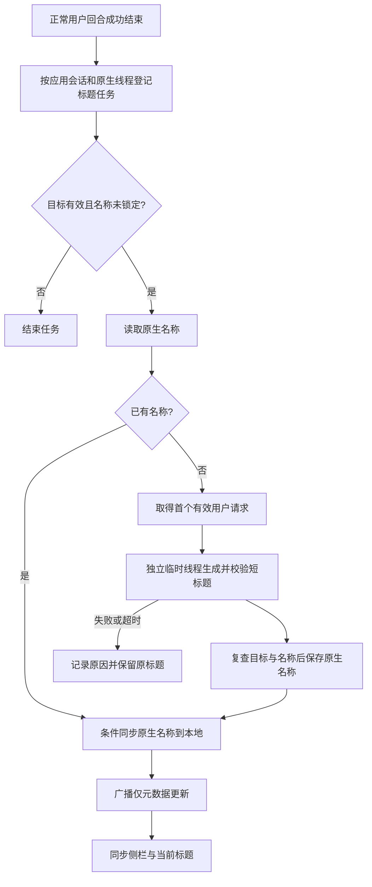

# Codex 会话标题

> 状态：已完成。真实账号驻留与临时工作进程、当前/后台/搜索会话浏览器场景、全量回归及独立代码和产品评审均通过
> 基准：2.16.0 / 2026-10-30；源码核对点 `codex-title-slice1` 工作树，仓库依赖 `@openai/codex` 0.166.0（升级时标题探针复测通过），文中上游源码引用仍为 `rust-v0.163.0` 标签

## 目标与范围

用户发起“我发现最近的版本很容易出现这种重复文字的情况……”的 Codex 会话后，CloudCLI 先用首句显示标题。正常回复结束后，后台生成例如“排查多引擎重复消息”的短标题，侧栏、聊天顶部和浏览器标题一起更新。这个示例说明预期含义，不要求模型逐字生成指定文案。

本方案实现 Codex 的自动命名。会话名称从服务端同步到当前页面的通用路径已经在用，由 [OpenCode 会话标题](OpenCode会话标题.md) 交付，本方案直接复用。Claude、ZCode、Antigravity 继续使用各自引擎提供的标题；OpenCode 的标题由引擎自己生成，CloudCLI 只监听。Cursor 的自动命名不在本次实施范围。

标题用于辨认会话。标题生成不占用聊天运行状态，不延迟发送下一条消息，不增加聊天消息、后台任务卡片或未读提示。用户手动命名优先。

实施依赖[Codex 会话驻留](Codex会话驻留.md)的连接管理与线程路由；驻留已交付并默认开启。驻留管理模块提供 `borrowCodexAuxiliaryThread` 临时线程借用入口。标题任务必须使用这个入口，不能用会替换会话级回调的整会话借用入口。保持连接本身不生成标题，仍需一次独立的命名请求。

## 已核实的机制

截图对应的 Codex 线程为 `01a15400-e857-7f53-9188-346452d9ecac`。只读核对本机记录时，CloudCLI 的 `custom_name` 是首句截断，`name_locked` 未锁定。Codex 的 `threads.title` 是完整首句，`threads.name` 为空；`session_index.jsonl` 没有这个线程的名称。这个会话没有可供 CloudCLI 同步的智能标题。

下面列出源码能够确认的事实。其他引擎的情况属于源码核对，没有在本轮重新运行真实聊天。

| 对象 | 证据位置 | 当前行为 |
| --- | --- | --- |
| Claude | `server/modules/providers/list/claude/claude-session-synchronizer.provider.ts`，`extractSessionTitle` | 从会话文件读取 `custom-title`、`ai-title`；普通提示词只作占位标题 |
| ZCode | `server/modules/providers/list/zcode/zcode-session-synchronizer.provider.ts`，`deriveSessionName` | 读取引擎数据库标题，用 `title_source` 区分生成标题和原始首句 |
| Antigravity | `server/modules/providers/list/antigravity/antigravity-session-synchronizer.provider.ts`，`deriveSessionName` | 读取引擎维护的会话摘要标题 |
| Codex 索引 | `server/modules/providers/list/codex/codex-session-synchronizer.provider.ts`，`processSessionFile` | 读取 `session_index.jsonl` 的最新 `thread_name`；没有名称时保留已有占位标题 |
| Codex 运行 | `server/modules/providers/list/codex/codex-runtime.provider.ts`，`handleCodexSessionEvent` | 通过驻留管理模块借用常驻进程，经引擎队列提交用户回合；没有标题生成任务；不读取 `thread/start`、`thread/resume` 应答里的 `name`；已借出的辅助线程事件由管理模块单独路由；其余非主线程事件交给会话级处理器，只有已登记子代理的完成项会作为代理卡片进入聊天 |
| Codex 驻留管理 | `server/modules/providers/list/codex/codex-session-manager.ts`，`acquireCodexResidentSession` | `borrowCodexAuxiliaryThread` 创建 ephemeral 线程，不替换会话回调；线程创建完成后单独路由事件与请求，并计入活动判断。辅助句柄返回实际启动应答，不带 `close()`；创建等待期间计入活动。辅助通知或请求回调抛错只终止辅助处理，不关闭正式进程；RPC 使用明确允许列表，正式线程仅可读取或命名。启动 RPC 超时不取消引擎请求，管理模块通过携带来源标记的启动通知识别晚到线程，等并发启动全部结束后退订无人接管的线程 |
| 标题保护 | `server/modules/providers/shared/sessions/session-title-resolution.ts`，`resolveSessionTitle`；`server/modules/database/repositories/sessions.db.ts`，`applyEngineSessionName` | `name_locked` 保护用户命名；引擎名称可以替换未锁定的占位标题；`applyEngineSessionName` 只在未锁定时写名称，不核对 provider、原生线程映射与归档状态 |
| 页面同步 | `src/modules/project-workspace/hooks/useProjectsState.ts`，`handleEvent` | `session_upserted` 更新侧栏；同 id 的名称更新合并进当前会话 |
| 页面副作用 | 同上 | 普通 `session_upserted` 落到空闲的当前会话仍会触发历史刷新，后台会话仍会被标记需要关注；带 `metadataOnly` 的增量两者都不触发 |

Codex 引擎自己不生成名称。上游 `rust-v0.163.0` 里生成标题的是终端客户端：[`app/thread_title.rs`](https://github.com/openai/codex/blob/rust-v0.163.0/codex-rs/tui/src/app/thread_title.rs) 调用临时线程生成结构化标题，[`temporary_structured_request.rs`](https://github.com/openai/codex/blob/rust-v0.163.0/codex-rs/tui/src/temporary_structured_request.rs) 负责临时线程、工具隔离、超时和清理。这段客户端逻辑不会因为 CloudCLI 调用了 `thread/start` 就自动执行。

[官方 app-server 文档](https://developers.openai.com/codex/app-server) 提供 `thread/name/set` 和 `thread/name/updated`，并通过 `thread/read` 等接口返回 `thread.name`。`thread/name/updated` 只由 `thread/name/set` 的处理函数在写入成功后发出（[`thread_processor.rs`](https://github.com/openai/codex/blob/rust-v0.163.0/codex-rs/app-server/src/request_processors/thread_processor.rs)，`thread_set_name`），引擎没有别的路径发它。这一点和 OpenCode 不同：OpenCode 的服务端自己生成标题并推送更新事件，CloudCLI 只监听就能拿到名称；Codex 由 CloudCLI 驱动时，这个通知只会回显 CloudCLI 自己的改名。所以 CloudCLI 必须自己组织生成请求。`thread/name/updated` 可以当作自己那次 `thread/name/set` 已落盘的确认信号，不能当作标题来源。

`thread/name/set` 写 SQLite 的 `threads.name`，并向 `session_index.jsonl` 追加一条记录（[`update_thread_metadata.rs`](https://github.com/openai/codex/blob/rust-v0.163.0/codex-rs/thread-store/src/local/update_thread_metadata.rs) 调 `append_thread_name`，实现在 [`session_index.rs`](https://github.com/openai/codex/blob/rust-v0.163.0/codex-rs/rollout/src/session_index.rs)），不改聊天记录 JSONL。CloudCLI 的 Codex 同步器只监听 `~/.codex/sessions` 下的 `.jsonl`，`session_index.jsonl` 只在扫描时查表（`codex-session-synchronizer.provider.ts`，`getSessionWatchTarget`）。按源码推断，仅改名不会触发现有 watcher，名称要靠本方案主动广播才能即时到页面；这一条以第一片真实探针为准。

`thread/read` 返回的 `name` 只来自显式名称列（`thread_processor.rs`，`attach_thread_name`）。首句 `title` 不会被当成名称返回，所以"名称为空才生成"的判断成立。

终端的临时线程隔离配方全部在 `temporary_structured_request.rs`。`thread/start` 带 `ephemeral: true` 和 `threadSource` 标记 `thread_title`，沙箱只读（用户有自定义权限档时沿用该档）。`config` 覆盖关闭约三十个能力开关，含 `features.shell_tool`、`features.unified_exec`、`features.hooks`、`features.memories`、`features.multi_agent`、`features.plugins`、`features.view_image`、`features.image_generation`、`cloud.skills.enabled`、`skills.include_instructions`、`tools.update_plan.enabled`、`tools.experimental_request_user_input.enabled`，并把 `web_search` 设为 `disabled`。它先读引擎有效配置，再把每个 MCP 服务器显式禁用；读不到有效配置就失败。`dynamicTools`、`environments`、`runtimeWorkspaceRoots`、`selectedCapabilityRoots` 置空。启动后核对应答里的 `sandbox` 确实是只读，不是就失败。回合超时 30 秒，拒绝一切交互请求。引擎核心对 `thread_title` 标记只改推理强度覆盖与缓存行为，源码注释写明不改权限（[`session.rs`](https://github.com/openai/codex/blob/rust-v0.163.0/codex-rs/core/src/session/session.rs)，`title_request`）；隔离只能靠上述配置与沙箱，不能靠标记。

`ephemeral: true` 时，引擎核心跳过线程持久化和状态库写入（`session.rs` 的 `thread_persistence_fut` 与 `state_db_fut` 在 ephemeral 下直接返回空）。所以临时线程不产生 `~/.codex/sessions` 下的聊天记录文件，不进 SQLite；只要不对它调 `thread/name/set`，`session_index.jsonl` 也不会有它。Codex 自己的线程列表读的是线程存储，看不到它；CloudCLI 的同步器只扫聊天记录文件，不会把它捞成侧栏会话。终端生成完只对临时线程调 `thread/unsubscribe` 停止接收通知，不另做删除。以上是源码推断，第一片探针要确认"临时线程不入普通会话列表"。

终端起名的模型选择在 `thread_title.rs`：模型提供方是 `openai`、有 ChatGPT 账号、账号模型目录里有 `gpt-5.6-luna` 这三条都成立时，用 `gpt-5.6-luna` 并把推理强度压到 `low`；否则用当前聊天模型、不另设强度。提示词上限 960 字节，标题上限 36 个字符，续聊时取最近 8 条消息。本机账号目录里有 `gpt-5.6-luna`（目录描述"较老的快速高效模型"）和 `gpt-6-luna`（"快而便宜，适合简单任务"），两者都支持 `low` 档；模型按轮传，标题线程可以用与聊天不同的模型。本机目录另有隐藏的 `gpt-reserve` 配额分组，前端把它当作"只给 `gpt-5.6-luna` 的保留额度桶"处理（`src/modules/chat/utils/providerQuota.ts`）；起名用 `gpt-5.6-luna` 是否走这个单独的桶、是否不占主额度，要用真实账号的配额快照验证。

本轮用仓库包内 CLI 导出公开协议核对了这套参数。`modelProvider`、`cwd`、`sandbox`、`config`、`ephemeral`、`threadSource` 在公开 `ThreadStartParams` 里；`model`、`permissions`、`runtimeWorkspaceRoots`、`environments`、`dynamicTools`、`selectedCapabilityRoots` 不在公开导出里，要用 `--experimental` 导出并在握手声明 `experimentalApi` 后验证（`codex-app-server.client.ts` 的握手已支持这个声明，驻留的队列方法正在用）。`model`、`effort`、`outputSchema` 在公开 `TurnStartParams` 里，模型、推理强度和结构化输出按轮传。`thread/read`、`thread/name/set`、`thread/name/updated`、`Thread.name` 均在公开协议。导出协议没有发起模型请求；临时线程的真实生成、工具隔离和写名称副作用仍需在实施时实测。

```sh
node node_modules/@openai/codex/bin/codex.js app-server generate-ts --out /tmp/cloudcli-codex-title-protocol
```

重点核对导出目录的 `v2/ThreadStartParams.ts`、`v2/TurnStartParams.ts`、`v2/ThreadReadParams.ts`、`v2/ThreadSetNameParams.ts`、`v2/ThreadNameUpdatedNotification.ts`。实施不能照抄 Rust 请求后就假定公开接口接受。

## 第一片协议实测

`scripts/probe/codex-title-isolation.probe.ts` 使用仓库安装的 Codex，引擎数据写入临时 `CODEX_HOME`。默认模式连接本地可控模型；`--real` 模式复制本机认证和配置到临时目录，用真实账号运行。探针退出时删除临时认证和会话文件，脱敏结果保存在终端打印的 `<probeRoot>.json`。

```sh
npx tsx --tsconfig server/tsconfig.json scripts/probe/codex-title-isolation.probe.ts
npx tsx --tsconfig server/tsconfig.json scripts/probe/codex-title-isolation.probe.ts --real
```

本机真实账号的 `gpt-5.6-luna` 标题轮使用 `low`，返回了结构化标题“排查多引擎重复消息”。启动应答为 `readOnly`，线程标记 `ephemeral` 且 `path` 为空。临时线程没有出现在普通 `thread/list`，也没有生成包含线程 id 的聊天 JSONL；标题回合事件没有送到正式聊天回调。本地可控模型收到的标题请求 `tools` 是空数组，包含 shell 在内的工具没有进入标题请求；同进程持久线程启用 shell，后续请求仍带工具。回合隔离断言从发起标题轮开始观察；启动窗口的同线程通知另外记录，不能把启动通知算作标题回复。

探针对临时目录中的持久线程写入原生名称，`thread/read` 能读回名称。聊天 JSONL 的文件内容不变，针对该文件的 `fs.watch` 没收到事件。归还辅助借用后，正式线程仍能读取。探针还直接查询临时目录的 Codex SQLite，临时线程没有入库。本地可控模型模式让辅助请求保持未完成，正式线程同时提交短回复；中断辅助回合后，正式回合正常完成。这支持主动发送 `metadataOnly` 广播的方案；无需为仅改名抑制聊天文件事件。

真实探针分别发起标题请求和用于建立持久聊天文件的短请求。配额接口前后只返回 `codex` 桶，没有返回保留额度桶；具体读数以探针结果文件为准。快照是整数百分比，期间可能有其他会话消耗；不能将变化归因到标题轮，也不能证明存在可用的 `gpt-reserve` 桶或标题不计主额度。模型选择沿用终端规则，不能以免费作为理由。

真实账号的一次复跑在通知隔离断言处失败，输出 `true !== false`；该轮未保存具体通知方法，原因尚不能确认。探针分别记录启动窗口和标题回合的通知后，真实账号复跑通过。探针尚未覆盖真实账号并发中断、启动沙箱不符时的拒绝路径，以及正式线程保留 MCP、hooks 和宿主授权时的辅助线程隔离。权限核验通过借用接口的 `startResult` 完成。本地模式另以 1ms 的真实传输超时触发晚到启动，管理模块发出的退订得到 `unsubscribed` 应答，正式线程仍保持加载。退订后的临时线程仍可能出现在 `thread/loaded/list`；退订不等于立即卸载，探针不把退订冒充删除。

## 选择的方案

CloudCLI 在用户回合成功结束后，提交一个独立的 Codex 标题任务。任务通过会话驻留管理模块借用连接，沿用原会话的模型提供方认证，创建不落盘的独立临时线程，只返回短标题。生成成功后，通过原生接口保存到目标线程，再条件更新 CloudCLI 的会话名称，最后广播名称更新。

驻留管理模块负责进程生命期和通知路由，标题任务只持有自己的临时线程借用。聊天运行提交任务后独立结束。标题等待、失败或清理不延迟用户下一轮，也不关闭正式聊天的连接。

共享连接的前提是临时线程工具隔离和每轮授权已经真实验证。临时线程不得取得正式回合的宿主任务能力。没有可借用驻留进程时（关闭驻留或容量满后的短连接回合），管理模块提供受控的临时工作进程。该进程只创建 ephemeral 线程，不恢复正式聊天线程；原生名称通过元数据接口读写。标题执行器串行使用工作进程，任务结束后由管理模块关闭，代价是一次额外进程启动。工作进程不携带宿主任务专用凭证，并绑定原应用会话的活动与关闭检查；标题模块不维护第二份会话进程表。

| 候选 | 代价和适用条件 | 取舍 |
| --- | --- | --- |
| 驻留连接上用独立临时线程生成，保存原生名称 | 每个尚未命名的会话多一次小请求；复用进程，需要管理模块提供线程路由和隔离 | 本方案采用 |
| 管理模块控制的临时工作进程 | 没有驻留连接时增加一次进程启动；不恢复正式线程，不与用户下一轮争夺线程所有权 | 关闭驻留或短连接回退时采用；仍走同一管理模块和隔离配置 |
| 等待 Codex 自动生成，只补标题监听 | 没有新增模型请求；需要引擎或所接客户端本来就生成名称 | 引擎不生成名称，`thread/name/updated` 只回显 `thread/name/set`；CloudCLI 不发生成请求就永远没有名称，不能解决截图问题 |
| 在正式聊天里追加“生成标题”指令 | 名称任务进入用户上下文，可能产生可见回复、工具调用或额外回合 | 不采用 |
| CloudCLI 单独接模型 HTTP API | 需要另管认证、模型路由和返回协议，用户配置也可能与 Codex 不同 | 当前不值得建立第二套请求路径 |

以截图中的会话为例：下一次正常用户回合成功结束后，任务读取线程原生名称，确认仍为空，再从历史取得首个有效用户请求。临时线程生成短标题。任务确认目标仍然是原线程且用户没有手动命名，保存原生名称和本地名称。页面只合并名称，不刷新聊天内容。



## 触发、输入与任务生命周期

新会话在首个成功的正常用户回合结束后具备生成资格。失败、用户停止、只有工具结果的异步任务接续不触发。浏览器打开会话、拉取历史和文件扫描也不触发，避免只浏览记录就消耗模型额度。

旧会话在下一次成功的正常用户回合结束后检查同一资格。已归档、已删除、已被编辑分支替代、已有原生名称或用户锁定的会话不生成。通过 fork 创建的会话保留分支创建时的名称，初版不自动重命名分支；编辑重发产生的原生线程替换仍按原应用会话检查。启动时不批量扫描旧会话生成标题；因此部署后只打开截图中的旧会话，标题不会立刻变化，需要继续一次正常对话。

运行时已经通过 `thread/start` 或 `thread/resume` 拿到名称，且名称与本地一致时，直接跳过标题任务，不额外启动进程。名称为空或本地需要补同步时才进入任务服务。进入任务后仍重新读取名称，不能把回合开始时的快照当成提交时的事实。

新会话优先使用创建时的原始用户文本。旧会话通过已有的 Codex 历史读取路径取得最早的有效用户文本；分页按时间向前读取，找到文本即停止。过滤系统指令、工具输出和宿主包装，不把 AGENTS.md、环境描述或整个聊天记录交给命名请求。没有有效用户文本时跳过；仅有图片且没有任务文字的会话保留占位标题。

标题用用户语言概括任务，单行、非空、无 Markdown。对提示词和模型输出设置大小上限，按 Unicode 字符边界截取。输出要求与上游同类的短任务标题，展示上限采用 36 个 Unicode 字符。输出必须经过结构校验，不能将整段回复或解析失败的原文当标题。

标题模型跟上游终端的规则：登录方式是 ChatGPT OAuth、且账号模型目录里有 `gpt-5.6-luna` 时，标题轮用 `gpt-5.6-luna` 并把推理强度压到 `low`；任一条件不成立就退回会话实际运行的模型，强度按模型目录选受支持的低档，目录不能确认支持时省略强度。目录判断用 `codex-models.provider.ts` 缓存的 `model/list`，登录方式用 `codex-auth.provider.ts` 的现有读数（OAuth 算 ChatGPT 账号，API Key 不算）。选它的理由是与官方终端的选择规则一致；真实账号配额探针未能确认保留额度桶，不能承诺起名不占主额度（见“第一片协议实测”）。初版不开放模型配置项，规则固定；以后要改模型，再加明确的配置与可用性验证。

同一应用会话与原生线程只保留一个待执行或运行中的任务。标题执行器在服务进程内串行处理任务，排队不占用聊天运行表，不阻止用户继续对话。标题生成不递归提交标题任务，也不登记为用户的后台工作。

任务总等待有截止时间；初版采用 30 秒，覆盖借用初始化、临时线程启动、生成和名称提交。到期后只停止自己的临时回合，清理订阅并归还借用，不能关闭共享连接。兼容分支的专用进程由管理模块关闭。清理另设短期限，不能因为等待清理再次悬挂。所有 Promise 拒绝和清理错误都要记录。

失败后本次任务结束，不定时循环重试。下次成功的正常用户回合重新检查资格。进程重启后内存中的任务丢失，也按下次用户回合恢复。成功的原生名称充当已命名依据；本方案不增加持久任务队列，不承诺跨崩溃只调用一次模型。

临时线程需要关闭 shell、文件修改、外部工具、MCP、hooks、skills、记忆和子代理等任务能力，只开放结构化文本生成。配置照终端的隔离配方（见"已核实的机制"）：只读沙箱、`config` 覆盖关闭能力开关、读有效配置后逐个禁用 MCP 服务器、启动后核对应答里的沙箱。不能仅靠提示词要求模型不用工具，也不能靠 `thread_title` 标记。不能确认隔离配置或实际权限时，任务失败并保留原标题。临时线程不得落成普通侧栏会话，也不得继承 CloudCLI 宿主任务专用凭证。

## 名称保存与竞争处理

Codex 原生名称使用 `thread/read` 和 `thread/name/set` 读写，不直接写 `state_*.sqlite`，也不由 CloudCLI 手工拼接 `session_index.jsonl`。名称已存在时只同步，不重新生成。这样，原生保存成功、本地保存失败的情况，可以在下一次资格检查中补齐本地数据，而不再调用模型。

本地自动写入必须是名称专用的条件更新。已有 `sessionsDb.updateSessionCustomName` 不检查锁；`applyEngineSessionName` 只检查锁。两者都不核对 provider、原生线程映射和归档状态，不能直接用来落自动标题。数据库更新同时要求应用会话、provider、原生线程映射仍匹配，名称未锁定且会话未归档。条件不成立时放弃结果，不创建会话、不解除归档、不改会话活跃时间和项目归属。

生成前、写原生名称前、写本地名称时都检查目标。用户在等待期间手动改名，本地的 `name_locked` 必须使自动结果失效。用户编辑早期消息导致同一个应用会话换到另一个原生线程时，旧任务只能丢弃，不能把旧主题写到新线程。

`thread/name/set` 和 CloudCLI 数据库不属于同一事务。原生提交结果不明时，先重新读取名称；确认已保存才继续同步，不能立即重新生成。如果原生提交后用户在 CloudCLI 手动改名，本地仍保留用户名称；这次任务可能留下不同的原生名称，与当前仅在本地保存手动改名的边界一致。

另一 Codex 客户端可能在最后一次读取与 `thread/name/set` 之间改名。当前原生接口没有条件写参数，无法保证这两个请求之间的跨客户端原子性。实施需要二次读取以缩小窗口，并如实保留这个限制；CloudCLI 自己的用户命名始终由数据库条件更新保护。

同步器仍负责已有 `thread_name` 的正常同步。按源码，`thread/name/set` 只写 SQLite 与 `session_index.jsonl`，不碰被监听的聊天 JSONL，所以仅改名不会触发现有 watcher。名称要靠自动标题提交后主动广播才能即时到页面，不能依赖文件监听。另一个 Codex 客户端改的名，CloudCLI 要等该会话的聊天 JSONL 下次变化、同步器重新查表时才会看到。隔离协议探针已确认仅改名不会修改聊天文件。

## 页面更新

`broadcastSessionUpserted` 是唯一的事件构造路径，`SessionUpsertedEvent` 带可选的 `metadataOnly` 标记。标题任务发送 true；缺省保持原有含义。字段在共享协议定义，前端复用共享类型。

前端收到仅元数据更新时，合并侧栏名称和当前会话名称，既支持应用 id，也支持 provider id 归并。当前会话 id 没变时不重新导航。标题相同则保留原对象，避免重复更新。

仅元数据更新不触发历史重新读取、不标记后台会话需要关注，也不改变消息数、活跃时间和会话排序。当前会话名称更新需要保留 provider、项目和工作树信息，并沿用手动改名对一次性搜索定位信息的处理，防止标题变化把聊天滚回先前搜索命中的位置。

`WorkspaceTitle` 和浏览器标题继续从当前会话状态派生，不增加第二套标题缓存。浏览器标题由常驻的 `useProjectsState` 更新，条件显示的项目列表不负责标题副作用。共享标题工具保留同会话的 `[Done]` 完成标记，切换会话时清理上一会话的通知。这个同步修复适用于所有引擎的同 id 名称更新；其他引擎的普通会话文件更新仍保留原有历史刷新行为。

这套机制是 OpenCode 自动标题正在用的路径（见 [OpenCode 会话标题](OpenCode会话标题.md)），Codex 侧直接复用。现行约束：仅元数据更新要换掉当前会话的对象才能带上新名字，重读消息的副作用因此只能挂在会话 id 上（`useChatSessionState` 的刷新 effect 若依赖 `selectedSession` 对象，标题到达会被当成「对话变了」而重读一遍）。

## 实施切片与涉及文件

正式代码在独立工作树实施。每一片先写能复现对应缺口的失败测试，再写实现。表中的新文件名表示职责落点；如果探针证明接口或范围需要变化，先回写本方案。

| 切片 | 涉及位置 | 完成依据 |
| --- | --- | --- |
| 驻留借用入口与真实协议验证 | `codex-session-manager.ts` 新增临时线程借用入口：不替换会话级回调、不暴露 `close()`、借用计入空闲回收与归档的活动判断、该线程的事件与请求只交给借用者；`--experimental` 协议导出；一次性探针 | 独立临时线程生成短标题；证明工具关闭（含 shell）、临时线程不入普通会话列表、原生名称保存后可读、改名是否触发 watcher；标题中断不影响正式聊天；失败时不改生产配置 |
| 标题生成客户端 | 新增 `server/modules/providers/list/codex/codex-thread-title.ts`；复用驻留管理模块与 `codex-app-server.client.ts` | 借用归还、通知按 thread/turn 隔离、结构化输出、超时、取消和清理有测试；不复制 JSON-RPC 传输或会话进程表 |
| 任务与条件落库 | 新增 `server/modules/providers/services/codex-session-title.service.ts`；`codex-runtime.provider.ts`；`server/modules/database/repositories/sessions.db.ts`；读 `codex-models.provider.ts` 的目录缓存与 `codex-auth.provider.ts` 的登录方式选标题模型 | 只在符合条件的成功用户回合提交；标题模型按规则选定并有回退；去重、旧线程失效、手动改名保护和半完成恢复成立 |
| 元数据广播与页面同步接线 | 标题服务调用 `server/modules/websocket/services/session-upsert-broadcast.service.ts` 的 `metadataOnly` 路径；探针证明有必要时包含 `sessions-watcher.service.ts` 与 Codex 同步器 | 同时更新侧栏、顶部和浏览器标题；无历史刷新、未读提示、重复导航或搜索回跳；改名与新消息相邻时不漏历史变化 |
| 同机制回归与文档 | providers/database/websocket/project-workspace 的对应 tests；`docs/requirements/Codex会话标题.md`；`docs/core/providers.md`、`docs/core/chat.md`、`docs/core/frontend.md` | 逐场景留下实测结果；活文档只写交付时已成立的机制 |

标题任务限定在 providers 模块内。跨模块存储和广播只经 database、websocket 的 barrel 调用。需要共享的类型复用共享定义，不为这一个 Codex 功能增加所有引擎都要实现的新切面。

## 验收与交付边界

| 场景 | 必须观察到的结果 | 验证方式 |
| --- | --- | --- |
| 新 Codex 会话正常完成 | 首句占位最终成为概括标题；原生名称与本地名称一致 | 可控 app-server 测试和隔离真实 Codex 探针 |
| ChatGPT 账号且目录含 `gpt-5.6-luna` | 标题轮用 `gpt-5.6-luna` + `low`；聊天回合的模型和强度不受影响 | 真实协议探针核对标题轮参数；runtime 测试 |
| API Key 登录，或目录无 `gpt-5.6-luna` | 退回会话模型；不报失败、不改聊天 | 登录方式与模型目录 fixture |
| `gpt-reserve` 保留额度桶 | 起名走 `gpt-5.6-luna` 后，配额快照显示它是否走保留桶、是否不占主额度；不成立就如实记录标题计入主额度 | 真实账号配额快照前后对比 |
| 截图同类的既有会话 | 打开页面不发生成请求；下一次正常对话后补标题；有名称后不重复生成 | 历史 fixture 与任务服务测试 |
| 同会话重复完成、多标签页 | 同一目标最多一个标题任务；页面不多出会话或聊天回合 | 调度与页面事件集成测试 |
| 生成期间手动改名、删除、归档或编辑重发 | 自动结果不覆盖用户名称、不复活会话、不写到新原生线程 | 真实数据库条件写与可控时序测试 |
| 已有原生名称、已命名分支 | 保留既有名称，只补本地同步；不另发模型请求 | 原生读取与分支 fixture |
| 无原生名称的分支 | 初版保留创建分支时已有的本地标题，不自动重命名分支 | fork fixture；明确排除分支任务 |
| 用户停止、回合失败、工具结果接续 | 不提交标题任务，不改变聊天终态 | Codex runtime 测试 |
| 模型超时、权限隔离失败、返回坏 JSON | 保留原标题；记录具体阶段和原因；临时线程与借用释放，正式聊天继续可用；兼容分支专用进程退出 | 故障注入与真实隔离负例 |
| 原生保存成功、本地保存或广播失败 | 下次检查读取已保存名称；重连读取本地结果；不凭失败立即重生成 | 部分失败测试 |
| 临时线程的输出与退出 | 不进入正式聊天、token 使用快照、任务条或侧栏 | 双线程通知隔离测试和真实协议探针 |
| 标题生成期间用户继续对话、停止标题或回收空闲进程 | 用户回合正常进行；标题停止不关正式连接；仍被标题借用的进程不被空闲回收 | manager 集成测试与真实并发探针 |
| 当前会话、后台会话与搜索打开的会话 | 标题同步；不刷新历史、不打未读、不回跳、不改变排序 | project-workspace hook 集成测试与浏览器验收 |
| Claude、ZCode、Antigravity 的名称更新 | 同 id 当前标题可同步；普通文件变化仍能刷新历史 | 通用事件回归；真实聊天是否复跑单独注明 |

日志只记录应用会话 id、原生线程 id、执行阶段和脱敏错误，不记录原始提示词、认证信息或完整模型返回。标题任务失败不发正式聊天错误帧，也不修改已完成回合的成功状态。

实现先跑对应模块的定向测试，再运行类型检查、lint 和构建；前端状态路径改变时运行前端测试。产品代码覆盖率按项目的 80% 要求实测，不能把已有通过测试当成新生成路径的验收。真实生成或隔离验证因环境受限没跑通时，交付明确写未验收。

实现完成后进行独立代码审查与独立产品评审。产品评审重点核对额外请求成本、旧会话的触发方式、用户命名优先、生成失败和页面跳动。文档提交本身不代表实现完成或上线；部署和 PM2 重启由用户执行。

生成入口集中保留开关，默认开启；关闭后不提交新任务，尚未写名称的任务停止提交结果，已有名称继续正常展示。配置按现有应用配置机制接入，实施时同步配置说明。回退代码不清空已保存名称，不批量恢复首句，也不恢复或取消归档会话。

## 完整服务验证入口

`scripts/probe/codex-title-service.probe.ts` 调用正式标题服务，使用临时应用数据库和 Codex 数据目录。默认连接可控模型；`--real` 复制本机认证并发起短请求，实际消耗账号额度；`--worker` 在聊天结束后关闭正式进程，再验证临时工作进程。结果写在临时目录同名的 JSON 文件，认证与会话文件在退出时删除。

```sh
npx tsx --tsconfig server/tsconfig.json scripts/probe/codex-title-service.probe.ts
npx tsx --tsconfig server/tsconfig.json scripts/probe/codex-title-service.probe.ts --worker
npx tsx --tsconfig server/tsconfig.json scripts/probe/codex-title-service.probe.ts --real
npx tsx --tsconfig server/tsconfig.json scripts/probe/codex-title-service.probe.ts --real --worker
```

探针检查原生名称与本地名称一致、仅元数据广播、聊天文件内容不变和没有额外持久线程。可控模型模式另检查工具列表为空、项目说明哨兵未进入请求。配额快照只用于观察接口返回，不能单独归因到标题请求。

浏览器探针 `scripts/probe/codex-title-browser.probe.mjs` 使用真实前端与 Chromium，HTTP 和 WebSocket 使用隔离夹具，不连接生产后端。先在该工作树启动 Vite，设置 `TITLE_PROBE_URL`；Playwright 不在当前依赖目录时，用 `PLAYWRIGHT_MODULE_PATH` 指向已经安装的入口。默认模式验证当前和后台会话，`--search` 验证搜索打开后改名；结果与截图保存在终端打印的临时目录。虚拟列表锚点允许 Chromium 的一个 CSS 像素取整差异，不允许滚回搜索目标。完整验收记录见 [验收快照](../archive/Codex会话标题验收_2026-10-21.md)。
