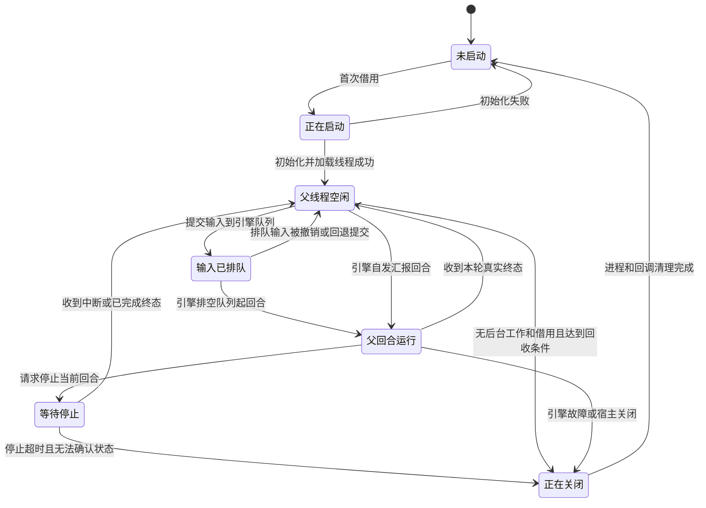

# Codex 会话驻留

> 状态：驻留默认开启；会话活动带出"在等引擎"这一档，页面区分等待与干活；真实后台汇报与辅助线程隔离仍待真实账号验收，产品评审已提出容量回退、停止确认与排队消息可见性的后续项
> 基准：2.16.0 / 2026-10-30；仓库依赖 `@openai/codex` 0.166.0，升级时线程队列与打断扣队列语义经探针复测一致；文中上游源码引用仍为 `rust-v0.163.0` 标签

## 目标与实施顺序

用户让 Codex 启动一个子代理，父回合先结束。子代理继续运行时，CloudCLI 保留所属 app-server 进程并接收后续事件。用户随后发送新消息，CloudCLI 在同一个进程、同一个原生线程上开始下一轮。每轮仍独立结束，页面不会因为进程还活着就一直显示正在回复。

本方案先解决进程被每轮结束清理的问题，再接入[Codex 会话标题](Codex会话标题.md)。会话标题使用独立临时线程，满足隔离条件时借用驻留连接。普通聊天、后台子代理、异步任务结果接续和辅助线程使用同一个连接管理入口，不能各保留一份会话进程表。

本方案只实现 Codex 的驻留管理，不把 Claude、ZCode 改成同一种协议。传输重放和消息判重沿用公共网关，并与[聊天事件重放](聊天事件重放.md)的事件身份规则一致；进程常驻本身不解决重复消息。

独立用户回合是本方案的交付条件。前置验证的结论是：包内版本不能用 `turn/start` 达成——活跃回合上的第二次 `turn/start` 不新建回合，而是把输入并入正在跑的那一回合。可用的隔离手段是引擎的线程队列（`thread/queue/add` 与 `thread/queue/start`，两者都是 experimental 方法）：引擎忙时明确拒绝启动，闲时把队列排空成独立回合。提交路径因此改为写入队列、由引擎起回合，宿主不再直接 `turn/start`。队列方法不可用时回退到 `turn/start`，并按“输入被并入已有回合”处理：输入不退回可重发队列，不绑定新回合授权，记录竞争。

## 依据与尚未验证的部分

`codex-runtime.provider.ts` 的 `queryCodex` 在每轮 `finally` 调用 `connection.close()`。`codex-app-server.client.ts` 的 `close` 会关闭读取器并终止子进程。`abortCodexSession` 发出中断请求后，也会通过短计时器关闭连接。`settleOutstandingAgents` 和 `codex-background-work.ts` 据此把回合结束时仍在登记的子代理收为停止。

这条生命周期是 CloudCLI 的实现选择。[官方 app-server 文档](https://developers.openai.com/codex/app-server) 将连接初始化、线程和回合分开：同一连接可以对已加载线程发起后续 `turn/start`，通过 `turn/interrupt` 中断当前回合，通过线程 id 区分辅助线程。

本机用仓库包内版本做过隔离实测。探针使用临时 `CODEX_HOME`、临时工作目录和独立线程，只复制登录所需的认证文件，结束后删除临时数据。模型采用接口返回的默认模型，工具关闭。没有操作生产聊天或重启生产服务。

前置验证的可复跑探针是 `scripts/probe/codex-turn-race.probe.mjs`：驱动包内真实 app-server，上游指向本地假模型端点，临时 `HOME` 与 `CODEX_HOME`，不碰真实账号与生产聊天。它既发请求也读上游收到的请求体，因此能判断输入是否真的被并入正在跑的回合；上游由本地 HTTP 服务模拟并可保持请求未完成，用来把回合停在进行中。上游 0.163.0 源码（标签 `rust-v0.163.0`）与包内协议导出一致：`codex-rs/app-server/src/request_processors/turn_processor.rs` 里 `turn/start` 走 `start_or_steer_turn`，新建和并入都返回 `status: InProgress`，响应里没有区分两者的字段；`codex-rs/core/src/session/turn_input.rs` 里的 `start_if_idle` 才是原子空闲判定，忙时返回 `NotIdle`；`codex-rs/ext/queue/src/service.rs` 的队列扩展在 `on_thread_idle` 时排空队列，每条排队输入单独起一个回合。

| 实测操作 | 观察结果 | 能说明什么 |
| --- | --- | --- |
| 首轮保存随机标记，次轮询问标记 | 同一进程返回正确标记；中间没有 `thread/resume` | 进程可以跨正常回合存活，线程上下文保留 |
| `turn/start` 返回后立即中断 | 首次探针返回 `-32600` | 存在需要处理的启动窗口；首次输出没有保留完整错误正文，不能断言错误的唯一原因 |
| 等到 `turn/started` 后中断，再发送新一轮 | 收到 `interrupted`，进程不退出，下一轮正常完成 | 中断回合不要求关闭进程；启动和停止的顺序必须显式管理 |
| 回合结束后读写原生名称 | 名称保存成功，进程仍为同一个 | 空闲连接可以承担元数据操作 |
| 在原连接创建另一个临时线程 | 返回独立线程 id，临时标记为真 | 连接能承载辅助线程；这不等于辅助线程的工具隔离已验收 |
| 受控 MCP 发起反向表单请求 | `never` 模式直接返回 decline，宿主未收到请求；`on-request` 下可往返 | 反向表单不能承担覆盖全部权限模式的内部授权桥 |
| `never` 下在同一个 MCP 进程跨轮调用只读工具 | 每轮的线程、回合与调用 id 都能和宿主收到的原生事件精确对上 | 原生元数据可以定位实际调用；真实任务登记和新桥接鉴权尚未验收 |
| 首轮运行中再次向同一线程发送 `turn/start` | 两次应答返回相同的原生 turn id，状态均为 `inProgress` | 第二次请求不保证创建独立回合；仅凭请求成功不能释放排队消息或新建回合授权 |
| 活跃回合上再次 `turn/start` | 模型第二次请求同时含两条文本，只有一条 `turn/started` | 输入被并入正在跑的回合；`features.steer = false` 不改变该行为 |
| `turn/steer` 带正确的 `expectedTurnId` | 返回当前 turn id，输入同样被并入 | 并入语义与 `turn/start` 相同；`expectedTurnId` 不匹配时报 `expected active turn id ... but found ...` |
| `thread/queue/add` 后在忙时 `thread/queue/start` | `-32600 thread already has an active or pending turn`；`thread/queue/list` 里输入仍在 | 引擎侧原子拒绝，输入既不丢失也不并入 |
| `thread/queue/add` 后等回合结束 | 引擎自行排空队列，`turn/started` 给出新的 turn id，上游收到排队文本 | 用户输入成为独立回合，这是交付条件要的行为 |
| `thread/settings/update` 后再排队 | 上游请求的 `model` 与 `reasoning.effort` 变成新值 | 排队回合能用上本轮的模型与推理强度 |
| 队列方法不带 `experimentalApi` 能力 | `-32600 thread/queue/add requires experimentalApi capability` | 驻留连接必须声明该能力；引擎不支持时提交要能回退 |
| 驻留进程组资源 | 一个 app-server 进程组约 158 MB RSS（node 启动器、codex 二进制与 git 子进程） | 驻留容量上限按进程数算，不能只按会话数 |

Claude、ZCode 的对比经过源码和固定生产目录核对。Claude 在后台工作及汇报回复需要进程时保持输入流，下一轮可交给原进程；没有后台工作时仍会退出。ZCode 使用常驻协议客户端，回合结束清理运行记录，停止使用 `session/stop`。本轮没有重跑这两家真实聊天。

后台子代理跨父回合存活、后台自行汇报、模型与权限跨轮切换、MCP 实际任务授权和辅助线程隔离尚未完成真实验收。实施时必须验证这些事实，不能把同进程普通对话通过当作全部能力通过。空闲回收时长定为 10 分钟，驻留容量定为 4 个会话（实测每个 app-server 进程组约 158 MB RSS），两者都能用 `CLOUDCLI_CODEX_RESIDENT_IDLE_MS` 与 `CLOUDCLI_CODEX_RESIDENT_MAX` 覆盖。

## 选型与归属

采用“每个应用会话一个受管理的驻留进程”。应用会话是 CloudCLI 对外使用的稳定 id；原生线程是 Codex 实际执行聊天的 thread id。管理记录还绑定可信用户身份和进程代次。原生线程因编辑重发而替换，或用户身份、启动配置不兼容时，旧记录不能直接复用。

| 候选 | 代价与适用条件 | 决定 |
| --- | --- | --- |
| 按应用会话驻留 | 多个活跃会话会占用多个进程；事件、权限和故障主要限制在所属会话内 | 采用，配套空闲回收和数量上限 |
| 全部 Codex 会话共用一个进程 | 进程数较少；需要同时隔离多用户、多套启动环境和任务授权，一个崩溃影响多个会话 | 初版不采用，不能仅凭 ZCode 的实现方式照搬 |
| 有后台工作才驻留 | 普通聊天仍反复启动；结束和新任务登记的交界仍需完整事件管理 | 不作为最终交付范围 |
| 仅删除每轮的 `close` | 没有新管理归属；旧 writer、取消状态和任务凭证仍绑定旧回合 | 不能交付 |

`codex-session-manager.ts` 是驻留归属模块。它管理进程创建、共享初始化、原生线程、事件路由、空闲回收、停止和销毁。调用方通过整会话借用与回合提交入口使用连接；借出的会话对象带完整连接句柄（含 `close()`）。临时线程借用入口与不含 `close()` 的受限句柄归 [Codex 会话标题](Codex会话标题.md) 第一片实现。

`codex-runtime.provider.ts` 负责准备本轮输入、沿用现有消息归一化，并把本轮交给管理模块。消息行转换仍只有 `codex-thread-items.ts` 一份。`codex-app-server.client.ts` 只负责 JSON-RPC 传输、请求关联、进程退出和受控关闭，不承担会话业务。模型目录、配额和脱离聊天的沙箱命令保持各自短连接，不占用聊天驻留记录。

管理记录绑定进程代次，每轮绑定自己的回合身份。旧进程退出、旧定时器触发或旧事件迟到时，只能清理自己的记录。任何清理都不能仅凭应用会话 id 删除新进程或结束新一轮。

图中的 Idle 只表示父线程没有前台回合。排队中的输入是已提交但还没起回合的状态，宿主要能区分它和空闲。子代理、后台回报和临时线程另外登记；存在这些工作时不能按空闲进程回收。进程存活、父回合运行、后台工作存在分别判断，不能合并为一个 `isRunning`。

## 回合执行与事件路由

首次运行时，管理模块创建连接、握手并 `thread/start` 或 `thread/resume`。初始化失败统一销毁连接并撤销凭证；会话在初始化中关闭后，迟到应答不能重新登记。初始化 Promise 由同一条驻留记录持有，并发借用共享它。下一轮沿用已加载线程，不重新执行连接握手和历史恢复。

提交一轮分两步。先用 `thread/settings/update` 把本轮校验过的模型、推理强度、工作目录、沙箱与审批策略写到线程上；0.163.0 里 `turn/start` 的这些覆盖项本身就是“本轮及后续回合”生效，与线程设置同义。再用 `thread/queue/add` 提交输入，带宿主生成的 `clientUserMessageId`。队列是引擎的准入闸门：线程忙时输入留在队列里，线程空闲时引擎自己把队列排空并为每条输入起独立回合。宿主不再直接 `turn/start`，也就不会把输入并进引擎自发回合。

每轮保留独立的 writer、原生 turn id、权限上下文、终态等待和取消意图。原生 id 只来自 `turn/started`：排空发生在该通知之前，队列项的删除发生在之后，两者之间有窗口。宿主按队列项是否已被消费判定这一回合属于自己还是引擎自发汇报；判定未落定前，该回合的事件按目标线程暂存，确认身份后按顺序处理。两种判定互相冲突时结束为状态不明，不能把两轮揉成一轮。

引擎不支持队列方法时（方法不存在，或要求 `experimentalApi` 能力而连接未声明），提交回退到 `turn/start`。回退路径下活跃回合会吸收输入，宿主按“已接受到已有回合”处理：输入不退回可重发队列，不伪装成独立新回合，不把新请求的能力令牌绑定到已有回合，记录竞争并阻止该会话继续自动提交队列消息。

事件先按进程代次与 thread id 找归属，再按 turn id 找回合。旧回合的终态只兑现旧回合的等待，不能结束当前回合。子代理事件按已登记的父子关系进入代理活动，不能参与父回合完成判定。临时标题线程的内容、用量和失败只交给自己的调用方。

缺少 turn id 的通知按协议语义处理：线程名称、用量等线程级通知走专门分支；已知工具项可通过所属记录定位；无法确认归属的错误或审批不得绑定到“最近的一轮”。记录脱敏原因，需要时重新读取线程状态，不能猜测执行者。

普通聊天的主回合 `complete` 只释放本轮的网关占用和临时权限，不关闭会话进程。进程驻留不延长已完成回合的 `isProcessing`。用户下一轮仍经过现有聊天网关的独占检查；前台回合未结束时沿用现有排队行为，不借这次改造加入回合内插话。

后台子代理跨轮存在时，下一轮复用同一进程，不把上一轮的代理记录清空。回合间的后台事件经当前会话的统一发布入口发送，不长期保留上一轮的闭包 writer。该入口归 `chatRunRegistry` 所有，继续执行应用 id 映射、统一序号、受众连接和重放记录，不允许 Codex 模块自己向浏览器编号发包。

现有 `ChatSessionWriter` 允许已完成回合继续发部分事件，但 `startRun` 会替换会话槽位和重放缓冲。旧 writer 继续使用旧的局部序号可能与新一轮冲突。因此需要为会话级后台事件提供稳定发布入口；序号从会话权威水位分配，回合终态仍按具体回合去重。公共事件身份以聊天事件重放方案为准，驻留进程代次不充当 `streamEpoch`。

网关将会话的受众、序号与有界重放存储从单轮记录中分开持有。新一轮更换运行记录，不更换会话事件通道；回合 writer 和后台发布共用这条通道。发布入口由网关注入运行时，Codex 管理模块不深层导入网关内部实现。没有前台运行时，后台事件仍可发布，但不能因此伪造 `isProcessing`；有界缓存和过期读取历史的规则继续成立。

若 Codex 在空闲父线程上自行启动汇报回合，管理模块根据真实 `turn/started` 登记引擎发起的网关运行。它与用户发送共用同一会话准入协调：引擎有自发回合在跑或有待触发的回合时，队列里的用户输入不会被启动，等真实终态后由引擎起成独立回合。不能凭“后台还有任务”伪造汇报回合。

宿主锁只能约束自己的调用，约束不了引擎内部启动：宿主判断线程空闲后准备提交，引擎恰好先启动后台汇报，而 `turn/started` 尚未到达宿主时，直接 `turn/start` 会拿到汇报的原生 turn id，输入被并进去。先读线程状态再提交存在同样窗口，延时提交只是把窗口变窄。真正闭合这个窗口的是引擎侧的原子准入：写队列的动作与排空时的空闲判定都在引擎内完成，宿主不需要猜线程此刻是否空闲。

`features.defer_mailbox_preemption = true` 只推迟 mailbox 抢占，不禁止引擎起汇报回合，不能拿它当隔离手段。

回退路径（引擎不支持队列方法）下，`turn/start` 返回已登记汇报或其他活动回合的 id 时，管理模块将该输入记录为“已接受到已有回合”。该输入不得退回可重发队列，不得伪装成独立新回合，也不得把新请求的能力令牌绑定到已有回合。保留已有回合的真实事件归属与终态，报告回合竞争，并阻止该会话继续自动提交队列消息，等待状态核对。请求超时或 id 冲突而无法确认接受情况时，记录为未知，禁止自动重发。以上处理只能防止重复提交和错误授权，不能算独立回合验收通过；不得以杀进程或中断汇报宣称输入已撤回。

原生工具结果不进入用户输入队列。`turn/start.toolOutput` 与直接用户输入共用 `start_or_steer_turn`，因此任务接续不能借用仍可自发汇报的驻留进程。管理模块先检查完整活动状态；活动时返回尚未提交的忙结果，任务派发器退回 pending。空闲时同步释放旧驻留记录，登记独占的一次性记录，再创建连接恢复原生线程。一次性记录从初始化到最终释放始终算活动，普通借用和资源淘汰不能抢走它。工具结果只在一次性记录上提交，真实终态或失败后按所属代次销毁。下一轮普通聊天仍恢复原生线程，但另开驻留进程。这条接续路径保留工具数据语义，不伪造用户提问，也不使用 `rootTurnId` 随机标记。

## 停止、故障与资源回收

停止请求先绑定目标回合，再发送 `turn/interrupt`。如果尚未收到可用的 `turn/started`，先记录取消意图，确认目标已经开始后再中断。重复点击停止共用同一次停止等待。启动窗口里的拒绝可以在确认同一回合状态后有界重试，不能转而停止后来开始的一轮。

还没起回合的排队输入没有回合身份，停止它用 `thread/queue/delete` 撤销队列项，且必须核对 `deleted` 为真。输入提交在途时先等待队列项身份；已消费且回合身份确定时中断该回合。删除拒绝、回合身份不明或提交等待到期时强制结束所属进程，运行状态保持不明，不把请求成功当作撤销成功。用户提示说明所属后台子代理同时停止，独立任务仍可能执行。

停止以真实终态或明确的强制退出结束。请求成功不等于终态已经到达；停止等待必须有期限。到期仍无法确认状态时，才关闭这个会话所属的进程，并将本轮标为中断或状态不明，明确记录强制退出。网关 `handleChatAbort` 的完成兜底只针对原运行，不能先释放发送再让新一轮进入尚在中断的线程。

父回合停止不预设所有子代理一定存活，也不预设 Codex 一定停止所有子代理。CloudCLI 按引擎真实事件更新卡片；进程被明确终止时，才统一收掉该进程代次下的未完成工作。父回合正常结束不再调用 `settleOutstandingAgents` 清空仍有生命的任务。

后台阶段的停止先取消已知子代理的实际活跃回合；不能验证原生独立停止能力时，整组停止才关闭该会话进程。界面只有在这种停止路径真实可用时声明可停止，不能出现按钮收到成功、引擎仍继续运行的情况。停止临时标题线程只处理该临时线程，不影响正式聊天。

进程崩溃时，管理模块拒绝该进程的待处理请求，结束受影响回合和审批，收掉后台快照，并撤销该代次的借用。下次明确的用户请求或已持久化的任务接续可以新建进程恢复原生线程。未知状态的旧输入不自动重发；驻留记录只存内存，不承担持久任务投递。

只有前台空闲、没有后台代理或汇报、没有审批、没有辅助借用时，进程才进入空闲计时。空闲期限到达后回收；真正的新活动重置期限，周期性状态检查不重置。达到驻留数量上限时先淘汰最久未使用的可回收记录。全部记录都在工作时明确返回容量不足，不杀活跃会话来接另一条消息。

浏览器断开或切换页面不回收进程。会话删除、归档、原生线程替换或所属用户身份失效时，先停止新的借用，再按操作语义结束或替换原进程。编辑重发必须等待旧目标隔离完成再绑定新线程。不能把“进程被替换”当作后台工作自然成功。

归档与删除需要覆盖手动和自动入口。`sessions.service.ts` 的 `deleteOrArchiveSessionById` 处理单会话操作；`sessions-auto-archive.service.ts` 的 `runAutoArchive` 经 `sessionsDb.archiveSessionsOlderThanCutoff` 直接批量归档，定时检查和手动触发自动归档共用这条路径。只给单会话入口接清理回调会遗漏批量归档。项目批量操作等间接入口也必须核对，不能只按路由名称排查。

自动归档跳过有前台回合、后台代理或汇报、审批、辅助借用，以及尚未处理完的已接受输入或接受状态未知输入的会话。判断活动状态不能只查 `isProcessing` 或数据库更新时间。没有驻留记录的会话沿用归档条件；只有空闲驻留进程的会话也可以自动归档。服务先关闭新运行与借用准入，再确认无活动；存在驻留记录时清理该代次，随后归档并广播移除。检查与归档之间的新用户发送、任务结果接续和引擎自发事件必须有确定归属；发现新活动则取消本次归档。原子准入机制属于生命周期切片的验收条件，不能仅传一份活动会话快照给批量 SQL 后直接更新。

手动归档和删除使用同一套活动检查与准入规则。有活动时返回明确冲突，提示先停止工作；`force` 只表示永久删除，不隐含停止后台任务。空闲时隔离旧代次并完成清理，再修改数据库或删除原生记录。失败时不广播操作成功，按真实清理结果恢复准入或报告故障。恢复归档会话只恢复会话可见性，不自动重建驻留进程。活动检查可以共享，自动归档按条件跳过，手动操作按条件报错，不复制两套状态判断。

宿主退出时先停止接收新运行和辅助任务，再通过统一关闭入口结束 Codex 驻留进程。关闭入口幂等、有总期限，等待中的 JSON-RPC 请求和审批必须兑现失败。`server/index.ts` 只装配该入口，业务清理留在 providers 模块。资源默认值、超时和日志标签在实现时集中配置，并同步对应说明。

## 模型、权限与宿主任务授权

下一轮的模型、推理强度、工作目录和沙箱按已经校验的本轮选项下发，写入 `thread/settings/update`；不能只修改本地选择器后继续使用旧配置。0.163.0 里 `turn/start` 的这些覆盖项本身就是“本轮及后续回合”生效，与线程设置同义，所以改走队列不会丢掉设置。协议里沙箱有两种形状：线程取模式字符串（`workspace-write` / `danger-full-access`），回合取按 `type` 标记的策略对象；把策略对象发给 `thread/start` 会被引擎静默忽略，权限模式和实际生效的就不一致了。不支持在线更改的启动设置进入兼容性判定，包括认证来源、模型提供方、MCP 配置和环境。配置不兼容时，空闲会话可以换进程；仍有后台工作的会话先报告阻塞条件，不能悄悄杀掉工作完成切换。

权限收紧尤其需要核对既有后台任务。旧代理保持原有授权快照，不能因为父线程下一轮改了权限就获得新权限。不能证明新回合已按要求收紧时，拒绝在旧进程继续发送。模型切换和权限切换分别测试，不把普通同模型连续对话视为验证。

宿主任务凭证是驻留的发布前置条件。当前 `task-run-context.service.ts` 为每轮发放能力，`chat-websocket.service.ts` 在运行结束时撤销；`task-continuations-mcp.ts` 从进程环境取得令牌并请求宿主 HTTP 接口。驻留后原进程的环境不会因下一轮到来自动变化，不能靠保留旧令牌或放宽令牌期限解决。

采用按实际工具调用定位本轮授权的内部桥接。包内 Codex 在 MCP `tools/call` 的 `_meta` 中提供原生调用身份。CloudCLI 的 MCP 读取这份协议元数据，经专用内部入口请求宿主执行任务操作。宿主用已经观测到的引擎调用核对元数据，定位网关批准的运行，再调用 task-continuations 的登记、查询和取消通知逻辑。用户、应用会话、目录与沙箱仍从可信运行快照取得，工具参数不能提供或覆盖这些身份。

元数据中的 `x-codex-turn-metadata` 提供原生 thread id 和 turn id；`callId` 对应 app-server `mcpToolCall` 项的 id。外层 `itemId` 是另一种标识，不能拿来代替这个调用 id。隔离探针确认了这组对应关系；上游 [`mcp_tool_call.rs`](https://github.com/openai/codex/blob/rust-v0.163.0/codex-rs/core/src/mcp_tool_call.rs) 的 `build_mcp_tool_call_request_meta` 提供元数据构造依据。实现必须校验实际字段和协议版本，不能把工具参数里同名的字符串当作可信身份。

连接启动时只给受控 MCP 一枚窄范围的桥接凭证，绑定可信用户、应用会话和进程代次，通过环境传入。凭证单独持有时没有登记、查询或取消任务的权限，必须同时命中宿主的实际调用记录。宿主只保留凭证摘要，进程销毁立即撤销；凭证不进入 shell、独立任务、模型上下文和日志。

运行时观测到受控 MCP 的原生调用后，按进程代次、线程、回合和调用 id 登记调用记录，保存工具名、参数摘要及当轮可信权限。MCP 回调必须逐项匹配这条记录。由于 HTTP 和 stdout 是不同的通道，回调先到时可以短暂等待同一调用的事件，超时就拒绝，不能改用“当前会话最新的一轮”。重复回调按这个原生调用身份幂等处理，不用可能在 MCP 重启后重复的 stdio 请求序号作为唯一键。

内部入口采用 `POST /api/tasks/mcp/invoke`，使用独立的窄凭证鉴权。启用全局 API Key 时，不能把该 Key 交给常驻 MCP，也不能让所有任务路由跳过全局鉴权。装配层只把这条精确路径及方法挂在通用 API Key 中间件前，入口自身必须完整验证桥接身份与调用记录，其他路径和方法保持原鉴权。路由仍只解析输入并调用服务，身份关联、权限与幂等在 task-continuations 模块内完成。

缺元数据、原运行已结束、参数与引擎调用不符、属于旧进程或属于辅助标题线程时，拒绝新的任务操作，不猜运行身份，也不改绑到下一轮。任务本身的副作用声明和 Codex 审批保持真实，桥接鉴权不能充当工具执行许可。HTTP 回调只返回操作结果，不返回 API Key 或每轮能力令牌。

宿主 HTTP 入口和内部桥共用任务操作与校验逻辑，保留功能开关、用户归属、沙箱检查和幂等规则。不能复制一份登记逻辑，也不能因为直接调用模块就绕过原先只写在路由里的必要校验。已结束父轮的子代理不会自动获得后来用户回合的任务登记权限；已登记任务的结果落盘与投递仍使用原有任务授权。

真实任务登记、并发调用、窄凭证鉴权、审批拒绝和旧回合拒绝必须在第一片与任务切片验证。若所用版本不能提供可靠元数据，就暂停开启宿主任务场景的驻留，回写替代方案；不能把延长旧令牌或每轮强制重启包装成已完成跨轮复用。反向表单路径不采用，因为 `never` 模式已实测不转发。`config/mcpServer/reload` 从磁盘重载配置，不保证换掉原进程环境里的令牌，也不能承担授权刷新。

已经登记的独立任务仍可在原回合结束后完成和落结果，按现有持久队列接续。它们的执行器不与聊天进程绑定寿命。结果接续与用户回合共用驻留管理和网关占用；不能为了保持进程而绕过接续状态、重复投递检测或沙箱约束。

## 后台状态与页面行为

后台代理登记移到会话级，正常父回合结束保留记录。真实完成、停止或所属进程丢失才移除。`listBackgroundWork`、输入框任务条、订阅快照和后台事件从同一份登记派生，避免侧栏说在跑而任务条已经消失。

同一进程能安全跨轮后，Codex 后台任务声明不阻塞新的正常发送。该能力通过现有 `backgroundTasks.queuesInput` 等运行时能力表达，前端不新增按引擎名称判断。后台审批能通过会话发布入口在重连后恢复，审批结果仍回到原生请求。

一轮从提交起就算在途：页面显示正在回复，回复在引擎起回合之后到达。用户自己发的消息仍由前端队列排队（会话忙时消息留在输入框），那条队列与引擎队列无关。引擎队列里的等待目前没有单独的页面状态，这是已知差距：网关分不清"这一轮已提交但引擎还没起回合"和"引擎正在跑这一轮"。

页面的“正在回复”只对应前台或真实汇报回合，后台工作由现有任务条表达。仅进程空闲驻留时不显示忙碌，也不在运行会话列表中冒充后台任务。没有活动句柄的后台工作不能声明可独立停止。

宿主后台事件继续走规范化、单调序号和重放。切换会话、多个标签页和浏览器重新订阅不能改变进程归属或抢走其他页面的受众连接。与聊天事件重放方案交叉的公共契约改动只保留一份实现与测试归属。

## 实施切片与改动范围

正式代码在独立工作树实施。每片先写真实调用位置能够触发的失败测试，再实现；整片通过后进入下一片。表中的新增文件表示职责落点，不要求复制现有通用函数。跨模块只走 barrel，共享契约放现有共享定义；日志、用户文案和配置同步登记。

| 切片 | 涉及文件或模块 | 进入下一片的依据 |
| --- | --- | --- |
| 协议与资源前置验证 | `scripts/probe/codex-turn-race.probe.mjs` | 已完成：确认活跃回合上的 `turn/start` 会吸收输入，确认队列提交能排成独立回合，确认排队回合能用上本轮设置，确认队列方法需要 `experimentalApi` 能力，测出进程组占用。后台代理跨轮存活、真实子代理汇报、MCP 实际任务授权与辅助线程隔离仍待真实验收，无法验证的能力明确阻塞对应交付 |
| 驻留管理与回合路由 | 新增 `server/modules/providers/list/codex/codex-session-manager.ts`；`codex-app-server.client.ts`；`codex-runtime.provider.ts` | 同一会话复用进程；并发初始化合并；旧代次与旧回合事件不影响新运行；回合完成释放占用；提交走 `thread/settings/update` 与 `thread/queue/add`，引擎排空后按队列项消费状态判定回合归属 |
| 网关发布与停止 | `server/modules/websocket/services/chat-run-registry.service.ts`、`chat-session-writer.service.ts`、`chat-websocket.service.ts`；`server/shared/types.ts`、`interfaces.ts` 及必要协议定义 | 后台事件跨轮仍有唯一序号和受众；停止在启动窗口、终态窗口和下一轮之间不串；引擎自发汇报有真实网关归属 |
| 后台与每轮授权 | `codex-background-work.ts`、`codex-runtime.provider.ts`；task-continuations 的 stdio MCP、内部调用路由、桥接调用登记、运行授权与任务操作逻辑；宿主入口的独立鉴权装配；运行时能力分发 | 子代理状态跨轮一致；窄凭证不能单独操作任务；旧回合不能借新回合授权；启用全局 API Key 时不依赖向 MCP 传 Key；宿主任务实际登记、审批和结果接续通过 |
| 回收与生命周期接线 | manager；providers barrel；`server/index.ts`；`sessions.service.ts`、`sessions-auto-archive.service.ts`、sessionsDb 批量归档接口及间接操作入口；线程替换入口 | 空闲及容量回收只作用于可回收记录；自动归档跳过活动会话，手动归档或删除拒绝活动会话；准入与归档竞争不产生孤立运行；宿主关闭不遗留进程；目标变化清理旧代次；异常不静默 |
| 前端与辅助线程接入 | 现有后台任务状态、订阅和 composer 能力消费者；标题模块按标题设计后续实施 | 不因驻留一直忙碌；新消息不杀后台工作；标题超时不关正式聊天；重复事件不重复应用 |
| 文档和完整交付 | 对应模块 tests；新增需求文档；`docs/core/overview.md`、`providers.md`、`chat.md`，必要时 `frontend.md` | 交付时同步现行机制；完成独立代码审查和独立产品评审；逐项列出真实与模拟验证 |

## 验收矩阵与回退

| 场景 | 必须观察到的结果 |
| --- | --- |
| 普通连续对话、空闲后继续 | 未回收前是同一进程和原生线程；上下文保留；每轮只有一个真实终态 |
| 父轮先结束、子代理稍后完成 | 不因父轮结束杀进程或伪造停止；代理真实结果可以到达页面 |
| 代理存活时发送新一轮 | 继续复用；旧代理事件不结束新一轮，也不覆盖新运行配置 |
| 后台汇报与用户发送竞争 | 汇报先开始时用户输入留在队列里，等真实终态后由引擎起成独立回合；用户先被接受时拥有独立回合；输入不被并入已有回合 |
| 队列方法不可用时的回退 | 提交回退到 `turn/start` 并记录能力受限；输入被已有回合吸收时按“已接受到已有回合”处理，不重发、不绑新授权 |
| 排队输入的归属判定 | 引擎排空后按队列项消费状态判定回合归属；判定未落定前事件暂存，冲突时结束为状态不明 |
| 重复原生 turn id、提交应答超时或身份冲突 | 已接受到已有回合或接受状态未知的输入不自动重发、不绑定新回合授权；保留真实归属并报告竞争或未知状态，不能作为独立回合验收通过 |
| 启动前停止、启动中停止、重复停止、刚结束时停止 | 停止只作用于指定回合；不因瞬时拒绝就报假成功；不杀后来运行 |
| 中断后继续、停止超时 | 正常中断保留可用进程；超时强退有原因和真实状态，下一轮可恢复 |
| 模型与权限切换 | 下一轮实际请求和沙箱生效；后台工作不被静默杀掉或增权 |
| 每轮 MCP 登记、并发调用、旧轮迟到调用 | 原生元数据与已观测调用精确对账；窄凭证单独使用、改参数、缺 turn id、旧轮、跨线程与跨会话请求均被拒绝；重复回调不重复登记 |
| 独立任务结束后接续 | 仍按持久回执投递，使用同一会话准入，不重复唤醒或重新执行任务 |
| 浏览器关闭、重连、多个标签页 | 后台进程继续；重新订阅得到同一会话的状态和缺失事件，不抢流、不重编号 |
| 空闲到期、容量已满、删除、归档、编辑换线程 | 只回收应回收的目标；旧回调不会清理新记录；工作被终止时不伪装完成 |
| 定时归档、手动触发自动归档、手动归档与永久删除 | 两条自动归档入口均跳过活动会话；手动操作对活动会话返回冲突；无驻留记录的会话沿用归档条件，空闲驻留先清理后归档或删除；失败不广播成功 |
| 归档与用户发送、任务接续或引擎自发汇报竞争 | 关闭准入后才做最终活动检查；归档前出现新活动则跳过，操作完成后不再接受旧代次事件或创建孤立运行；恢复会话不自动启动进程 |
| 进程崩溃、认证失效、宿主退出 | 请求和审批全部结束；资源释放；未知输入不自动重发；后续显式恢复有效 |
| 标题生成与聊天并发、标题超时 | 内容与用量隔离；辅助任务不占前台忙状态，不关闭正式连接 |
| Claude、ZCode 与短连接工具 | 原有发送、停止、后台工作和关闭流程不被公共网关改动破坏 |

定向测试覆盖 manager 的状态和代次、runtime 的真实调用路径、网关事件、任务授权及前端状态。真实 CLI 验收使用临时目录和独立线程，不能只靠脚本化假引擎。资源、启动延迟和覆盖率均以实施时实际命令输出为准，不在文档写死测量数字。

完整交付运行后端与前端测试、类型检查、lint 和构建，并实测产品代码覆盖率满足项目要求。检查失败保留失败输出，环境受限项目标为未验收。涉及的停止、排队与默认行为由独立产品评审核对，审查委托不预设结论。

驻留开关在完整验收后默认开启。关闭开关停止新增驻留，后续请求通过统一入口走短连接模式，并立即清理可回收的空闲记录。已经运行或有后台工作的记录先排空，不能因回退开关中途杀任务；同一会话在排空前不能另起一份进程。强制终止走明确停止操作。回退保留原生线程、聊天记录和已有任务结果，不清空数据库。

设计提交只交付实施依据。代码实现、真实后台能力验收、生产发布和部署分别报告；任何部署或 PM2 重启仍由用户执行。
