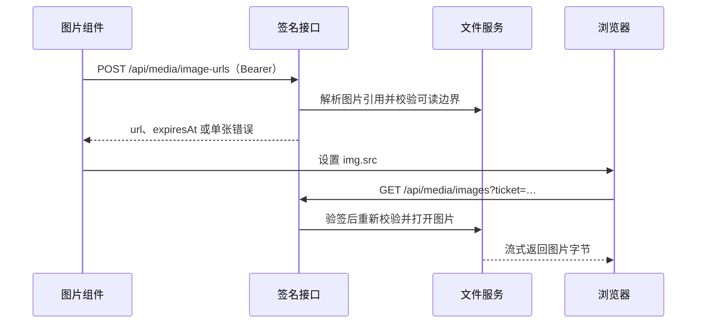

# 图片签名直连

> 状态：已实施，验证与独立审查完成
> 核对基准：2026-10-28，实施前源码

## 目标与范围

让浏览器通过 `` 直接读取已授权的图片，省去 `fetch → blob → Object URL` 中转，获得真正的图片懒加载和独立的 HTTP 缓存。

覆盖聊天附件、聊天 Markdown、编辑器 Markdown 预览（包括点击图片链接打开原图）及文件树图片查看器。普通外链仍交给浏览器；上传前本地预览、导出图片和保存/分享操作可按需使用 Blob。消息仍保存图片原始引用，不持久化签名 URL。

本次不做缩略图、不引入 Nginx、不改变登录方式，不部署或重启生产服务。

## 当前依据

- `src/shared/api.ts` 的鉴权请求统一使用 `cache: no-store`；缓存认证响应头曾导致旧令牌重放。
- 聊天附件、聊天 Markdown 和编辑器预览在组件挂载时请求完整图片，再创建 Blob URL；给最终 `` 加 `loading=lazy` 无法延迟前面的请求。
- `assets` 和 `file-tree` 已提供流式文件读取。外部文件服务执行目录白名单和项目工作树边界校验。
- 附件接口对 SVG 使用 `nosniff` 和下载响应头，防止作为同源文档打开时执行脚本。新入口必须覆盖该风险。

## 接口与调用链

申请接口接收 `images` 数组，每项带调用方 `id` 和一种来源：

| 来源 | 字段 | 读取规则 |
| --- | --- | --- |
| `asset` | `filename` | 全局附件目录内的文件 |
| `project` | `projectId`、`path` | 项目文件服务 |
| `external` | 可选 `projectId`、`path` | 外部白名单文件服务 |

兼容旧附件的全局资产到项目文件回退，以及聊天绝对路径到项目文件的现有回退。解析放在服务层，签名绑定最终确定的来源与路径。

单次最多 50 张；输入结构非法拒绝整批，单张不可读返回该项错误，其他项正常处理。签名申请响应使用 `Cache-Control: no-store`。

## 签名与安全边界

- 有效期 10 分钟；普通登录模式不超过申请时登录令牌的有效期。平台模式沿用现有用户来源。
- 复用 JWT 库，固定算法、issuer、audience 和专用用途 `image-read`。绑定用户、来源、项目、规范化路径、签发时间、过期时间与协议版本。
- 使用与登录令牌隔离的密钥，可从现有持久化 JWT 密钥按专用用途派生。登录鉴权不能接受图片票据，图片入口不能接受登录令牌。
- 图片入口单独注册，只接受专用票据；其他文件接口保持原有鉴权。现有可选 API key 和平台入口约束须检查调用链，不能因新增入口意外放开。
- 签发时和读取时都复用现有路径校验，包括 realpath、目录白名单、项目边界及符号链接检查。签名不替代文件边界校验。
- 每次读取检查用户仍存在，只允许既有可显示图片类型。验签及边界校验发生在文件传输和 `304` 判断之前。
- 设置正确的 `Content-Type`、`X-Content-Type-Options: nosniff`。SVG 必须具有限制主动内容的 CSP，包括独立打开 URL 的情况。
- 票据可读但不可篡改，不放密钥；日志不记录完整票据，远程使用应通过 HTTPS，图片元素使用 `referrerPolicy=no-referrer`。
- URL 是短期访问凭据，持有者可在有效期内读取对应图片。退出登录不主动撤销已签发票据，默认接受最长 10 分钟窗口；已下载或已显示图片无法收回。

## 缓存与内容变化

| 响应 | 缓存规则 |
| --- | --- |
| 不会原地修改的附件 | `private, max-age=N, must-revalidate`，N 不超过剩余有效期和 5 分钟 |
| 可修改的工作区图片 | `private, no-cache`，配合 ETag 再验证 |
| 错误 | `no-store` |

不能确认附件不可变时按可修改文件处理。缓存规则由签名图片入口设置，不能改变全部鉴权 API 的 `no-store`。图片响应不刷新登录令牌，不带 `X-Refreshed-Token`。内容更新后必须能取得新图片，不把可变文件标为 `immutable`。

## 前端加载与错误处理

- 共享 Hook 负责签名申请和生命周期，API 定义集中到 `src/shared/api.ts`。
- 图片接近视口才申请；查看器打开后立即申请。相邻请求批量发送，相同引用共享进行中的请求和有效结果。
- 在内存中以账号及规范化引用为键复用 URL；限制缓存容量，退出登录或切换账号时清空，并防止旧账号的异步结果回填。
- 结果只含 URL、有效期和错误，不保存图片字节。图片交给浏览器，通过 `loading=lazy`、`decoding=async` 加载。
- 尚未加载且票据接近过期时重新申请；已成功显示的图片不定时换地址，避免闪烁和重复下载。
- `` 加载失败不能直接判断 HTTP 状态；最多自动重新申请并重试一次，之后进入原有错误展示与手动重试。手动重试可重新开始一次尝试。
- 放大查看复用有效 URL，过期时可重新申请。保留现有复制路径、错误提示、下载及分享能力。
- IntersectionObserver 不可用时允许立即申请，保证功能可用。

## 实施步骤

1. 先落本设计文档及“文档先行”仓库规则。
2. 在媒体接口和共享图片加载入口这两个公共边界补失败测试，覆盖正常、过期、篡改和错误边界，再实现签名服务、路由和依赖装配。
3. 实现共享前端申请与加载能力，接入四类图片入口，保留导出及本地预览语义。
4. 同步 `docs/core/overview.md`、`docs/core/chat.md`、`docs/core/frontend.md` 中实际变化的机制；涉及后端公共契约时核对 `docs/core/providers.md` 的相关事实。
5. 完成回归、独立代码审查和产品评审；修复核实的问题，变基、验证后按工作树流程合入。

## 验证与验收

TDD 红绿灯只运行当前测试文件；实现完成后执行相关模块回归、前后端全量测试、类型检查、lint 和构建。独立审查提供 diff、本设计与真实验证结果。

- 申请接口需要登录；批量上限、输入结构与单张失败隔离符合约定。
- 篡改签名、用途、路径、项目、有效期，跨用途使用令牌均被拒绝；过期、缺失用户、目录穿越、符号链接越界和非图片文件有失败覆盖。
- 缓存命中及 `304` 不绕过校验；工作区图片覆盖后可更新；认证响应头不进入图片缓存。
- 未接近视口不申请；同图去重；切换账号、引用和卸载不回填过时结果；加载失败重试有上限。
- 放大、下载、分享、导出及旧附件路径正常；SVG 作为图片显示及直接打开时均不能执行脚本。
- 实际浏览器网络检查图片由 `` 直接加载，无本地图片 Blob 中转，懒加载和缓存生效。

## 代价与风险

首次显示比直接裸 URL 多一次轻量签名请求，以批量申请和内存复用降低成本。URL 更新会产生新的浏览器缓存键。签名泄漏带来单图限时读取能力，需避免日志泄漏。过期仅限制后续服务端请求，不撤回已经显示或缓存的字节。原图传输量和解码成本不因签名减少，缩略图属于后续任务。

## 参考

- [签名 URL 的访问与有效期语义](https://docs.aws.amazon.com/AmazonS3/latest/userguide/using-presigned-url.html)
- [HTTP 缓存指令](https://developer.mozilla.org/en-US/docs/Web/HTTP/Reference/Headers/Cache-Control)
