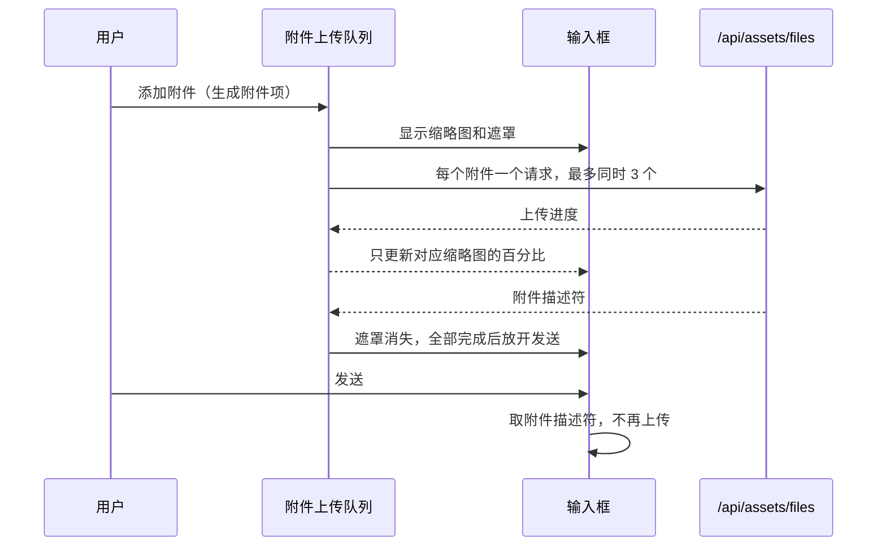
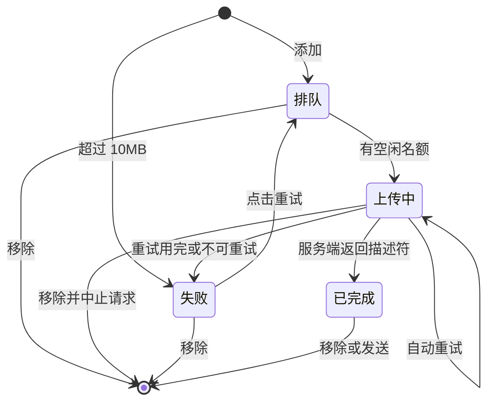

# 输入框附件即时上传

> 状态：待实施，方案待用户确认
> 基准：2.17.1 / 2026-11-07
> 执行模式：L2（改普通发送和排队发送的主链路，不改鉴权、不动数据、不改后端协议）

## 目标与范围

附件一加入输入框就开始上传，用户在缩略图上看到每个附件的进度。全部上传完成后才能发送。

验收标准：

1. 选择、拖入、粘贴附件后立即上传，不用等点击发送。
2. 上传中的缩略图和文件卡有遮罩，中间显示百分比；上传完成后遮罩消失。
3. 多个附件同时上传，互不影响；一个失败不拖累其他附件。
4. 存在未完成或失败的附件时，所有发送入口都不可用，包括按钮、Enter 和语音“停止并发送”。
5. 失败的附件可以单独重试或移除，文字和其他附件不受影响。
6. 上传失败不再往时间线写错误行。
7. 手机 4G 下通过 `code.hicimi.com` 发送多张截图，不再整批失败。

不做：

- 分片上传和断点续传。
- 发送前压缩图片。
- 清理用户移除或放弃的已上传文件。
- 刷新页面后恢复附件。附件现在也不跨刷新保留。
- 修改 `/api/assets/files` 接口。它已支持单文件请求。
- 修改定时消息。定时消息只发文字，不带附件。

## 为什么要做

### 现状

- 上传发生在点击发送之后。`useChatComposerState.ts` 的 `handleSubmit` 先清空输入框，再调用 `uploadAttachmentFiles`。
- 所有附件放进一个 multipart 请求。任何一处中断，整批重来。
- 上传走 `fetch`，拿不到上传进度。`uploadingFiles` 和 `ComposerAttachment` 的 `uploadProgress` 已经存在，但从未写入和渲染。
- 失败后把文字和附件放回输入框，再往时间线写一条 `Failed to upload files: ...`。
- `RETRYABLE_STATUS_CODES` 不含 524，这个错误不会自动重试。

### 2026-11-07 14:22 的 524 故障

事实：

- 手机 4G 下发送 4 张截图，两次都报 `Failed to upload files: Server error (524)`。
- 生产环境走 Cloudflare Tunnel，`code.hicimi.com` 指向 `localhost:3030`。
- `cloudflared` 在 14:21:56、14:24:14 记录了到 3030 的 `Incoming request ended abruptly: context canceled`。
- `~/.cloudcli/assets` 在 13:47 到 14:37 之间没有新附件。
- 14:37 同一账号上传的单张 1.4MB 图片成功落盘。

推断：一个请求里的 4 张图没能在 Cloudflare 约 100 秒的响应窗口内传完。服务端要收完 multipart 才会响应，所以 Cloudflare 判定源站超时。

未确认：当时的实际上行速度。隧道日志和报错时间只是接近，没有逐条对上。实施后用验收项 7 实测确认。

改成逐个文件请求后，每个文件有独立的时间窗口，单个文件超时也只影响自己。这是这次设计最重要的收益，进度遮罩是它带来的第二个收益。

## 方案

### 总体流程

### 附件项与状态

输入框的数据从 `File[]` 改成附件项列表。每个附件项有固定 `id`、`File`、状态、进度、服务端返回的附件描述符和错误信息。

- `id` 同时作为 `X-Upload-Request-Id`。自动重试和手动重试都复用它，服务端的上传幂等继续生效：成功响应丢失后再传，不会重复存文件。
- 进度和错误按 `id` 记录。iOS 粘贴的图片常常同名，按文件名记录的 `uploadingFiles.get(file.name)` 会串。React `key` 也改用 `id`。
- 消息里的附件顺序按添加顺序，不按完成顺序。

### 上传队列

新增 `src/modules/chat/utils/attachmentUploadQueue.ts`，是不依赖 React 的纯逻辑模块，由 `useChatComposerState` 持有一个实例。

- **全局最多同时上传 3 个。** 手机上行带宽有限，10 个文件齐发会分薄带宽，又回到超时。限制按队列算，不按会话算，因为多个会话共用同一条网络。
- **附件项按草稿范围存放。** 切换会话不打断上传，切回来继续显示进度。这个模块接管 `attachedFiles`、`scopeFilesRef` 和 `failedSubmissionsRef` 里的文件部分；`uploadingFiles`、`fileErrors` 两个状态删除。
- **发送判断可同步读取。** 队列提供“这个范围是否全部完成”，同一 tick 里按 Enter 也不会误判。
- **移除即中止。** 移除上传中的附件会立刻 abort 请求并释放名额；排队中的附件直接移除，不发请求。
- **生命周期跟随输入框。** 输入框卸载、退出登录（`draftGeneration` 变化）时中止全部上传。迟到的回调找不到附件项，直接忽略，不会写回旧用户数据。

### 进度上报

`fetch` 拿不到上传进度，改用 `XMLHttpRequest`。

- `src/shared/api.ts` 新增一个与 `authenticatedFetch` 形状相同的 XHR 函数，额外接收 `onProgress` 和 `signal`，返回标准 `Response`。
- 令牌处理和 `authenticatedFetch` 保持一致，包括 `Authorization`、`X-Refreshed-Token`、`X-Auth-Error`。
- 网络失败抛 `TypeError`，取消抛 `AbortError`，和 `fetch` 语义一致。`uploadAttachmentFiles` 的重试逻辑基本不用改。
- `useFileTreeUpload` 的 XHR 改用同一个函数，令牌处理只留一份。
- 进度封顶 99%，收到服务端响应才算完成。请求体发完不代表服务端已经存好。

重试状态码加上 Cloudflare 的 520 到 524。同一 `id` 重试是安全的：断开的上传已被服务端清理并释放记录。

### 渲染性能

遵守 `docs/core/frontend.md` 里“不做逐帧 setState”的约束。

- 百分比放在队列里，每个缩略图用 `useSyncExternalStore` 只订阅自己的值，并且只在整数百分比变化时通知。进度变化不会重渲染 `ChatInterface` 和输入框。
- 附件列表只在结构或状态变化时更新。

### 界面

`ComposerAttachment` 改为接收附件项和 `onRetry`，图片缩略图和文件卡共用同一层遮罩。

| 状态 | 遮罩 | 中间内容 | 右上角移除 |
| --- | --- | --- | --- |
| 排队 | 半透明黑 | `0%` | 可点 |
| 上传中 | 半透明黑 | 百分比 | 可点 |
| 已完成 | 无 | 无 | 可点 |
| 失败可重试 | 半透明红 | 重试图标，整层可点 | 可点 |
| 超过 10MB | 半透明红 | 文案“超过 10MB”，不可重试 | 可点 |

- 遮罩不拦截移除按钮。上传中仍可点开大图。
- 百分比使用等宽数字，避免数字跳动。遮罩带 `role="progressbar"`。
- 超大文件现在被静默丢弃，用户无感知。`useDropzone` 的 `maxSize` 拦在前面，粘贴路径写入的 `fileErrors` 也没有对应的显示位置。本次去掉 `maxSize`，由 `handleAttachmentFiles` 统一判断，让超大文件显示为失败项。
- 新增文案走 i18n，en、zh-CN、zh-TW 给全。

### 发送闸门

闸门放在两处：

1. **`handleSubmit` 入口**是唯一权威判断，覆盖按钮、Enter、语音“停止并发送”和命令展开。没通过就返回 `false`，且在 `clearComposerForSubmit` 之前返回，文字保持原样。
2. **`ChatComposer` 按钮**只负责显示禁用状态。`title` 和 `aria-label` 说明原因：“附件上传中”或“有附件上传失败，请重试或移除”。

几个必须保持的行为：

- **排队消息的自动发送不受闸门影响。** 它带的是已上传的描述符，和输入框里正在传的附件无关。判断只针对不带 `queuedSubmission` 的调用。
- **运行中按钮不变成停止。** 现在“运行中 + 有草稿”时按钮是排队。如果上传中直接把 `canQueueDraft` 关掉，`offersStop` 会把按钮变成停止，用户想发送却可能中断任务。所以上传未完成时按钮保持排队外观并禁用，停止继续走 `ActivityIndicator`。
- **`hasDraftContent` 把未完成附件算作草稿内容。** 按钮状态不会闪动。

### 发送链路

`handleSubmit` 的两处 `uploadAttachmentFiles` 调用删除，普通发送和排队发送都直接取附件项的描述符。

- `ComposerSubmitError` 里的上传错误分支随之删除，时间线不再出现上传失败行。这也符合时间线只放真实对话的原则。
- 发送失败时（如建会话失败、连接断开），附件项原样放回，状态仍是已完成，不再重传。
- `restoreComposerAfterFailedSubmit` 改为接收附件项。编辑排队消息时，把 `recoverQueuedFiles` 恢复的文件和 `uploadedAttachments` 按序配对成已完成的附件项，也不用重传。
- `QueuedDraft` 的结构不变，服务端协议不变。

## 文件清单

| 文件 | 改动 |
| --- | --- |
| `src/modules/chat/utils/attachmentUploadQueue.ts` | 新增上传队列 |
| `src/modules/chat/utils/attachmentUpload.ts` | 改为单文件上传，加进度和取消，重试码加 520 到 524 |
| `src/shared/api.ts` | 新增带进度的 XHR 函数 |
| `src/modules/file-tree/hooks/useFileTreeUpload.ts` | 改用共享 XHR 函数 |
| `src/modules/chat/hooks/useChatComposerState.ts` | 接入队列、发送闸门，删除发送时上传 |
| `src/modules/chat/composer/ComposerAttachment.tsx` | 遮罩、百分比、重试 |
| `src/modules/chat/composer/ChatComposer.tsx` | 按钮禁用与说明，`key` 改用 `id` |
| `src/modules/chat/ChatInterface.tsx` | 移除、重试按 `id` |
| `src/modules/i18n/locales/{en,zh-CN,zh-TW}/chat.json` | 新增文案 |
| `docs/core/chat.md` | 更新“附件上传与恢复”和提交闸门说明 |

## 验证

先写测试再实现，只跑对应测试文件。

- **上传队列：** 同时不超过 3 个；有名额后排队项启动；完成顺序打乱时消息顺序不变；移除上传中项会中止并释放名额；移除排队项不发请求；手动重试复用 `id`；失败项阻止发送；同名文件互不干扰；不同范围互不干扰；超大文件不发请求；全部中止后迟到回调被忽略；进度封顶 99%。
- **上传函数：** 524 会重试；取消不重试；每次请求只带一个文件。
- **XHR 函数：** 状态码映射正确；处理刷新令牌和认证失败；网络失败抛 `TypeError`；取消抛 `AbortError`。
- **`useChatComposerState`：** 上传中按 Enter 不发送也不清空文字；上传完成后发送不再请求上传；发送失败后恢复附件不重传；上传中排队消息仍能自动发送；切换会话后上传继续并能切回；编辑排队消息不重传。
- **`ChatComposer`：** 上传中和失败时按钮禁用；运行中上传时按钮不变成停止。
- **文件树：** 现有上传测试通过，进度和错误文案不变。
- **模块回归：** 跑 `src/modules/chat` 测试、类型检查、构建。
- **真机验收：** 手机 4G 走 `code.hicimi.com`，发 4 张以上截图、1 个非图片文件；上传中切会话、移除、断网再重试。部署由用户执行。

## 风险与取舍

- **会留下孤儿文件。** 用户添加后又移除，或放弃草稿，文件已经存到 `~/.cloudcli/assets`，现在也没有清理机制。这是即时上传的固定代价。单用户场景下先接受，后续需要时再做定期清理。不做删除接口，因为附件没有按用户和消息记录归属，直接删有误删风险。
- **会多用流量。** 添加后移除的文件也已经传过。
- **单个大文件仍可能超时。** 慢网下 10MB 文件可能超过 Cloudflare 的窗口，表现为该文件失败。用户可以重试或移除。如果这种情况常见，再做分片上传。
- **进度反映的是到 Cloudflare 的速度。** 边缘节点到源站这一段看不到，所以可能在 99% 停留一会儿。
- **断流时遮罩可能长时间不动。** 经 Cloudflare 的请求最多约 100 秒后返回 524；直连时取决于系统超时。这段时间用户可以点移除。不额外加停滞检测，避免增加复杂度。
- **`handleSubmit` 改动面大。** 普通发送、排队、强制发送、编辑发送都经过这里。靠上述 `useChatComposerState` 测试和现有 `composerQueuedFollowUps` 等测试覆盖。
- **遗留问题，本次不改：** 一次拖入超过 10 个文件时，`react-dropzone` 会整批拒绝且没有提示；累计超过 10 个时超出部分被静默截断。
